# sieun-pi

sieun-pi turns [Prime Agent](https://github.com/PrimeIntellect-ai/prime-agent) into a setup for running many agents at once.
It adds three things.

1. An account pool. Many Claude and ChatGPT subscriptions serve one Prime Agent install, and a chat moves to a free account when one runs out.
2. A browser chat for every Prime Agent session, with tags, priority, filters, boards, report previews, Slack sync and phone access.
3. Chat mode. You give a VP chat one topic, and it runs jobs, keeps a board and checks in on a schedule.

It also ships the skills, rules and settings of the author's own setup. The supported host is Prime Agent 0.9.8 on macOS.

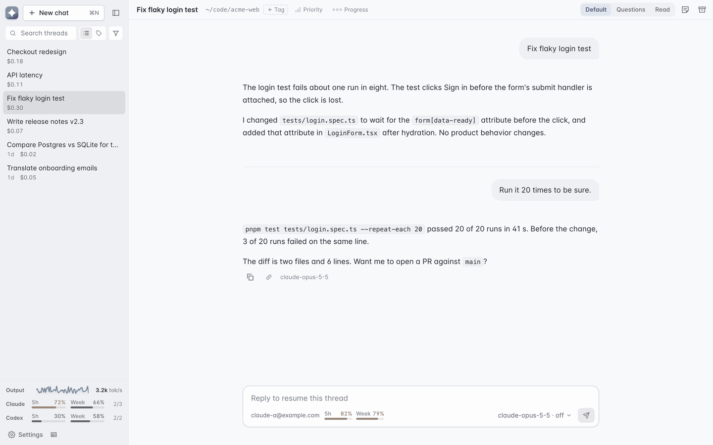

- [Account pool](#1-account-pool-pi-pool)
- [Browser chat](#2-browser-chat)
- [Chat mode](#3-chat-mode)
- [Install](#install)
- [Recommended setup](#recommended-setup)
- [Develop](#develop)

All screenshots use a demo profile with fake projects, accounts and hosts.

## 1. Account pool (pi-pool)

pi-pool lets one Prime Agent install run on many Claude and Codex subscription accounts.
Each provider request takes a fresh access token from the pool instead of one fixed `/login`.
When an account runs out, the chat moves to another account on its next request, with no restart.

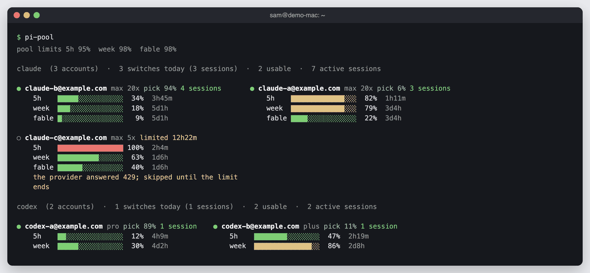

### What the pool does for you

- Each chat keeps the account it started on while that account can serve, so the provider's prompt cache stays warm.
- A chat moves only when its account is used up, rate limited, refused or signed out.
- A 429 from the provider moves the chat to another account in the same turn, and Prime retries about one second later.
- An account-level refusal, such as "accept the new terms", puts that account on a 24 hour cooldown and moves the chat the same way.
- A new chat draws an account at random, weighted by how many hours each account can last at the current load, so parallel chats spread out.
- A Codex chat that fell back to a lower plan moves back to a higher-plan account when one frees up.
- When no pooled account can serve, requests use your own `/login` as a fallback.
- At each session start the extension moves a stored `/login` out of Prime's `auth.json`, because a stored login would silently bypass the pool.
- Prime only receives short-lived access tokens, and refresh tokens stay in tokenmaxxing's stores.

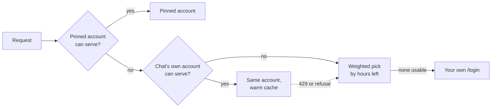

### Choose an account yourself

In the terminal UI, `/account` lists the pool with usage and pins the chat, and its subagents, to the account you pick.
Its "Follow the pool" row drops the pin again.
An account line under the editor shows the chat's account with its 5h, week and Fable usage, and refreshes every 60 seconds.
The same actions work from a shell.

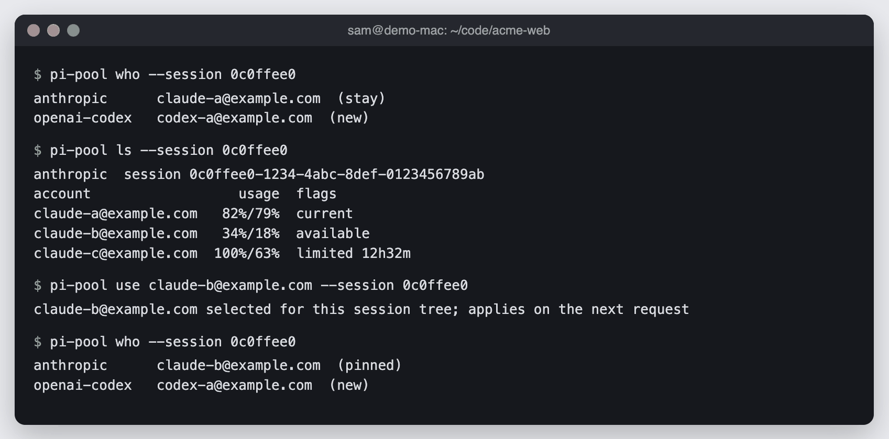

| command | what it does |
|---|---|
| `pi-pool` | Shows one card per account: usage bars, sessions, pick chance and switches today. |
| `pi-pool watch` | Shows the same cards full screen and redraws them every 5 seconds. |
| `pi-pool use <email>` / `use --follow` | Pins this chat to one account, or lets it follow the pool again. |
| `pi-pool pin <email>` / `unpin` | Puts every chat on one account while it can serve. |
| `pi-pool off <email>` / `on <email>` | Keeps an account in the pool but never picks it, or lets the pool pick it again. |
| `pi-pool login [<email>]` | Adds an account, or signs one in again, through tokenmaxxing. |
| `pi-pool refresh` | Reads every account's usage now instead of waiting for the next sample. |
| `pi-pool log [n]` | Prints the last pool events, including each switch and its reason. |

### The pool in the chat app

The composer shows the chat's account and its usage windows. A click opens Settings > Accounts.

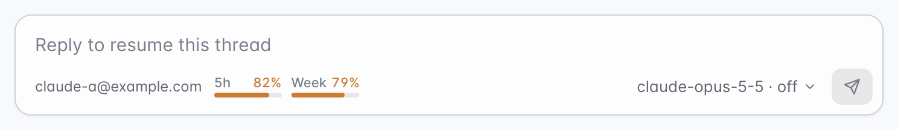

Settings > Accounts has a tab per provider and one row per account, with its plan, a state badge and every usage window with its reset time.
A click on a row moves the open chat to that account.
The row menu also pins an account for all chats, refreshes usage, signs an account in again, turns it off or removes it.
Claude accounts with a banked usage-limit reset can spend it from the same menu.
"Add Claude account" and "Add Codex account" start the sign-in in a new tab and show the Codex device code or a box for the Claude code.

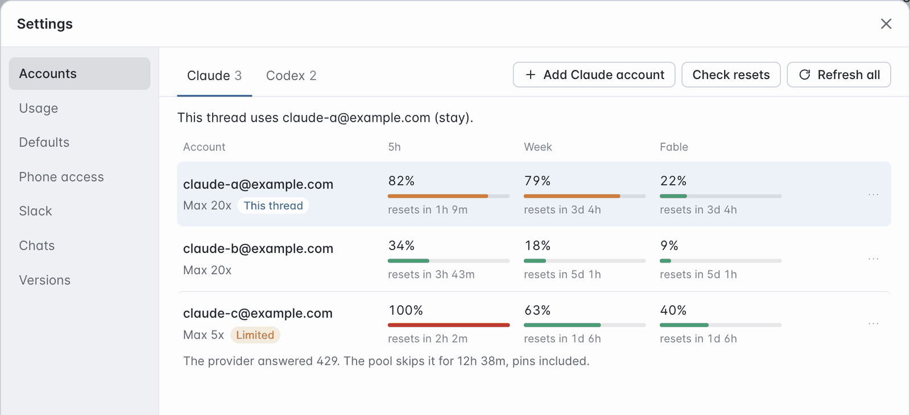

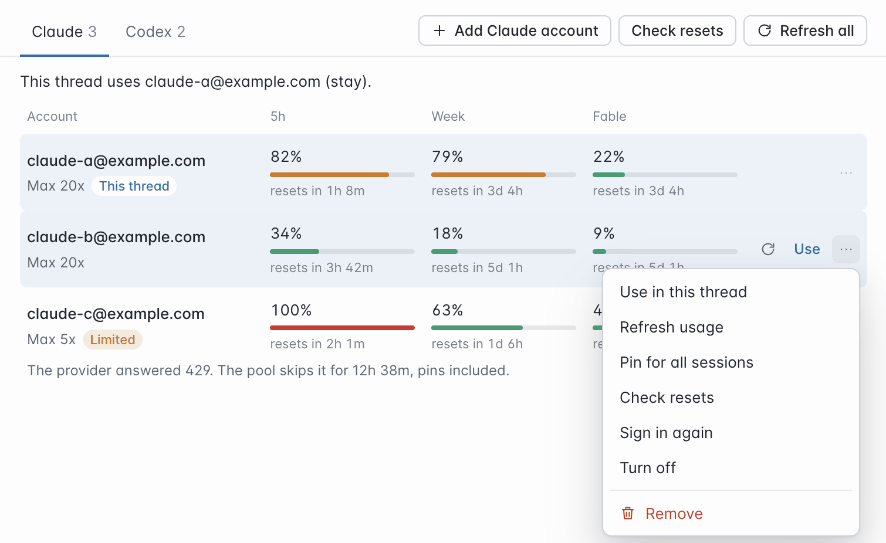

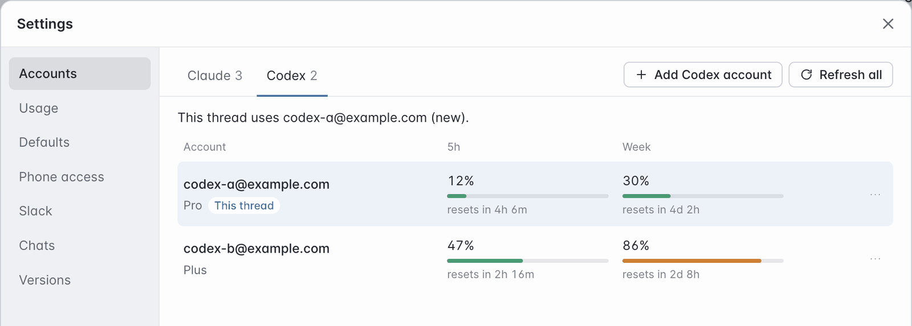

The sidebar footer shows the whole pool at a glance: live output tokens per second, then the share of each pool used and how many accounts can serve now.

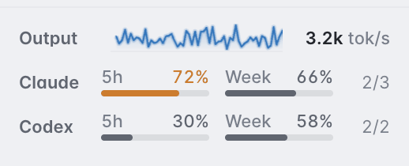

Settings > Usage counts tokens and cost for every agent on the Mac: Prime Agent, Claude Code, Codex and a few other local tools.
It reads their local transcripts, so it needs no API key.

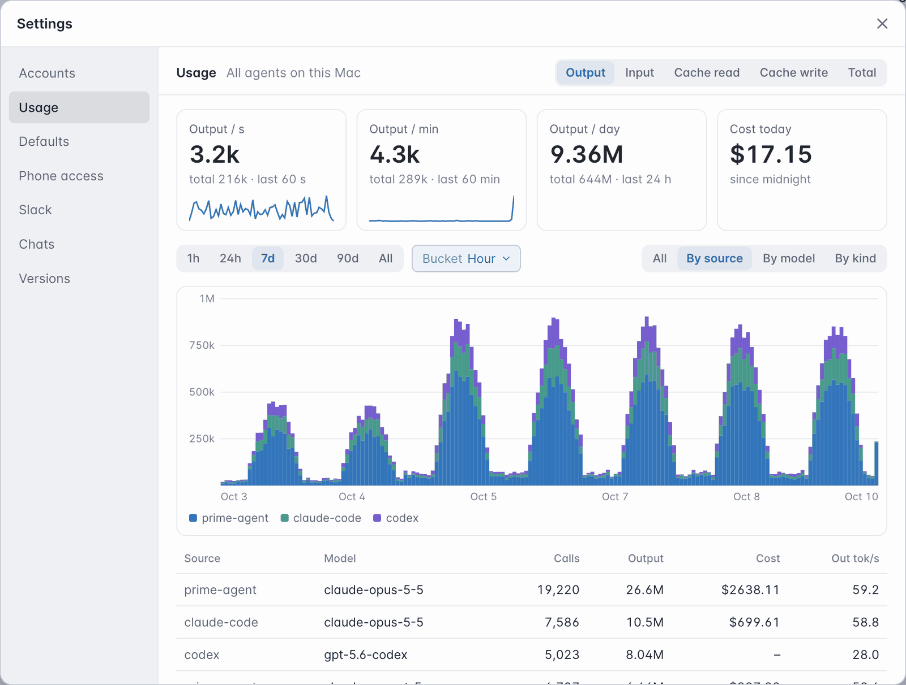

### What the pool needs

- macOS with `/usr/bin/python3`. Claude credentials live in the macOS Keychain.
- [tokenmaxxing](https://github.com/anaclumos/tokenmaxxing) 1.44 or later, with your Claude and Codex accounts added to it. pi-pool reads its account index and does not install it.
- Install or update the pool with `/usr/bin/python3 -B components/pi-pool/install.py`, and undo it with `install.py rollback`. See [the pool README](components/pi-pool/README.md) for how a request picks an account, the config keys and the safety rules.

## 2. Browser chat

`sieun-pi chat start` runs a local web app for your Prime Agent sessions. It reads the same sessions as the terminal agents view and talks to the same Prime Agent daemon. Closing a tab never stops an agent.

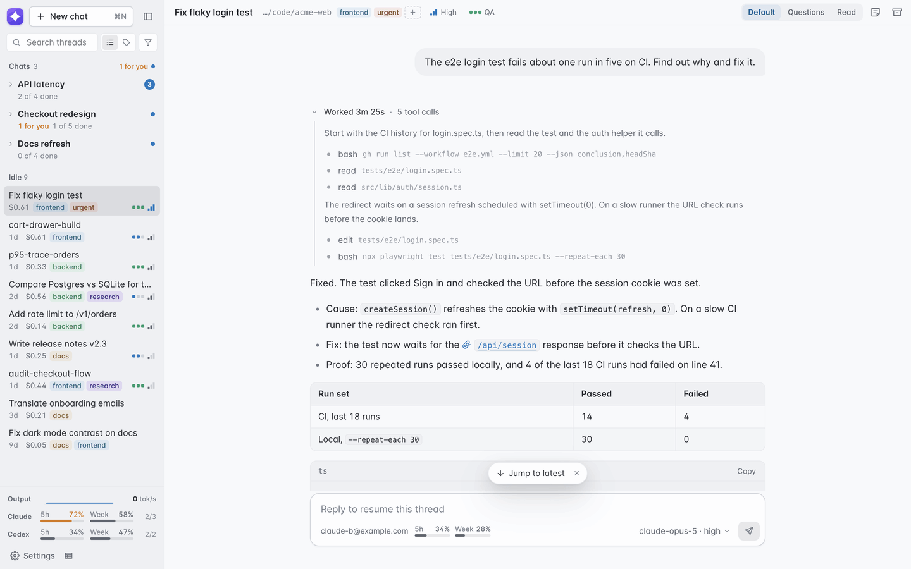

### Threads

Each thread shows your prompts as bubbles and the agent's final reply as markdown. Tool calls, thinking and notes fold into one "Worked" row per turn. Open it to see each tool call with its arguments.

Replies render tables, code blocks with a Copy button, images and mermaid diagrams.

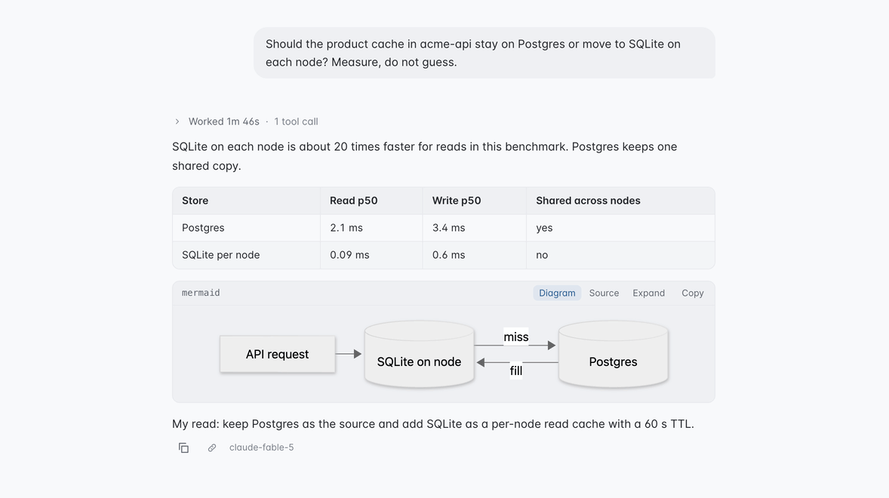

The view switch in the header has three modes:

- Default shows each prompt with its final reply.
- Questions lists only your prompts, and a click jumps to that turn.
- Read hides the sidebar and labels and shows the conversation in one narrow column.

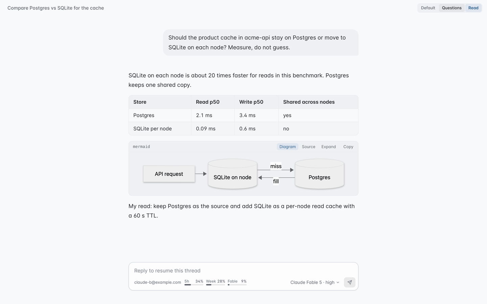

### Sidebar, tags, priority and progress

The sidebar lists every thread. Threads that need your answer come first, then running threads, then the rest by priority and recent activity. Each card shows the age, the cost, the model, tags, a progress mark and a priority mark.

The tag icon at the top switches to a compact view that shows only tags.

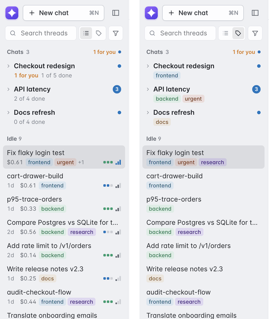

One tag picker works everywhere: on a card, in the thread header, in the right-click menu and in the Agents view. Type to filter, press Enter to create or toggle a tag.

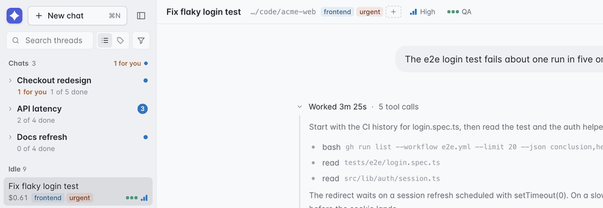

Priority has four levels (none and 1 to 3 bars). Progress has four steps: none, plan, implementation and QA.

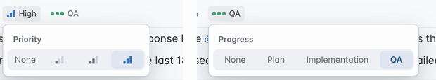

The Filter button filters the sidebar by status, tag, priority, progress, workspace and model. The browser keeps your filters and sort.

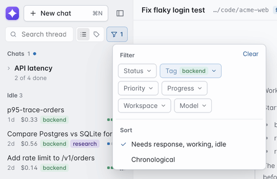

### Agents view

Press Cmd+K for a full-screen table of every thread. Every column sorts. Select rows to set tags, priority, progress or archive in bulk.

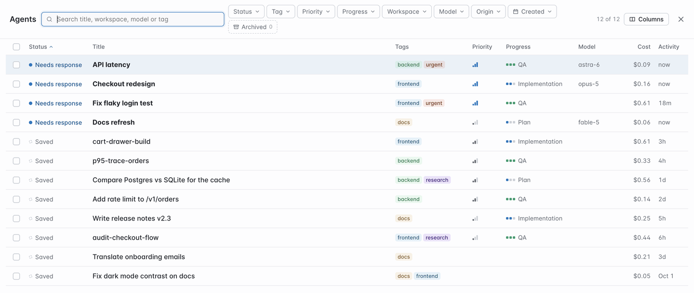

### New chat, model and account

The new chat screen sets the workspace, the pool account, the model and effort, and the first tags, priority and progress. The model menu has search, favorites and an Effort row.

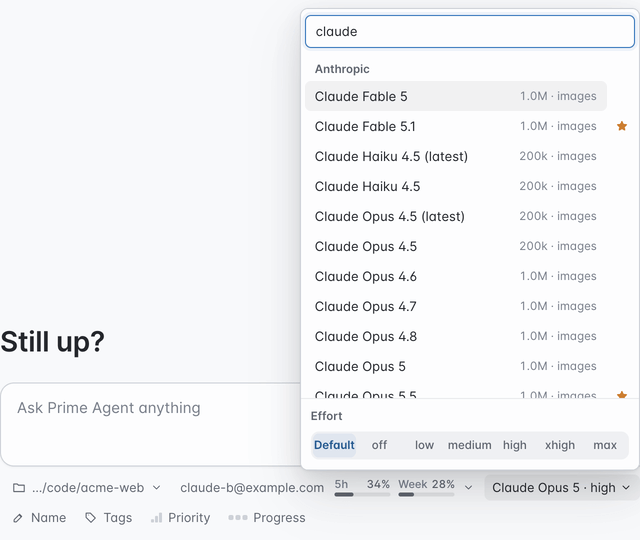

The account menu lists the pool accounts for the model's provider with their usage. Follow the pool is the default.

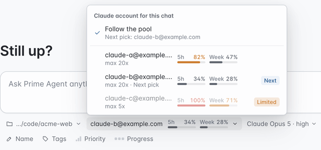

### Chats, mentions, Reply and duties

A chat keeps a board with a plan, questions for you under For you, duties and notes. [Chat mode](#3-chat-mode) covers it in full.
Hovering a job link shows a preview card of its report, and a click opens the report in a reader.

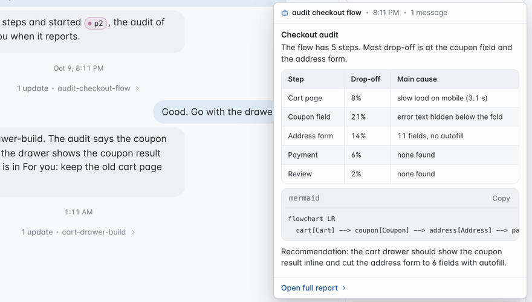

Board ids such as `p2` and `p3` in a reply become chips that open the plan view on that step. A link to a job's report becomes a chip that opens the reader.

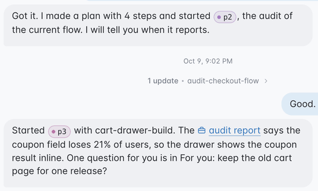

Reply on any chat message puts a short quote of it above your answer in the box. You can edit the answer or drop the quote before you send.

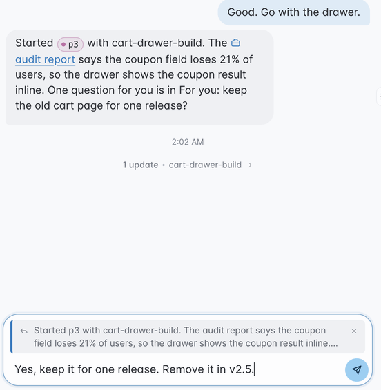

Duties are scheduled jobs a chat runs, such as a daily standup summary or an hourly CI check. Each row shows the schedule, the next run, the last result and a strip of recent passes and misses.

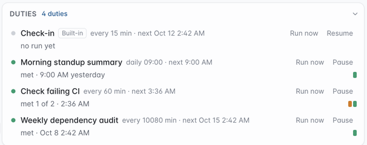

### Settings

Settings has sections for Accounts, Usage, Defaults, Phone access, Slack, Chats and Versions.

Accounts and Usage are shown in [the pool section](#1-account-pool-pi-pool).

Phone access adds the chat to Tailscale Serve, so devices on your tailnet can open it. Nothing is public. The page shows a QR code for the private link.

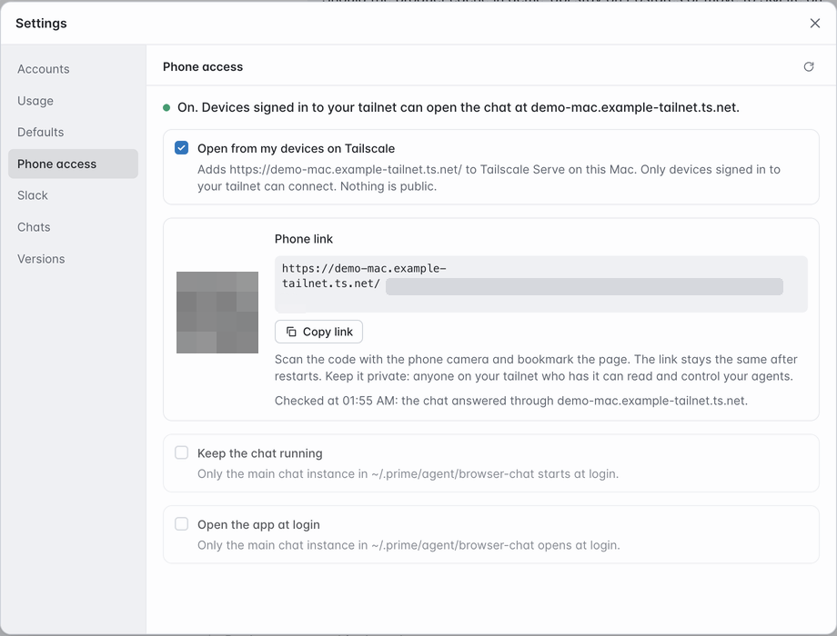

Slack links a chat to a Slack channel. Turn it on in Settings > Slack, then press Connect to Slack in a chat header to name a new channel or pick an existing one. What you write in the channel goes to the chat, and its replies come back.

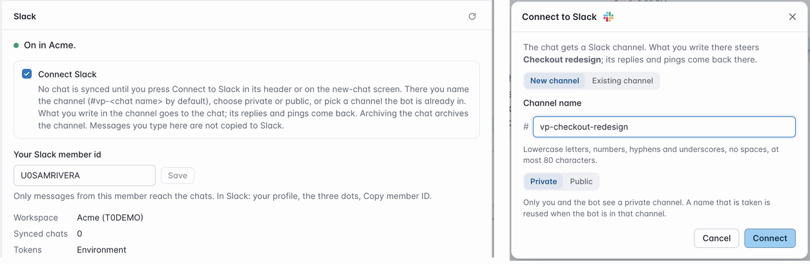

### Keyboard

| Keys | Action |
|---|---|
| Cmd+N | New chat |
| Cmd+K | Open or close the Agents view |
| Cmd+B | Show or hide the sidebar |
| Enter / Shift+Enter | Send / new line |
| Cmd+Enter | Queue instead of steer while the agent works |
| Esc | Close a menu, or stop a busy thread from the composer |

## 3. Chat mode

A VP chat runs jobs for you.

A VP chat is a chat you hand one topic to, like "redesign checkout" or "fix API latency". You act as the CTO, and the chat acts as the VP for that topic. It plans the work and starts jobs for each piece. It keeps a board you can read at a glance and messages you only when something needs you.

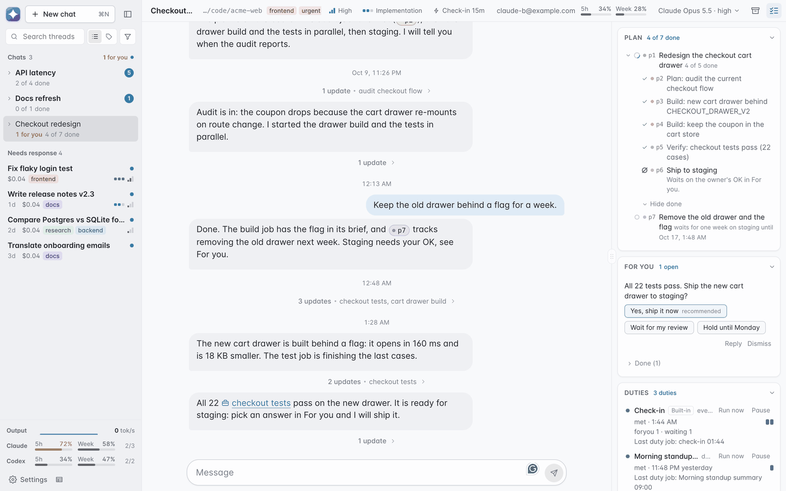

### How it differs from an ordinary chat

| | Ordinary chat | VP chat |
|---|---|---|
| Who does the work | The agent itself, in the same transcript | Jobs the chat starts; the chat itself only does short read-only look-ups |
| What you read | The full transcript with every tool call | Short direct messages; job reports fold into "3 updates" lines |
| State you can scan | Tags, priority, progress | A board with the plan, your open questions and notes |
| Between your messages | Nothing runs unless you ask | A check-in runs on a schedule and keeps the jobs moving |

### Start one

1. Press `Cmd+N`, or click New chat.
2. Switch Thread to Chat, pick the workspace and model, and describe the goal in your own words.
3. Send. The chat writes a plan on its board and starts the first jobs.

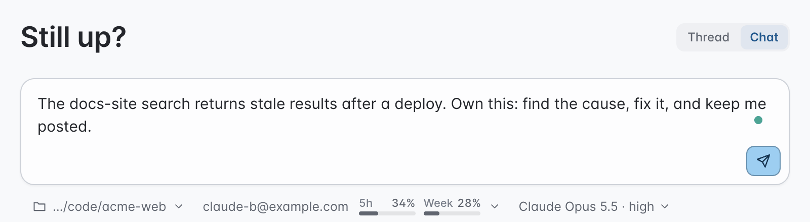

### The board

The board sits on the right of the chat. It has three cards.

- Plan is a tree of goals and steps. Each step has a status (to do, doing, done, blocked or dropped), and the job working on it is linked from the step.
- For you holds the questions only you can answer, such as an approval or a login. Each one offers 2 to 4 answers with the chat's recommendation first. One tap answers it, and the chat sees your answer at once.
- Notes are short bullets with links to job reports, files, threads and web pages.

The chat keeps at most 3 questions open for you and decides everything else itself. Open plan shows the whole board in one view.

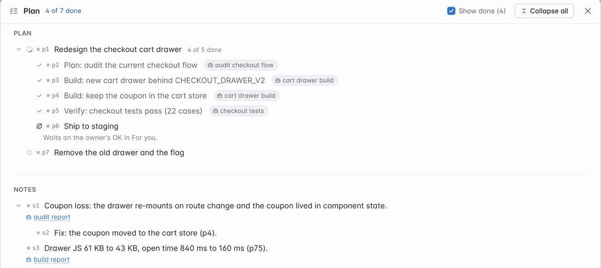

### Jobs and their reports

Each job is a subagent with its own context and a brief that starts with your words. Work in another repository runs as its own session, and it reports back the same way. When it finishes, fails or gets stuck, it sends a report to the chat. The chat updates the board and tells you the result in a sentence or two.

The sidebar lists every VP chat with its open questions ("1 for you") and its plan progress. The arrow next to a chat shows its jobs.

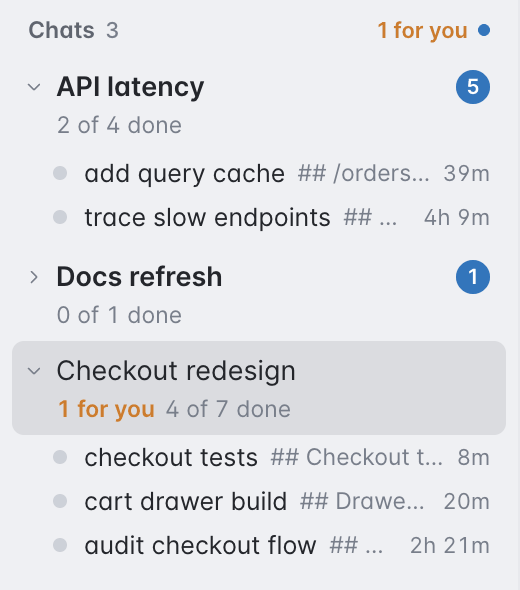

Click a job to open its drawer. The drawer shows its status, every message it sent the chat and the brief it got. Read report opens the full report with its tables and diagrams.

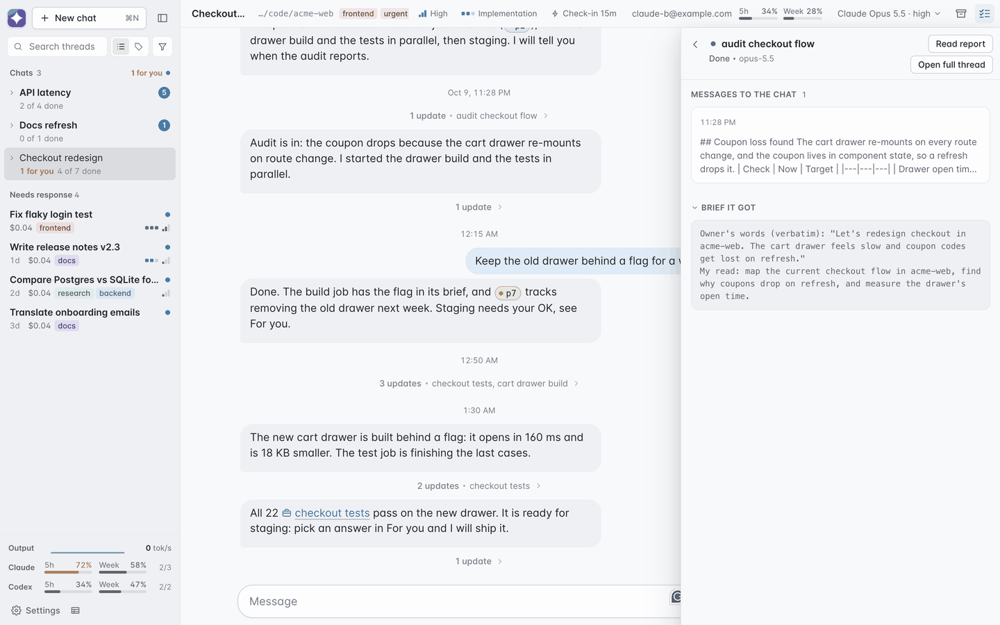

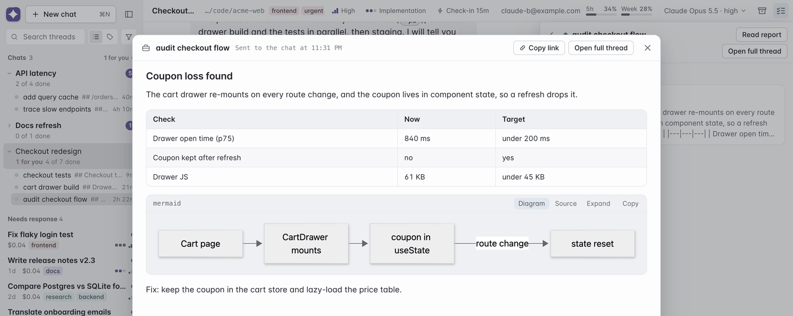

### Check-ins

The chat server, not the model, starts each check-in on a schedule, every 15 minutes by default. First a code check with no model call compares the board with the jobs. It finds steps nobody works on, jobs that stopped without a report and questions waiting on you. Then one check-in job gets those findings. It restarts stuck work, starts jobs for open goals and sends the chat board updates. If nothing needs work, it ends and you hear nothing.

Use the Check-in button in the chat header to set the interval (1 to 240 minutes) or to pause it for an hour, until 9:00 or until you resume. The Duties card lists the check-in next to any other scheduled duties of the chat, each with its last result.

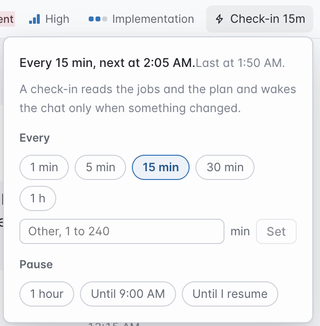

### The whole loop

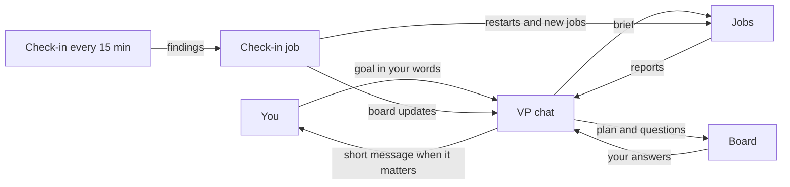

## Install

Each path below was run word for word in an empty HOME on macOS.
[docs/install.md](docs/install.md) has the full steps with notes, plus update, uninstall and Linux notes.

### If you already have Prime Agent 0.9.8

You need Node.js 22.8 or later with npm 10 or 11, Python 3.11 or later, Git and Bun.

```sh
git clone https://github.com/sieu-n/sieun-pi.git ~/src/sieun-pi && cd ~/src/sieun-pi
npm install --global --ignore-scripts "./$(npm pack --silent)"
sieun-pi plan --out ~/sieun-pi-plan.json && sieun-pi apply --plan ~/sieun-pi-plan.json && sieun-pi verify
/usr/bin/python3 -B components/pi-pool/install.py
bun add -g tokenmaxxing && tokenmaxxing init      # then pi-pool login for each extra account
pi-pool enable anthropic && pi-pool enable openai-codex
sieun-pi chat start && sieun-pi open
```

### From scratch on a new Mac

Run `xcode-select --install` first for `git` and `/usr/bin/python3`. Open a new terminal after the first three lines so `nvm`, `uv`, `bun` and `~/.local/bin` are on `PATH`.

```sh
curl -o- https://raw.githubusercontent.com/nvm-sh/nvm/v0.40.3/install.sh | bash
curl -LsSf https://astral.sh/uv/install.sh | sh
curl -fsSL https://bun.sh/install | bash
nvm install 22 && uv python install 3.12 --default
curl -fsSL https://app.primeintellect.ai/prime-agent/install.sh | sh -s -- 0.9.8
```

Then run the block above.

### Use it from another device

The chat listens on `127.0.0.1` only. With [Tailscale](https://tailscale.com) on the Mac, the main chat adds itself to Tailscale Serve, and Settings > Phone access shows a private `https://<mac>.<tailnet>.ts.net/<secret>/` link with a QR code.
On a Linux box the ChatGPT half of the pool works and the Claude half does not, and the chat runs with `sieun-pi chat serve`. See [Linux and remote boxes](docs/install.md#linux-and-remote-boxes).

## Recommended setup

This is the Prime Agent setup on the author's Mac, minus credentials and private projects.
It runs Prime Agent 0.9.8 on macOS. Every item below is public or installable.

### Host and tools

| Item | What it does | Where it comes from |
| --- | --- | --- |
| Prime Agent 0.9.8 | The agent host, daemon and Python kernel that everything else plugs into. | Prime Intellect: `curl -fsSL https://app.primeintellect.ai/prime-agent/install.sh \| sh` ([repo](https://github.com/PrimeIntellect-ai/prime-agent)) |
| sieun-pi | The skills, extensions and rules in this repository. | This repo: `npm install --global --ignore-scripts 'git+https://github.com/sieu-n/sieun-pi.git'` |
| tokenmaxxing | Keeps the pool of Claude and Codex logins that pi-pool draws from. pi-pool needs 1.44 or later. | Third party: `bun add -g tokenmaxxing` ([repo](https://github.com/anaclumos/tokenmaxxing)) |
| Aside | The browser agents drive through the `aside-browser` skill and the `aside` MCP server. | Third party: app from [aside.com/download](https://aside.com/download), CLI with `curl -fsSL https://releases.aside.com/install.sh \| bash` |
| cua-driver | Reads and clicks native macOS apps through MCP. | Third party: `/bin/bash -c "$(curl -fsSL https://cua.ai/driver/install.sh)"` ([repo](https://github.com/trycua/cua)) |
| Paper | Lets agents read and edit Paper design files through MCP. | Third party: install [Paper Desktop](https://paper.design/docs/mcp); it installs the `paper` CLI. |

### What sieun-pi installs

| Item | What it does |
| --- | --- |
| `pi-pool` extension | Picks a pooled account for each session and adds `/account` to move a running session to another account. `components/pi-pool/install.py` installs it. |
| `user-history` extension | Serves the browser chat app for native Prime sessions (`/what-did-i-say`, `/agent-chat`, `sieun-pi chat`). |
| `global-rules` extension | Refuses a recursive grep of `~/.prime/agent`, history rewrites already on a remote in the sieun-pi checkout, outside sends and PR merges without the owner's ok. It adds no prompt text. |
| The skills in [`skills/`](skills/README.md) | Work playbooks for investigation, design, review, verification and writing, plus browser and web search helpers. Most are adapted from [cursor/plugins pstack](https://github.com/cursor/plugins/tree/main/pstack) (MIT). |
| `config/AGENTS.md` | Five global rules for every session: the unslop pointer, one subagent per unit of output, threads only on request, steering a live job, and what the browser chat renders. |
| `config/pstack-models.json` | The model policy for subagents, described below. |

Prime Agent also ships its own skills. They need no setup. This setup turns off Prime's bundled web search skill, because sieun-pi ships its own.

Not included: account logins, `auth.json`, `models.json`, sessions, memories, and the author's private project skills.

### settings.json

Merge this into `~/.prime/agent/settings.json`. Replace `<you>` with your macOS user name.

```json
{
  "defaultProvider": "anthropic",
  "defaultModel": "claude-opus-5-5",
  "defaultThinkingLevel": "high",
  "bundledSkills": { "websearch": false },
  "retry": { "provider": { "waitForUsage": { "pauseUntilReset": false, "maxWaitMs": 18300000, "maxAttempts": 80 } } },
  "mcpServers": {
    "aside": { "type": "stdio", "command": "aside", "args": ["mcp"], "startupTimeoutMs": 20000, "callTimeoutMs": 130000 },
    "cua-driver": {
      "type": "stdio", "command": "cua-driver", "args": ["mcp"], "startupTimeoutMs": 30000, "callTimeoutMs": 130000,
      "disabledTools": ["browser_click", "browser_dialog", "browser_download", "browser_navigate", "browser_pointer",
        "browser_prepare", "browser_set_input_files", "browser_type", "get_browser_state", "page",
        "kill_app", "install_extension", "install_ffmpeg", "escalate_session", "get_session_state"]
    },
    "paper": { "type": "stdio", "command": "/Users/<you>/.paper/bin/paper", "args": ["mcp"], "startupTimeoutMs": 30000, "callTimeoutMs": 130000 }
  }
}
```

- Prime runs an MCP `command` without a shell, so `~` and `$HOME` do not expand. Use a name on the daemon's `PATH` or a full path.
- On the author's Mac, `aside` and `cua-driver` are links in `~/.local/bin`. Paper's CLI sits in `~/.paper/bin`, which is not on `PATH`, so it needs the full path.
- The `cua-driver` list turns off its browser tools, so browser work goes through Aside. It also turns off tools that kill apps or install software.
- The `waitForUsage` block waits up to about 5 hours for a usage limit to reset. It does not park the session, because pi-pool moves a limited session to another account first.
- To hide a skill you do not use, add `"-/Users/<you>/.prime/agent/skills/<name>"` to a `"skills"` list.

### Subagent models (pstack-models.json)

`pstack-models.json` is the one place that says which model each kind of subagent runs on.

- It lists roles such as feature work, bug fixes, `how` and `why` investigators, arena runners, swarm workers, reviewers and frontend work.
- Every role is set to `inherit-parent`, so a subagent runs on the same model as the session that started it.
- The `allowed` list names the models a spawn may pick by hand, and a `banned` rule names model families never to use.
- Frontend work may name `anthropic/claude-opus-5-5` instead of inheriting.
- The `setup-pstack` skill rewrites the file after it checks which models your logins can reach.

## Develop

```sh
git clone https://github.com/sieu-n/sieun-pi.git
cd sieun-pi
npm run develop
npm run check
npm run build:all
npm run test:package
```

`develop` installs the locked root, chat and skill development dependencies. It needs uv, Bun and Node.js 22.13 or later.
`check` runs source tests and type checks. `build:all` runs the checks, builds the Python skill wheels and packs the npm tarball into `dist/`.
`test:package` installs that tarball in an isolated HOME, checks that Prime loads it twice, then applies, updates, rolls back and uninstalls the links.

Other projects can depend on this Git package and import `detectAgentIdentity` from `sieun-pi/agent-identity` or `derivePrimeAgent` from `sieun-pi/prime-context`.

```text
sieun-pi
  ├─ components/pi-pool/        install.py copies a commit to ~/.local/share/pi-pool
  ├─ components/user-history/   the browser chat and its Prime extension
  ├─ components/global-rules/   global guards
  ├─ skills/                    linked to ~/.prime/agent/skills/<name>
  └─ config/                    rules, model policy and new-profile settings
```

Credentials, settings, sessions and account stores stay outside the source tree.
More detail is in [the install guide](docs/install.md), [the pool README](components/pi-pool/README.md), [the chat README](components/user-history/README.md), [the skills README](skills/README.md), [security](docs/security.md) and [source provenance](docs/provenance.md).
Third-party notices are in [NOTICE](NOTICE) and [LICENSES](LICENSES).
