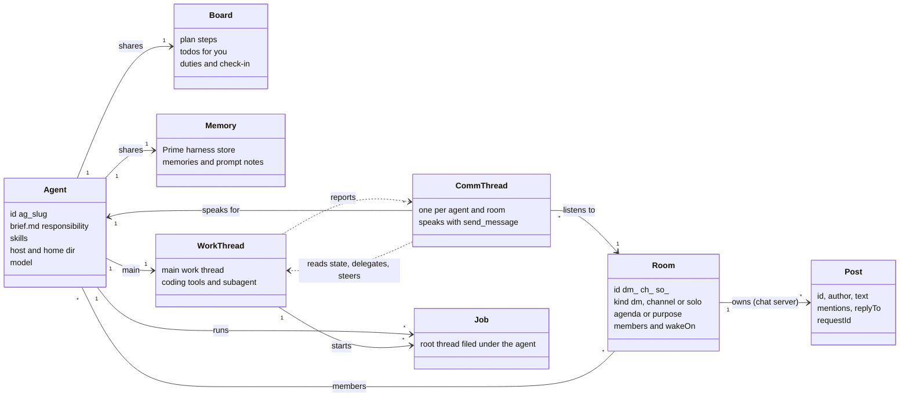
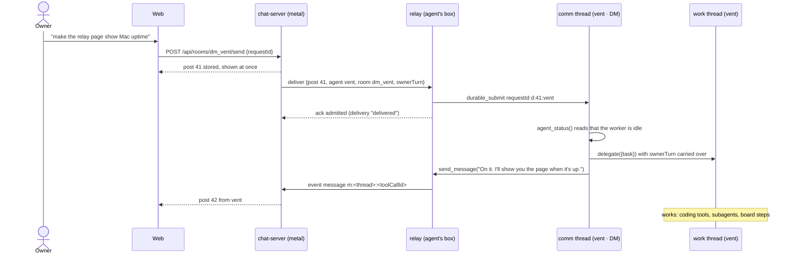
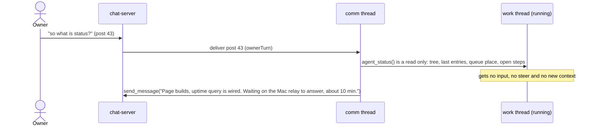
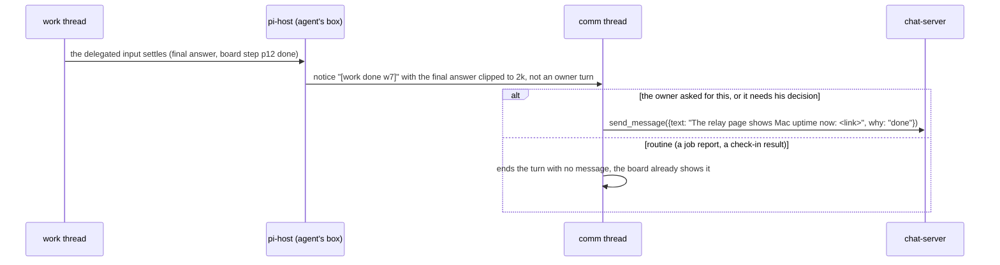
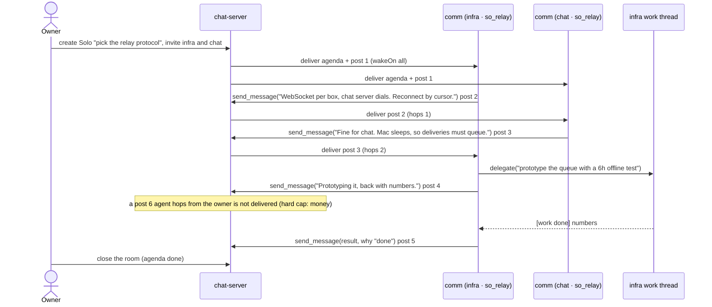
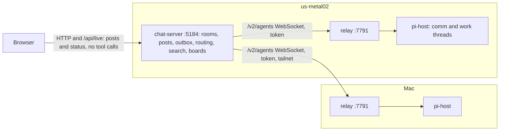

# The agent model: agents, rooms, and comm and work threads

Status: design, for the owner's review. Phases 1, 2 and 3 are built; the rest is not, except where a line says "today".

## The answer

1. An **Agent** is a shared template, not a thread. It is a folder holding a name, a brief (its responsibility), skills, a home directory, a host and a model. It has one board and one memory, and every thread that works for it shares them.
2. A **Room** is where people and agents talk: a DM (the owner and one agent), a Channel, or a Solo room (a group chat of invited agents around one agenda). The chat server stores every room message, as Slack does, and no message is a projection of a pi thread.
3. Each (agent, room) pair has its own **comm thread**: a thin, cheap pi thread that reads the room and speaks only through `send_message`. It does no real work. It reads the agent's state with read-only tools, and it hands work to the agent's work thread or steers it.
4. The agent's **work** happens in its main work thread and the subagents and jobs that thread starts. Work threads never talk to people; they report to the comm thread, and the comm thread decides whether the owner needs to hear it.
5. "So what is status?" asked mid-work starts a turn in the comm thread only. That turn reads the work thread's state and answers, and the worker's context never sees the question.
6. The sidebar shows Solo rooms, Channels and DMs, and the DMs list holds agents only. Work threads, comm threads and jobs open from the Agents page and from job pills, never from the sidebar.
7. There are three tiers. The chat server runs on metal only and owns messaging. A relay on each box delivers room messages to that box's pi-host and carries `send_message` back. pi-host runs the threads.
8. We build it in six phases, each shippable alone. Phases 1 to 3 are built: `send_message`, DMs as rooms the chat server owns, and the agent folder with its brief and memory. Phase 4 adds the comm and work split.

## What the owner asked for

| # | Owner's words | Where this doc answers it |
|---|---|---|
| 1 | "SOLO is like a 단톡방. group chat between invited agents, focused around some agenda." | Rooms, sequence (d) |
| 2 | "the old Chat should be Agent right, but not all pi threads should be entity with 'Direct message'" | The model, Sidebar, Migration |
| 3 | "agent also shouldn't really be constrained into single thread. it's more of a 'swarm of (sub)agents with shared board, memory, …' so for example, the coordinator should be super thin. each channel should have it's own thread (local context) of that Agent. so Agent is essentially a `shared template/skill` with responsibility, data regarding it's specialty. the abstraction of thread matters less nowadays." | The model, Memory and instructions |
| 4 | "chat-server (이건 metal에서만, messaging related services) \| pi & chat relay server (?) running on each machine \| pi agent server (the thing that actually runs the harness)" | Three tiers |
| 5 | "client \| chat-server 이건 진짜 Slack처럼 동작해야됨. chat server (@each machine)에서 알아서 orchestration하는거지" and "no need to stream tool calls/… AT ALL." | Three tiers; the client never gets tool calls |
| 6 | "Direct message는 thread를 그냥 relay하는게 아니라니까? prime-agent-chat처럼 send_message로만 보내는거 할말이 있을때, 그리고 as a human would" | Comm thread tools, phase 2 |
| 7 | "that's why i prefer an actual main thread/subagent doing the work. this channel's thread is more on the communication layer between human." | Comm and work split, phase 4 |
| 8 | "막 일하고 있는데, 중간에 'so what is status?' 이렇게 물으면, chat-channel-thread를 관조하는 thread가 알아서 working thread의 상태를 읽고 답변하는거지. 딱히 전달해서 context를 pollute할 필요 없이." | Sequence (b), `agent_status` |
| 9 | "prime-agent-chat와 essentially same UX를 지향해." | UX kept from prime-agent-chat |
| 10 | The Agents page shows each agent's configuration: host and home directory, memory and board. | Memory and instructions, phase 3 |

## Today, in the code

| Part | Today | File |
|---|---|---|
| Agent | Each root pi-host thread is an agent, and its id is the thread id. A job is `<thread>:<conversation>` or a root thread of kind `job` with a parent. | `server/threads.ts`, `server/store.ts` (`ThreadMeta`) |
| DM | A root chat the owner opened with `openDm`. Its timeline is built from the thread's entries. | `server/threads.ts`, `server/timeline.ts` |
| Owner send to a thread | Lands in the chat server's outbox at once, then goes to pi-host with retries. | `server/outbox.ts` |
| Channel | A room whose posts the chat server stores. A mention goes to the agent's thread as an `agent.message` input, and the turn's final answer is posted back. Hop cap 6. | `server/channels.ts`, `<data dir>/channels/<id>.jsonl` |
| Board | The `chat.board` doc of each chat's root conversation in pi-host. | `server/boards.ts` |
| Duties, check-in | `<data dir>/boards/<chat>/duties.json`. | `server/boards.ts`, `server/duty-run.ts` |
| Agent config | Read from pi-host's thread row and the agent folder: the brief, the agent's harness store and Prime's global one, and the instruction files Prime's loader takes, each marked loaded. | `server/agent-config.ts`, `server/agent-folder.ts` |
| Thread setup | Every thread gets Prime's preamble, the coding tools and `subagent`, and nothing else. | `packages/pi-host/src/durable/registry.ts` |
| Hosts | The chat server talks to the local pi-host socket only. `/api/hosts` reads each box's prime-relay `GET /v1/host`. | `server/host/pi-host.ts`, `server/usage.ts` |

pi-durable already supports most of what the model needs. Each conversation stores its own agent state (`AgentState`: model, extensions, tools filter, instructions, cwd), and a prompt section's `render` gets the conversation id and its documents. So a comm thread and a work thread can run on different extensions and tools without a fork of pi-durable.

## 1. The model

| Thing | What it is | Who stores it | Example |
|---|---|---|---|
| Agent | A template with a responsibility. It has no transcript of its own. | The agent folder on its host, plus a row in the chat server's `agents.json` | `ag_vent`, home `~/work/vent`, on us-metal02 |
| Room | A conversation of people and agents. | The chat server | `dm_vent`, `ch_cutover`, `so_relay-protocol` |
| Comm thread | That agent's local context in that room. It reads the room's posts as inputs and speaks with `send_message`. | pi-host on the agent's host, one durable thread file | "vent · DM" |
| Work thread | Where the agent works: the main thread, its subagents and its jobs. | pi-host on the agent's host | "vent", the existing thread |
| Job | A background thread the work thread starts for one goal, such as a duty run. | pi-host, filed under the agent | "relay uptime duty" |

Rules that keep it simple:

1. One agent has exactly one main work thread at a time. The comm threads of all its rooms delegate to it, so the owner's DM and a channel never fight over two copies of the work.
2. A comm thread never runs coding tools that write. It may read files in the agent's home, read the agent's state, and post. Its context stays small (soft cap 40k tokens, then compaction). It runs Opus 5.5 at high thinking, as every thread does (owner rule c31).
3. A work thread never posts to a room. It writes to the board and calls `report`, and the comm thread decides whether to speak (owner rule c117: on a turn the owner did not start, the default is to say nothing).
4. Room messages belong to the chat server. A thread holds copies of the posts it was given as inputs, and the room never reads its timeline from a thread.

### What the sidebar shows

| Group | Rows | Opens |
|---|---|---|
| Solo | Agenda rooms, open ones first. A closed room collapses under "Done". | The room, with its agenda pinned on top and the agents' board side panel |
| Channels | Channels the owner is in. | The room |
| Direct messages | One row per Agent, never per thread. The status dot is the agent's: working while any of its work threads runs. | The DM room with that agent |

Work threads, comm threads and jobs are reached from the Agents page (tabs Overview, Work, Jobs, Board, Memory, Instructions) and from job pills under a message. Today's Solo rows, which are root chats, all become agents with DMs (see Migration).

### (a) The owner asks for work in a DM

### (b) "So what is status?" mid-work

The comm thread's turn is the only new run. `agent_status` reads the work thread's file through pi-host in process (`durable_tree`, `durable_entries`, `durable_ticket`), so the worker's turn and its context do not change.

### (c) The worker finishes, and the comm thread decides whether to speak

pi-host knows which comm thread delegated each work input (the `delegate` call records it), so the notice goes back to the room it came from. A `report({kind: "question"})` from the worker takes the same path while the work goes on.

### (d) A Solo room with two agents and an agenda

Every invited agent hears every post, and each speaks only when it has something to add. The 6-hop cap from today's channels stays as it is.

## 2. Tools per kind of thread

| Tool | Signature | Comm | Work | Job | Implemented in |
|---|---|---|---|---|---|
| `send_message` | `({text, why?: "answer"\|"done"\|"decision"\|"blocker"\|"update", replyTo?: PostId, images?: string[]}) => {requestId}` | yes | no | no | pi-host registry (`durable/comm.ts`). It commits a `chat.send` entry, and the relay carries it to the chat server. |
| `agent_status` | `({part?: "summary"\|"work"\|"jobs"\|"board", job?: string}) => text` | yes | no | no | pi-host, in process: thread rows, tree, last entries, ticket, plus the agent's board copy (an `agent.board` doc) |
| `delegate` | `({task, to?: "main"\|<job name>\|"new", name?, model?}) => {to, submission}` | yes | no | no | pi-host: `durable_submit` to the work thread, requestId `w:<thread>:<toolCallId>`, records who asked |
| `steer_work` | `({to?: "main"\|<job>, text?, stop?: boolean}) => {state}` | yes | no | no | pi-host: submit with `whenBusy: "steer"`, or `durable_abort` |
| `report` | `({text, kind: "progress"\|"done"\|"blocked"\|"question"}) => ok` | no | yes | yes (to its work thread) | pi-host: a notice into the comm threads that delegated, or the DM comm thread when none did |
| `board` | `({ops?: BoardOp[]}) => BoardView text` | read, and owner-asked edits | yes | yes | chat-server API `POST /api/agents/:id/board {actor: "agent"}`, reached through the relay |
| `rlm.harness` | Prime's kernel API: `create_memory`, `update_memory`, `delete_memory`, the prompt, skill and subagent calls, `search`, and `refine.run()` | yes | yes | yes | Prime's kernel, with `RLM_HARNESS_STATE_DIR` at the agent's store (section 3, built in phase 3) |
| `room_history` | `({room?, before?, q?, limit?}) => posts` | yes | no | no | chat-server API `GET /api/rooms/:id/items`, through the relay |
| `start_job` | `({name, brief, model?}) => {job}` | no | yes | no | pi-host: `durable_create` with `{agent, role: "job"}` and the first input |
| `wake` | `({at?, run?, check?, every?, note}) => {wake}` | no | yes | yes | relay timers on the agent's box (today the chat server's `wakes/`) |
| `subagent` | as today | no | yes | yes | pi-host `durable/subagent.ts` |
| coding tools | as today | read, ls, grep only (tools filter) | all | all | pi-durable `CodingTools` |

The comm thread stays thin because its tools are few and cheap, its inputs are only its room's posts and work notices, and the system prompt tells it to answer from state and delegate anything over a minute (today's chat brief rule c52). Comm, work and job threads all run Opus 5.5 at high thinking (owner rule c31).

`send_message` keeps `tell_owner`'s rules from `legacy/prime/user-history/src/chat-brief.ts`: one point per message, short plain sentences (c104), no message on a turn the owner did not start unless something finished that he asked for, a decision, a blocker or an answer (c117), and `replyTo` only for a wake-up that answers an older message. The text a turn ends with is not posted; it shows in the comm thread's fold.

## 3. Memory and instructions

Phase 3 is built this way. The agent folder lives on the agent's host, at `~/.pi/agent/agents/<slug>/`, next to the chat server's own `~/.pi/agent/chat`.

| Path | Holds | Written by | Loaded into |
|---|---|---|---|
| `brief.md` | The responsibility, in the owner's words, with what done looks like. Missing or blank means no brief. | the owner on the Agents card (`PUT /api/agents/:id/brief`) | every thread of the agent, as one more Prime context file |
| `harness/harness_state.json` | The agent's memory: a Prime harness store in Prime's own format, with memories, prompt notes, skills and subagent specs | the agent's kernels through `rlm.harness` and `refine.run()`, and the owner on the Agents card (`/api/agents/:id/memory`) | every thread of the agent, through Prime's harness digest |

The agent record stays in the chat server's `agents.json`. An `agent.json` on the box waits for phase 6, when the relay needs it there.

### Memory is Prime's harness store, not a second system

Prime merges two stores into its harness digest: the global one in `~/.prime/agent/harness`, and a local one. Commit 76c5ceda gave each pi-host thread conversation its own local store, at `session-artifacts/<thread>[-<conversation>]/harness`, because in Prime a session is the unit.

In this model the agent is the unit, so for a thread that belongs to an agent the agent's store takes the local slot. Its work thread, the child conversations in it and every root job filed under it read the same store in their digest, and their kernels get `RLM_HARNESS_STATE_DIR` set to it.

So `rlm.harness.create_memory(...)` in any of them writes the agent's memory, and `global_=True` still writes the global store. Prime's two scopes, its digest code (`vendor/prime-harness.ts`) and its kernel API stay as they are, with no third level and no new tools.

A thread no agent holds keeps its own store. No per-thread local store existed on us-metal02 when this shipped, so nothing moved.

Each entry keeps its `version` and `updated_at`, and the store keeps Prime's refinement log, so the card shows who wrote each entry and when. The owner removes an entry from the card. The folder is not a git repo.

### How pi-host loads them

The chat server writes a `chat.doc` named `agent.ref`, `{agent, dir, role: "work"|"job"}`, into the root conversation of each work thread and each root job thread filed under an agent. It uses the existing `durable_doc_put`, when it makes an agent or files a job, and on each thread list read for any thread whose ref is missing or different. pi-host reads the root's ref for every conversation of the thread (`durable/agent-profile.ts`), and a ref of another shape reads as no agent.

| Part | Where it goes | Source |
|---|---|---|
| Prime's preamble and the rest of Prime's prompt | unchanged, preamble first | `prime-prompt.ts` |
| `brief.md` | one more context file after the AGENTS.md files Prime's loader found, so Prime's own `buildSystemPrompt` renders it under its path in "# Project Context" | `agent-profile.ts` `briefFile` |
| agent memory | the local store of Prime's harness digest: the root's digest message, a child's `harness` section, and the kernels' `RLM_HARNESS_STATE_DIR` | `agent-profile.ts` `conversationHarnessDir` |
| AGENTS.md and CLAUDE.md | as before, through Prime's resource loader | `prime-prompt.ts` |

The context section is not pinned, so a brief edit reaches the next request of every thread as a new `pi.system` entry that holds the `context` section alone, and an unchanged brief sends nothing new. A new memory reaches the next turn as a `[harness-digest update]`, as in Prime.

The role section (comm or work rules) and a per-agent skills list wait for phase 4.

## 4. The three tiers

| Tier | Runs on | Owns | Never does |
|---|---|---|---|
| chat-server | metal only | rooms, posts, read marks, the delivery outbox, routing by membership and mention, hop cap, search over posts, boards, For you, duties' schedule | run a model, stream tool calls to the client |
| relay | each box | the link to the chat server; maps (agent, room) to a comm thread and creates it on first use; delivers inputs; drains `send_message` events; wakes, check-ins and duty prechecks that must run on this box; health | store room messages |
| pi-host | each box | durable threads, the turn queue through pi-pool, the tools in section 2, resume after restart | talk to the chat server directly |

The relay does the orchestration on each box, as the owner asked ("chat server (@each machine)에서 알아서 orchestration하는거지"). The chat server routes a post to (agent, room), and the relay on that agent's box decides which thread takes it.

### Protocol sketch: one WebSocket per box

The chat server dials `ws://<box>:7791/v2/agents` with the box's bearer token from `hosts.json`, as `/api/hosts` does today. Frames are JSON lines.

| Direction | Frame | Notes |
|---|---|---|
| relay → server | `hello {box, version, piHost: {up, version}, upCursor}` | `upCursor` is the last up-event seq the server acked |
| server → relay | `welcome {replayFrom}` | the server resends every delivery not yet acked |
| server → relay | `deliver {id, agent, room, post, context?, ownerTurn, whenBusy, hops}` | `id` = `d:<postId>:<agent>` and becomes the `durable_submit` requestId |
| relay → server | `ack {id, state: "admitted"\|"refused", thread, place?, error?}` | refused only for good (no agent, archived) |
| relay → server | `event {seq, kind: "message", agent, room, requestId, text, why?, replyTo?, images?, at}` | `requestId` = `m:<thread>:<toolCallId>`; the server stores the post once per requestId |
| relay → server | `event {seq, kind: "status", agent, state, place?}` | working, idle, sleeping, failed, and the queue place |
| server → relay | `ack {seq}` | the relay advances its cursor in pi-host |
| server → relay | `call {id, op, args}` / relay → server `result {id, ...}` | config reads (agent folder for the Agents page), create agent, abort, transcript pages for "open work thread" |
| relay → server | `call {id, op: "board"\|"room_history", args}` | tool calls that need the chat server go up the same socket |

1. **Idempotency.** Every hop has one key, and each receiver keeps the first copy: the client's `requestId` for the owner's post, `d:<post>:<agent>` for a delivery (pi-host already dedups `requestId`), `m:<thread>:<toolCallId>` for a message (the chat server already dedups posts by `requestId`), `w:<thread>:<toolCallId>` for a delegation and `n:<work thread>:<submission>` for a notice. pi-durable replays a tool call with the same id after a crash, so a replayed `send_message` lands once.
2. **Up events survive restarts.** `send_message` commits its entry in the thread, and pi-host adds a row to a host-wide `outbox(seq, thread, requestId, payload)` table in `index.sqlite`. A new `durable_feed {after}` command streams it. The relay forwards from the server's `upCursor`.
3. **Reconnect.** Either side may drop. On reconnect the relay says `hello` with its cursor, and the server replays unacked deliveries in order per comm thread. Nothing is lost and nothing lands twice.
4. **The Mac case.** The Mac sleeps and goes offline (10-18: offline 13:10Z to 19:42Z, and 221 held messages then landed hours late). While a box is away, its deliveries wait in the chat server's outbox, the post's delivery reads "queued, Mac is offline" and the agent's DM row shows the box as away. On return, the waiting posts for one comm thread go as one bundled input headed with their age, as `agent-outbox.ts` learned to do. A delivery to an agent the owner archived meanwhile is dropped with a note.
5. **Health.** The relay keeps today's `GET /v1/health` and `/v1/host`, and its `hello` reports pi-host. `/api/hosts` shows relay, pi-host and link state per box.

### What exists, and what changes

| Today | Change |
|---|---|
| `components/prime-relay/relay.mjs` as `prime-relay.service` on :7790, in front of Prime's daemon: token, `/v1/health`, `/v1/daemon` byte pipe, `/v1/file`, `/v1/host` | Unchanged while Prime runs. `/api/hosts` keeps reading `/v1/host` from it. |
| The same `relay.mjs` as `pi-host-relay.service` on 100.83.139.73:7791, in front of pi-host's socket. Nothing in `apps/chat` uses it. | Becomes the agent relay. It adds `/v2/agents` and its routing module (`components/prime-relay/agents/`). Its byte pipe stays for debugging. |
| `~/.config/sieun-pi/hosts.json`: per box `address`, `relayPort` 7790, `token`, and `roles.chat` on us-metal02 | Adds `agentRelayPort: 7791` and `roles.agents` per box that runs pi-host. |
| `apps/chat/server/host/pi-host.ts`, the local unix socket | Stays the `Host` for metal until phase 6. The routing code is written as `server/relay/` behind the frame interface above, so phase 6 moves it into the relay unchanged. |
| `server/outbox.ts`, owner sends to a thread | Becomes the per-box delivery outbox for every post (owner and agent). |
| `server/channels.ts`, mentions sent as `agent.message` with a header, the final answer posted back | Becomes `server/rooms.ts` for all three kinds. Posts come only from `send_message`, never from a turn's final text. |
| `pi-rlm` bus (`PI_AGENT_BUS_BOXES`, `~/.config/pi-host-relay/boxes.json` with no boxes) | Not used by agents. Agents talk to each other through rooms. |
| `legacy/.../cross-host-message.ts`, `agent-outbox.ts` | Their lessons carry over: one lane per target, bundling behind a busy target, drops only on proof, an offline-box backlog. |

## 5. Migration from today

| Today | Becomes |
|---|---|
| A root thread of kind chat ("agent factory", "vent", the VPs) | An Agent `ag_<slug>`. Its thread becomes its first work thread with all its history, its cwd becomes its home, its host is us-metal02, and its first message (today's `purpose`) seeds `brief.md` for the owner to edit. |
| A DM with that chat | Room `dm_<slug>`. The old thread's owner messages and its text answers (no tool calls) are copied in as posts with their original times, and older history sits behind "Earlier, in the work thread" (open question 1). |
| A chat listed under Solo today | The same as a DM: an agent with a DM room. The Solo group starts empty and holds agenda rooms only. |
| A job (`<thread>:<n>`) or a root job with a parent | A job of that agent. Duty threads are the agent's jobs, with kind `duty`. |
| `chat.board` doc per chat | `agents/<id>/board.json`, copied once. Ids stay, so p12 and t4 keep working. |
| `boards/<chat>/duties.json`, check-in, wakes | Under `agents/<id>/`. Wakes fire on the agent's box from phase 6. |
| Channel members (thread ids) | Agent ids. The thread-id-to-agent map is kept, so old links `#/c/<thread id>` open the agent's DM. |
| A channel mention | A delivery to that agent's comm thread for the channel. Until phase 4, it goes to the work thread as today. |

The migration is one script, `apps/chat/scripts/migrate-agents.ts`. It is dry-run by default, writes `agents.json` and the folders, never changes a thread file, and can be undone by deleting what it wrote.

### UX kept from prime-agent-chat

| Behaviour | Legacy source | Here |
|---|---|---|
| Only explicit messages are bubbles; work folds into "Worked" | `tell_owner` in `shared/chat-feed.ts`, `client/WorkRow.svelte` | `send_message` posts; a "show work" fold opens the comm and work turns behind a post |
| Typing dots only while answering the owner | `client/Chat.svelte` | Dots while the comm thread runs an owner turn |
| For you: todos with 2 to 4 choices, the open count in the sidebar | `client/board.ts` | Same, across agents |
| Board side panel: steps with owners, "Done when", awaiting go, owner ops reach the agent as `[board]` | `client/BoardPanel.svelte`, `PlanView.svelte` | The agent's board in a DM; the invited agents' boards in a Solo room |
| Bare ids as chips: p12, d9, t4, c31 | `client/IdChip.svelte` | Same, resolved against the room's agent |
| Job pills under the message that started a job, opening its transcript | `client/JobDrawer.svelte`, `SubagentList.svelte` | Pills under the post whose turn delegated or started a job |
| Check-ins every N, pause for 1h, until tomorrow or forever | `client/CheckInControl.svelte`, `chat-checkin.ts` | Per agent. They go to the work thread, and the comm thread speaks only if needed. |
| Duty cards with the last verdict and miss streak, and run, pause and resume | `client/DutyList.svelte`, `chat-duty-*.ts` | Per agent |
| Wakes on a CI run, a time or a check | `skills/board/SKILL.md` | The `wake` tool |
| The owner's message starts at once (owner turn), with the queue place shown | `chat-turn-queue.ts` | `ownerTurn` on the delivery, carried into `delegate` |
| Steer or follow-up while busy | `client/Composer.svelte`, `QueueChips.svelte` | Steer goes to the comm thread, which may `steer_work` |
| `why` on a message (answer, done, decision, blocker, update) | `TELL_WHY` | `send_message.why`, shown as a small label |
| Wiki page cards, rich replies, mermaid | `client/WikiEmbeds.svelte` | Already in `apps/chat` |

## 6. Phased plan

Each phase ships alone through `scripts/release-chat.mjs` (and pi-host's own install), ordered by what the owner gets first.

| Phase | Owner gets | Size |
|---|---|---|
| 1. `send_message` (in progress) | Agents speak only when they mean to; the rest folds | pi-host 2 files, chat server 1, web 2 |
| 2. Agents and DM rooms | Slack-like DMs whose messages the chat server owns; the DM list holds agents only; per-agent boards | chat server ~7, web ~6, pi-host 2, 1 script |
| 3. Agent folder: brief and memory (built) | Each agent knows its job and remembers; the Agents page shows host, home, brief, memory and board | pi-host 3, chat server 2, web 3 |
| 4. Comm and work split | "So what is status?" answered from state; the worker is never interrupted by chat | pi-host 4, chat server 2, web 2 |
| 5. Solo rooms, and channels on rooms | Agenda group chats with invited agents | chat server 2, web 4 |
| 6. Relay tier and the Mac | Agents on the Mac, through the same rooms | relay 3, pi-host 1, chat server 3, install 2 |

### Phase 1: `send_message`

Built by another subagent in `packages/pi-host/src/durable/registry.ts`, plus a timeline that shows only `send_message` text as bubbles and folds the rest.
**Done when** an agent's DM shows only its `send_message` texts as bubbles, its other turns sit in a fold, and a turn with no `send_message` shows no bubble.
**Tests:** a pi-host tool test with the faux provider (the call lands as an entry, and a replay after SIGKILL lands once), a `timeline.ts` unit test for folding, and a fixture spec in `test/server/`.

### Phase 2: Agents and DM rooms

1. `server/agents.ts`: `agents.json` with the agent records and the thread-id alias map. `/api/agents` returns agents, and jobs move under them.
2. `server/rooms.ts`: posts, members and deliveries for kind `dm` (channels move in phase 5). It reuses `store.ts`'s post log and `outbox.ts`'s retries.
3. The chat server's feed (`server/rooms.ts`) reads each agent's work thread from a saved cursor, and turns every `tell_owner` or `send_message` call into one post keyed `m:<thread>:<toolCallId>`. It runs on each thread poll and on a live watch while the DM is open, so phase 2 needs no pi-host change. pi-host's `durable_feed {after}` and its `outbox` table wait for phase 6, where the relay drains them.
4. An owner post goes to the agent's work thread as an input (no comm thread yet), and its `send_message` calls come back as posts.
5. Boards and duties are keyed by agent id. The migration script runs.
6. Web: the sidebar's DMs from agents, the DM page reads posts, and "Open work thread" opens today's transcript view.

**Done when** the owner's DM with "vent" reads as a chat of posts, survives a pi-host restart with no lost or doubled message, every old root chat sits under DMs as an agent, and no job appears there.
**Tests:** server specs for post, deliver, ack and dedup (the same requestId twice lands once), a restart spec with the fixture host down for 30 s, a migration dry run against a copy of the live data dir, and a Playwright check of the sidebar.

### Phase 3: Agent folder, brief and memory

Built and live on 2026-10-29: pi-host d3368356 (the folder in a163066e), apps/chat release-432f9e1 with the chat server in d4228e1c and the card in 33458d5b, and the purpose fix in 21da91d4.

1. pi-host `durable/agent-profile.ts` reads `agent.ref` from a thread's root conversation, puts `brief.md` in as one more Prime context file, and makes the agent's harness store the local store of every conversation of the thread (section 3). The doc's earlier `memory_read`, `remember` and `memory_write` tools, `MEMORY.md` and `inbox.md` are dropped, because Prime's `rlm.harness` already does this.
2. The chat server's `agent-folder.ts` reads and writes `brief.md` and the harness store in the format Prime's `harness.py` writes, and `agents.ts` writes `agent.ref` into each agent thread. `agent-config.ts` reports the folder and marks the brief, the stores and the instruction files loaded.
3. The Agents card shows host, home, model and the brief (editable, offering the first input as starting text when empty) on Overview, the agent's memory with add, edit and delete and Prime's global store on Memory, and the board on Board. A job's card shows its agent's folder read-only.

**Done when** a new thread's first request carries the brief, memory and AGENTS.md sections, an edit to `brief.md` shows in the next turn, and the Agents page shows host, home dir, memory and board for every agent.

**Tests:** pi-host agent-profile 4/4, rlm 8/8, prime-prompt 5/5, prime-harness 5/5 and prime-chat 8/8; apps/chat agent-folder 5/5, agent-config 7/7, rooms 6/6 and migrate 4/4; Playwright `test/agents` 21/21, with folder.spec.ts 3/3.

**Live walk** on :5184, in the box Chrome, on a throwaway agent "phase3 walk" made with `POST /api/agents` and archived after, with screenshots in `~/work/phase3/`:

1. The brief written on its card and a memory added on its Memory tab reached its first request: the `pi.system` entry 12 holds the brief under `## /home/sieun/.pi/agent/agents/phase3-walk/brief.md` in its `context` section, and the full digest holds `[local:the_owner_s_favorite_fruit_is_quince]`. Asked through its DM, it answered both codewords with `tell_owner`, and the answer came back as its post.
2. After a brief edit and a second memory on the card, the next turn wrote `pi.system` entry 21 with the `context` section alone, and a `[harness-digest update]` that adds the second memory. The agent answered with the new codeword and the new memory's code.
3. Deleting the second memory on the card removed it from the store.
4. vent's brief, edited on its card, sits in `~/.pi/agent/agents/vent/brief.md`, and its work thread and its six root job threads hold `agent.ref`.

### Phase 4: Comm and work split

1. pi-host `durable/comm.ts` (`agent_status`, `delegate`, `steer_work`, `room_history` through the chat server) and `durable/work.ts` (`report`, `start_job`, `wake`). Work-done notices go back to the comm thread that delegated, keyed `n:<thread>:<submission>`.
2. `server/relay/` (in the chat server for now) maps (agent, room) to a comm thread and creates it on first delivery with `role: "comm"` and the agent's model, Opus 5.5 at high thinking (c31).
3. DM deliveries go to the comm thread. The web shows the comm thread's turns in the fold and adds a "Work" pill when work is running.

**Done when** asking "so what is status?" during a long work turn gets an answer within one comm turn while the work thread's entries show no new input, and a finished delegated task reaches the owner only if he asked for it.
**Tests:** a pi-host test with a slow faux work turn that asserts the work conversation's entry count does not change across a status turn; a notice test (done, then the comm thread decides; the faux model scripts both branches); a fixture e2e of sequences (a), (b) and (c).

### Phase 5: Solo rooms, and channels on rooms

1. Rooms of kind `solo` with `agenda`, invited agents (`wakeOn: "all"`), close and reopen. Channels move into `rooms.ts`, and mentions deliver to each member's comm thread.
2. Web: a create-Solo dialog (agenda, agents), the agenda pinned on top, the sidebar's Solo group, and the invited agents' boards in the side panel.

**Done when** the owner opens a Solo room with two agents and an agenda, both answer in it, the 6-hop cap stops an agent loop, and closing the room stops deliveries.
**Tests:** server specs for wakeOn all, hops and close; sequence (d) in the fixture; the existing channel specs pass on rooms.

### Phase 6: Relay tier and the Mac

1. The agent relay in `components/prime-relay/agents/`: `/v2/agents`, the moved `server/relay/` routing, `durable_feed` draining, local wakes, check-ins and duty prechecks.
2. The chat server's `RelayHost`, one per box in `hosts.json`, implements `Host` and the frames. Metal uses it too, so there is one path.
3. Install pi-host and the agent relay on the Mac (launchd), and `hosts.json` gets `agentRelayPort`.

**Done when** an agent whose host is the Mac answers in its DM, a Mac offline for an hour gets its queued posts as one bundled input on return, and nothing lands twice.
**Tests:** a relay test with a real pi-host child process and a fake chat server (drop the socket mid-delivery, then reconnect, and check exactly-once), a 6 h offline replay on fake clocks, and a live check on the Mac in an isolated profile before the coordinator installs it.

## 7. Open questions for the owner

Each has a default, so work goes on without an answer.

1. **How much DM history moves into the new rooms?** Default: the owner's messages and the agents' text answers from the last 30 days are copied in as posts, and anything older sits behind "Earlier, in the work thread".
2. **May agents write their own memory without asking?** Default: yes, through Prime's `rlm.harness` as in Prime. The Agents card shows each entry with its author and time, and the owner deletes one there.
3. **In a Solo room, does every agent hear every post, or only when mentioned?** Default: every invited agent hears every post and speaks only when it adds something, with the 6-hop cap; a channel keeps mention-only.
4. **May the owner talk to a work thread directly?** Default: yes, from "Open work thread", where his message goes in as a labeled steer. The DM always goes through the comm thread.
