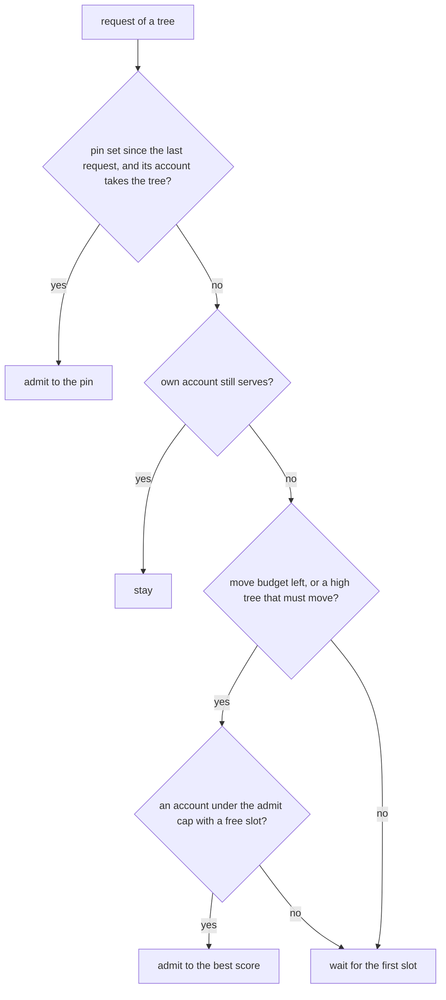

# pi-pool - account pooling for Prime Agent (pi)

Every pi session draws its Claude and Codex credentials from the accounts already
pooled in `tokenmaxxing`, instead of one fixed login. You can move one session to a
different account while it runs, with no `/login` and no restart.

## Source and runtime state

This directory is the maintained pi-pool source, verified live on Prime Agent 0.9.5.
Python uses the macOS `/usr/bin/python3` standard library. The extension uses
Prime Agent's public types and its `@earendil-works/pi-tui` dependency.
No account store or credential is included here.

```text
checkout/components/pi-pool/
  install.py               copies a commit into ~/.local/share/pi-pool (next section)
  vend.py                  entry point and command table; code root from realpath(__file__)
  pool/                    the code vend.py loads from its own real folder, one module per part
  app/extension/           /account command, account line, login adoption
  bin/                     executable, relocatable Python wrappers

PI_POOL_DIR or ~/.config/pi-pool/
  config.json, state.json   configuration, pins and session records
  lock, pi-pool.log         lock and event log
  rotations/, fallback.json, backups/   private runtime data
```

`PI_POOL_DIR` selects state only. It never selects Python modules or executables.
The wrappers resolve symlinks before they locate source files. `vend.py` loads `pool/`
from the folder of its own real path, fresh for each load, so the current directory and
`sys.path` never select a module and two loads never share module state.
Both wrappers use `-B`, so normal commands do not write Python bytecode into source.

## Install, update and roll back

Prime never runs files from this checkout. `install.py` copies a commit into its own
folder and points the runtime links at it, so an edit here is not live until it is
committed and installed. On 2026-10-08 a half-done edit in the checkout broke every
session from 17:45 to 17:59, because the links pointed at source.

```sh
/usr/bin/python3 -B components/pi-pool/install.py            # install HEAD
/usr/bin/python3 -B components/pi-pool/install.py --ref <sha>  # install another commit
/usr/bin/python3 -B components/pi-pool/install.py rollback     # back one release, or to the old links
/usr/bin/python3 -B components/pi-pool/install.py status
```

`install` takes these steps.

1. `git archive` exports `components/pi-pool` at the commit into a staging folder.
   Uncommitted edits never ship.
2. The pool's Python tests run in that folder. A failure stops here and changes nothing.
3. The folder becomes `~/.local/share/pi-pool/releases/<tree id>`, read-only. The id is
   the commit's tree id for this directory, so installing the same code twice reuses it.
4. The runtime links point at `~/.local/share/pi-pool/current`. Then `current` flips to
   the new release in one rename, and the release it replaced becomes `previous`.
5. Both token hooks run through `~/.config/pi-pool/bin/pi-pool-token`. If either hook
   exits nonzero, hangs past 10 s or is missing, `current` and the links go back to where
   they were and the command exits 1. Only token lengths are read.

The first install saves the links it replaced in
`~/.local/share/pi-pool/links-before-install.json`. `rollback` with no `previous` puts
those links back and removes `current`.

The installer owns these links. It refuses to replace anything at these paths that is
not a link.

```text
~/.config/pi-pool/vend.py           -> ~/.local/share/pi-pool/current/vend.py
~/.config/pi-pool/app               -> ~/.local/share/pi-pool/current/app
~/.config/pi-pool/bin               -> ~/.local/share/pi-pool/current/bin
~/.local/bin/pi-pool                -> ~/.local/share/pi-pool/current/bin/pi-pool
~/.prime/agent/extensions/pi-pool   -> ~/.local/share/pi-pool/current/app/extension
```

Prime's `models.json` names `~/.config/pi-pool/bin/pi-pool-token`, so it follows
`current` with no edit. `pi-pool enable` writes that same link path when it exists.
State stays where it is: `state.json`, `pi-pool.log`, `config.json`, `fallback.json`,
`rotations/` and `backups/` under `~/.config/pi-pool`, and the accounts under
tokenmaxxing. The installer keeps the 10 newest releases plus `current` and `previous`.
A running session keeps the extension code it loaded, from its own release, until it
is rebuilt; a new session loads `current`.

For a custom state directory, pass the same `PI_POOL_DIR` to the CLI and Prime Agent.
The CLI rejects state roots inside the code directory.

## External credential dependencies

pi-pool depends on the user's existing tokenmaxxing pool under
`~/.config/tokenmaxxing` (or `TOKENMAXXING_HOME`). It reads the per-account
store layout that tokenmaxxing 1.44 and later use, index schema version 2.
A version 1 index makes every command fail with the schema version in the error.
This repository does not install or seed those stores.

| dependency | use |
|---|---|
| `accounts.json` (v2) | Claude account ids, emails, usage `windows` and `needsReauth` |
| `stores/<uuid8>/` | One Claude store per account. Its credential is the Keychain item `Claude Code-credentials-<sha256(store path)[:8]>`, the same item a supervised `claude` reads |
| macOS Keychain | Claude credentials, read and written through `/usr/bin/security` using `USER` as the keychain account |
| `secrets/<service>` | Claude credentials on a host without `/usr/bin/security` (Linux), or with `PI_POOL_SECRETS=file`: one 0600 file per Keychain service name in a 0700 folder (`tests/test_linux_host.py`) |
| `lock` and `stores/<uuid8>/.oauth_refresh.lock` + `stores/<uuid8>.lock` | tokenmaxxing's Claude pool lock, then Claude Code's own refresh lock on that store |
| `live/` | Presence files of supervised `claude` sessions, a picker penalty only |
| `codex-accounts.json` (v2) | Codex account ids, emails, plan (`tier`), usage `windows` and `needsReauth` |
| `codex-stores/<uuid8>/auth.json` | One Codex store per account, refreshed in place |
| `codex-lock` | tokenmaxxing's Codex refresh lock |
| `codex-live/` | Presence files of supervised `codex` sessions. pi-pool never refreshes a store one of them runs on |

A dead refresh token (`invalid_grant`, `refresh_token_reused`) sets `needsReauth`
on that account in tokenmaxxing's index, so `tokenmaxxing auth --all` offers it.
On a switch or a fresh rotation, pi-pool also sends one free
`/v1/messages/count_tokens` request. A 401 or a 403 such as
`oauth_not_allowed_for_organization` puts the account on a
`refused_cooldown_sec` cooldown (24 hours by default) and sets tokenmaxxing's own
`enforcedUntil` on the account.

Refresh requests use `https://platform.claude.com/v1/oauth/token` and
`https://auth.openai.com/oauth/token`. They require network access and valid grants.
The pool returns only access tokens to Prime. Rotation journals and legacy
`fallback.json` can contain refresh tokens, so the state directory is private too.
Neither those files nor the credential stores belong in Git.

## Switch the account for this session

In the TUI:

    /account

It lists the pool with usage and flags, plus a "Follow the pool" row. Codex rows also
carry the plan (`email  plus  0%/100%  [depleted]`); `ls --json` puts it in a `plan`
field on codex rows only. Pick a row.
The tray shows `<email> (next request)` and the switch lands on that session's next
request when the account can take the session (see "Which account a request gets").
Picking an account that cannot take it now asks first; the pin then waits, and the
session moves there only when it must move or starts cold.

From a shell inside the session:

    pi-pool use claude1@example.test      # pin this session tree
    pi-pool use --follow                 # drop the pin, follow the pool again
    pi-pool priority high                # this tree's class: high, normal or low
    pi-pool who                          # what this session resolves to now
    pi-pool ls                           # the rows /account renders

`use` writes an intent, nothing else. No request is made and no credential is read
until the session's next provider request runs the hook.

## Commands

    pi-pool                       one card per account: usage bars, sessions, score, waiters; switches today
    pi-pool status --provider openai-codex
    pi-pool watch [sec]           the same cards full screen, redrawn every sec seconds (default 5)
    pi-pool use <email|id> [--follow] [--provider p] [--session id] [--new-session]
                                  --new-session pins a session created a moment ago (full uuid) before its first request
    pi-pool priority high|normal|low [--session id] [--provider p]
                                  the tree's class; a full uuid with no record yet creates one
    pi-pool who [--json] [--session id]
    pi-pool ls [--json] [--provider p] [--session id]
    pi-pool pin <email>           force EVERY session onto one account
    pi-pool unpin
    pi-pool switch [--session id] this session's next request moves to the best account that takes it now
    pi-pool enable anthropic|openai-codex   point that provider in models.json at the pool hook
    pi-pool adopt-logins          move a stored /login that would bypass the pool into fallback.json
    pi-pool refresh [<email|id> ...] [--provider p] [--json | --stream]
                                  read usage now for every account, or the named ones (needs --provider)
    pi-pool off <email|id> [--provider <p>]   keep an account pooled but never pick it (`ls --json` shows `disabled`)
    pi-pool on <email|id> [--provider <p>]    let the pool pick it again
    pi-pool rm <email|id> [--provider <p>]    `tokenmaxxing rm`, then drop its pins here
    pi-pool login [<email|id>] [--provider <p>] [--timeout <sec>]
                                  add an account or sign one in again (Claude: by organization, see below)
                                  for a browser: stdout is JSON lines ({"event":"url"} with the link and the
                                  Codex device code, {"event":"retry"}, one {"event":"done","ok":...}); stdin takes
                                  one pasted Claude code per line, and closing stdin cancels
    pi-pool resets [<email|id> ...] [--json]   read each Claude account's banked usage-limit resets (spends nothing)
    pi-pool reset <email|id> [--grant <id>] [--json]   spend one banked reset
    pi-pool probe [--force]       check every Claude account for an API refusal (no token refresh)
    pi-pool limited --until <epoch sec> [--provider p] [--session id]
                                  the provider answered 429 for this session's account; prints the next
                                  account, or null and retry_at, the session's own slot time
    pi-pool refused <error text> [--provider p] [--session id]
                                  an account-level refusal (terms, OAuth off) cools this session's account down; prints the next account or null
    pi-pool log [n]               last n pool events
    pi-pool config / set <k> <v>

`--session` takes a session uuid, a uuid prefix, or the short active id.

## One login in two organizations

One Claude login can hold several organizations, for example a personal Max plan and a
team seat on the same email. tokenmaxxing keys an account by the login's account uuid
alone, so `tokenmaxxing add` for the second organization overwrites the first one's
record and Keychain item.

So `pi-pool login` for Claude runs `tokenmaxxing add` in a scratch home under
`<state>/logins/<pid>` and files the result itself, under tokenmaxxing's pool lock:

1. It reads the harvested record's `oauthAccount` (account uuid and organization uuid).
2. A record of the same pair is signed in again in place. A record with no organization
   on file matches by account uuid alone.
3. A new pair becomes a new record. The first organization of a login keeps the account
   uuid as its id; another gets uuid5(`ORG_ID_NAMESPACE`, `<account>:<org>`), with its own
   store, Keychain item, usage, limits and cooldowns.
4. With an account named (`pi-pool login <id>`), a login of any other pair is refused and
   nothing is written.
5. The scratch Keychain items and folder are deleted, whatever the outcome.

Rows carry `label`: the email, or `email (organization)` when two accounts share the email
(`personal` for the organization Anthropic makes per login). Every command takes an id, a
label, a unique id prefix, or an email only one account has; a shared email exits with the
labels to choose from. Add a second organization only through `pi-pool login` or
Settings > Accounts: a hand-run `tokenmaxxing add` or `auth` still keys by the login.

`ls --json` names the pool `pin`, the tree's `priority` and its `wait` (`{account, slot_at}`
or null; `who --json` carries the same `wait` per provider and `priority` at the top). Its
rows carry `usable` (the account takes this tree now), `serves` (a tree already on it stays),
`score` (null when it cannot take the tree), `slot_cap`, `admitted_recently`, `waiting`, and
what `status` draws: `tier` (`max 20x`, `pro`), `windows`
(one entry per usage window in display order, each with `kind` session, weekly or model,
`label`, live `pct`, `resets_at` in epoch seconds or null, `window_sec`, `sampled_at`),
`usage_at` and `usage_age_sec`, `sessions` (vends in the last hour), `cooldown_until`
and `cooldown_reason` for a refused account, and `limited_until` for an account with a 429 on file.

`refresh` reads usage now for every account, or the named ones. `tokenmaxxing status`
cannot do this: it skips a Claude account read in the last 90 s to 15 min and reports it
as `cached`. So `refresh` runs `app/usage-read.ts` with tokenmaxxing's own Bun, once per
provider. That script imports tokenmaxxing's own read and save functions from the installed
release (found through the `tokenmaxxing` wrapper), reads four accounts at a time, and saves
each result under tokenmaxxing's pool lock. It still waits out a rate limit the usage
endpoint set, and reports it with the time of the next read. If an auto-update renames a
function it calls, it fails with the missing name, and the contract test in
`tests/test_commands.py` fails too. It writes only tokenmaxxing's usage figures and moves no
session or pin. tokenmaxxing may refresh an expiring store under its own lock while it reads.

A team seat's usage has a 5h window and no weekly one, and tokenmaxxing's read rejects that
body. When tokenmaxxing's read fails without a rate limit, `usage-read.ts` reads the account
once more and lands the 5h and per-model windows (`app/usage-seat.ts`). tokenmaxxing's minute
`check` still skips such an account, so its figures move only on a `refresh`.
The hook runs that `refresh` itself, detached, when the seat's 5h sample is older than
20 minutes and it would otherwise take a tree, and logs `usage_read`. On 2026-10-13 nothing
read the Virev seat for 31.6 h, its old sample read as 0%, and it took 9 trees from 22:40 to
22:56 KST before Anthropic refused it at 23:04 until 03:40.

`--stream` prints one JSON line per event while the reads run: `accounts` (the list),
`reading`, `read` with `ok` and `usage_at` or `reason` and `retry_at` (epoch seconds),
`error`, and a final `end`. Every line carries `provider`, and `reading` and `read` carry
`email`. A read still running after 180 s is reported as not finished. `--json` prints one
report at the end. Claude usage is also sampled every minute by
tokenmaxxing's `check` timer; Codex usage only when tokenmaxxing samples it, so Codex
figures can be hours old.

## Banked resets

Anthropic gives some Claude accounts banked usage-limit resets (program `cedar_ember`,
for example "Claude Opus 5.5 launch: one usage-limit reset for Pro and Max"). The contract
comes from the CLIProxyAPI Management Center (`src/services/api/claudeResetGrants.ts`,
`resetGrantOperations.ts`) and was checked against live accounts.

- `resets` calls `GET /api/oauth/usage?cedar_ember=1&skip_spend=1` as each account and saves
  the parsed `cedar_ember` block in `resets.json`; `ls --json` shows it as `resets` on Claude
  rows. One grant that does not parse rejects the account's whole block. A failed read keeps
  the last good grants and adds `error`.
- Anthropic decides eligibility by client. The calls send Claude Code's own User-Agent with
  the installed version (`claude-cli/2.1.289 (external, cli)`); pi-pool's plain User-Agent
  makes every account read as ineligible with reason `surface`.
- `reset` reads the organization (`GET /api/oauth/profile`) and the grants, and sends nothing
  when a grant cannot be spent (paused, not usable now, none left, needs the account to be
  limited, not started, expired, cooldown). Otherwise it writes the claim, with a new
  `request_id`, to `reset-claims.json` before it calls
  `POST /api/organizations/<org>/reset_rate_limits` with `{program, grant_id, request_id}`.
  The answer is one of `reset`, `already_used`, `not_limited`, `cooldown`, `ineligible`,
  `unavailable`; 429 and 401/403 mean nothing was spent.
- No answer (timeout, network) leaves the claim open. Running `reset` again within 10 minutes
  resends the same `request_id`, which Anthropic counts once. A refusal on such a retry does
  not settle the claim, because the first POST may have spent the reset. After 10 minutes the
  next `reset` compares the grant's `resets_left` with the count before the claim, and records
  whether the reset was spent.
- `reset.lock` allows one claim at a time on this Mac. Exit codes: 0 reset, 1 not reset or
  blocked, 3 unknown outcome.

## Which account a request gets

The pool keys by session tree (next sections), and the hook asks the scheduler on every
request. Its answer is one of three: stay on the tree's account, admit the tree to an
account, or wait for a slot. `decide` in `pool/sched.py` holds the rules, first match wins.



| # | rule | effect |
|---|---|---|
| R1 stay | the tree's own account still serves: no 429 on file, every counting window under 100%, credential ok | it stays, warm or cold. No move because of a cutoff, a better account, a pin set earlier or another tree's move |
| R2 admit cap | an account takes a tree that is not on it only under `admit_5h_max_pct` (70) of its 5h window and under `seven_day_max_pct` (98) of its week and its Fable cap, and only on a 5h sample under 20 minutes old, with that sample projected to the next read | holds for new trees, moves after a 429, pins and `pi-pool switch`. An account with an older sample is `unsampled`: the hook starts a background `pi-pool refresh` of it, and a tree that waits for it asks again after 180 s. The projection is the read plus the account's own rate for each tree that sent a request there in the last 15 minutes over the 20 minutes from the read to the next one, plus the new tree from now to the next read The own rate is the 5h change between the last read and the newest read at least 20 minutes older in the same window, plus one point for rounding, divided by the spending tree-minutes between them. Until a window has two such reads, `tree_5h_pct_per_min` of the tier stands in (team 0.68, max 5x 0.92, max 20x 0.28, measured on 10-12 and 10-13; see `base.DEFAULTS`). A projection at the cap holds the tree until the next read has landed |
| R3 score | among the accounts that pass R2, the highest weekly pace x 5h headroom / load | weekly pace is `(98 - week%) / hours to the weekly reset`, so a week that resets soon with budget left is spent first. Headroom is `(70 - 5h%) / 70`. Load is `(trees vended in the last hour + 1) / tier units` |
| R4 slots | an account admits one tree per `admit_slot_sec / slot_cap` seconds, where `slot_cap` is `admit_per_unit` x tier units (max 20x 4, max 5x and team 1, pro 0.5, at least 1) | a full account is skipped. The admission is written under the pool flock in the same decision, so trees that leave together see each other |
| R5 wait | nothing passes R2 to R4 for this tree | the tree gets its own `slot_at` on the account that frees first (429 end, 5h reset or its next free slot), ordered by priority, then by wait start |
| R6 move budget | the tree moved `max_moves_per_day[priority]` times in 24 h (high 6, normal 3, low 1) | it waits for its own account when that account frees within `budget_wait_max_sec` (3600); otherwise it moves anyway and logs `why: budget_overrun`. A high tree is refused only an optional move (`pi-pool switch`) |
| R7 priority | low trees enter only under `low_admit_5h_max_pct` (50) | high trees rank first for slots. When one account is left, the last slot of each `admit_slot_sec` window is for high trees |

A tree that waits gets its own account from the hook while the provider refuses that
account, so the request comes back as a 429 that writes no cache. `pi-pool limited` then
prints `retry_at`, the tree's slot, and the extension sets the message's `retryAfterMs` to
it, at most 15 minutes at a time. Prime 0.9.8's wait-for-usage reads `retryAfterMs` from the
message's `provider_stream_failure` diagnostic first and sleeps exactly that long, bounded
by `retry.provider.waitForUsage.maxWaitMs` and `maxAttempts`. When the tree's own account
serves again before its slot, the hook gives no token, and the extension turns that hook
failure into the same wait.

A slot holds one tree. A tree that ranks ahead (higher priority, or the same priority and an
earlier wait start) may take a slot a later tree was promised; that tree finds its slot taken
when it wakes and is given the next one. So a reset admits the waiting trees at slot pace,
high trees first. On 2026-10-12 15:30, 25 vends landed on claude7 in 4 seconds; at the
2026-10-10 21:00 reset 26 trees landed on claude9 in 2 seconds.

A pin is an owner intent applied once: the tree's next request moves to the pinned
account if it passes R2 (a high tree skips R4). After that the pin steers the tree only
when it must move or starts cold (no request for `cache_ttl_sec`), and it never pulls a warm
tree back. A pool pin (`pi-pool pin`) moves trees at slot pace while its account passes R2.
On load the pool drops pins whose `by` starts with `recovery:` (the lost 2026-10-11 recovery
pool), pins older than `pin_ttl_sec` and the old `recovery_batches` key.

Every vend that changes a tree's account logs one `vend` line with `reason` (`new`,
`switch`, `back`, `session_pin`, `pool_pin`, `upgrade`), the yielded pin in `shadowed`
with `why` (`depleted`, `limited`, `busy`, ...) and the `previous` account, and one `switch`
line with `why` (the old account's reason, `asked`, `waiting`, `plan`, `pin` or
`credential`) and the top `scores`. A new wait logs one `wait` line with the slot.
`pi-pool status` counts today's `switch` lines per provider.

Removed on 2026-10-12: the hop onto a depleted account when nothing was usable (on
2026-10-12 15:01-15:04 it moved 18 trees 85 times in 4 minutes, each onto an account that
answered 429 a minute later), the random runway-cubed pick, `use --force`, and a pin pulling
its tree back the moment its account reset. `tests/replay_scheduler.py` replays a day of real
requests through the old resolver and this one; its numbers are in the pool-scheduler session
folder (`replay.md`). `tests/test_scheduler.py` holds one or more tests per rule, and
`tests/mutation_check.py` takes each rule out of a copy of the code and fails when no test
in that file notices.

The Fable cap only counts for a tree that runs Fable: the `/account` extension records each
session's model (`pi-pool model`) at session start and on every model change, and a tree
with no Fable model ignores the cap. A tree with no recorded model keeps it. A cooldown
comes from a refusal probe (see the dependency section).

The codex plan upgrade exists because a tree otherwise moves only when its account
cannot serve. A free codex account taken while the paid one was depleted would hold the
tree after the paid window resets, and the API refuses several models on a free plan
with a 400 "not supported when using Codex with a ChatGPT account". The upgrade admits
the tree to an account on a higher plan (reason `upgrade`), and a higher plan ranks first
for every admission. Anthropic accounts carry no plan, so it never fires there.

## A 429 moves the session in the same turn

Usage figures come from tokenmaxxing samples that can be 15 minutes old, so the provider's
own 429 is the first sign that an account is used up. The extension handles it on
`message_end`:

1. An assistant error with status 429 on a pooled provider runs
   `pi-pool limited --provider <p> --until <now + retryAfterMs>` (5 minutes when the
   provider sent no reset).
2. `limited` finds the account the session tree last vended, writes
   `providers.<p>.limits.<account> = {until, at, session}` to `state.json` under the flock,
   runs the scheduler for the tree's retry, holds what it decides (a slot now, or the
   tree's wait), logs a `limited` line, and prints `{"account", "until", "next", "retry_at"}`.
3. When `next` names an account, the extension returns the message without `retryAfterMs`
   and without the "Try again in" phrase. Prime's usage wait then pings after about one
   second instead of sleeping until the reset, and that ping's hook call vends `next`.
4. When `next` is null, `retry_at` is the tree's own slot. The extension sets the
   message's `retryAfterMs` to `retry_at - now`, at most 15 minutes, with a matching "Try
   again in N minutes" text, so Prime sleeps until the slot and not until the provider's
   reset. On 2026-10-12 15:04 a tree slept 1 h 45 min for claude10's reset while claude7
   came back at 15:30.

The limit lives in `state.json`, so a restarted worker or daemon still skips the account.
The hook prunes it when it expires. A successful `pi-pool login` for the account drops it,
since the 429 belonged to the replaced credential. `tests/native/swap.mjs` runs this against a copied
Prime install: request 1 gets a 429 on one Codex account, request 2 of the same turn uses
the other one, and a restarted Prime process goes straight to the other account. With
`FIXTURE_FAILURE=all` every account answers 429 until its own reset; the same turn sleeps
until the first account frees and finishes there with no manual continue.

## An account-level refusal moves the session the same way

Some errors fail every request on one account whatever the prompt. Prime treats a 400 or
403 as permanent, so without the pool the turn ends there. On 2026-10-08 a newly added
Claude account answered every turn for 3 minutes with a 400: "We've updated our Consumer
Terms and Privacy Policy. You'll need to accept them in claude.ai". The extension handles
these on `message_end` too:

1. An assistant error with status 400 or 403 on a pooled provider runs
   `pi-pool refused --provider <p> <error text>`.
2. `refused` reads the text (`account_refusal`). Terms not accepted is `needs terms`; OAuth
   turned off for the organization is `oauth not allowed for organization`. Any other text
   prints `{"reason": null}` and changes nothing.
3. For a refusal it cools the account the tree last vended down for `refused_cooldown_sec`,
   with the reason in `cooldown_reasons`, logs a `refused` line, and prints
   `{"account", "reason", "next"}`.
4. When `next` names an account, the extension marks the failure a rate limit, so Prime's
   usage wait retries in about a second and that retry's hook call vends `next`. When it is
   null, the failure becomes a rate limit that waits until `retry_at`, the session's slot.

Settings > Accounts shows a `needs terms` account as "Needs terms". To bring it back, sign
in to claude.ai as that account, accept the terms, then choose Check again (`pi-pool probe
--force`, which sends that account a one-token message) or sign it in again (`pi-pool
login`). `FIXTURE_FAILURE=terms node tests/native/swap.mjs` runs this against a copied Prime
install, and with `FIXTURE_EXPECT=baseline` it shows the turn failing without the extension.

## A pin covers the whole session tree

The pool keys by the ROOT session uuid, taken from the daemon worker descriptor
(`daemon-workers/<daemonId>/<workerId>.json` -> `rootSessionId`). One worker process
serves one root session and every `rlm()` subagent under it, so a pin set anywhere in
a tree covers the whole tree.

The short active session id is NOT stable: resuming a session in a new worker gives it
a new one (verified 2026-09-06). It is stored for display and for `--session <short id>`
lookups, never as the key.

## openai-codex

    pi-pool enable openai-codex

writes the provider entry into `~/.prime/agent/models.json`. The entry needs `baseUrl`.
A provider entry with only `apiKey` fails `validateConfig` and takes every model down,
not just codex.

Codex credentials live in `~/.config/tokenmaxxing/codex-stores/<uuid8>/auth.json`. A
rotation takes tokenmaxxing's `codex-lock` and is journalled before the write. A store
that a supervised codex session runs on is never refreshed here: the codex CLI owns
that rotation.

## Why the pool vends access tokens, never refresh tokens

pi and Claude Code use the same OAuth client
(`9d1c250a-e61b-44d9-88ed-5944d1962f5e`), so tokenmaxxing's credentials work in pi
unchanged. But Anthropic rotates the refresh token on every refresh, so two independent
refreshers on one grant family kill each other: whoever refreshes second gets
`invalid_grant`.

So pi is never given a refresh token. The hook vends a short-lived access token, and any
rotation happens inside tokenmaxxing's own store under tokenmaxxing's own flock.

This works because pi sniffs the key string, not the credential type
(`isOAuthToken = apiKey.includes("sk-ant-oat")`), so a plain `apiKey` that happens to be
an OAuth access token still gets the full Claude Code request shape.

The hook is a models.json `!command` on purpose. A provider `apiKey` is re-executed on
every provider request, uncached, while an `auth.json` `!command` is cached for the whole
process and only re-runs after a 401. Per-request resolution is what lets a switch land
on the next request.

## Inside Prime Agent: the /account extension

`app/extension` is a Prime Agent extension, linked into `~/.prime/agent/extensions/pi-pool`
by the root installer. It uses only the public extension API, so a Prime Agent update
needs nothing re-applied. Earlier versions also patched Prime's bundled JavaScript for
the tray line. Prime 0.9.5 ships as one compiled binary, so that patch is gone.

| part | what it does |
|---|---|
| `/account` | pick this session's account, or follow the pool. Accounts that take the session are listed first, best score first |
| account line | one widget line by the editor: `account <email> 5h 25% · week 7% · fable 12%`, plus `→ <email>` when the next request switches. Drawn at session start, on model change, after every turn, and every 60 seconds. One `pi-pool who` run per 60 seconds serves every session in the process, and a model or account change runs it at once. A session with no UI and an RLM child session run no `who` at all (`tests/test_extension_status.py`) |
| login adoption | at session start it runs `pi-pool adopt-logins` (next section) and tells you if it moved a login |
| 429 swap | on a 429 it runs `pi-pool limited`; when another account takes the session it drops the reset from the message so Prime retries in about a second on that account, else it sets the reset to the session's slot (see "A 429 moves the session in the same turn") |
| hook retry | a turn that failed with "Failed to resolve API key ... pi-pool-token" loses Prime's lifecycle-failure tag, so Prime retries it like any unclassified error; when `pi-pool who` shows the session waiting, the failure becomes a rate limit that waits until its slot |
| refusal probe | at session start it runs `pi-pool probe`, which sends one free `count_tokens` request per account with a valid token, at most every 6 hours. `pi-pool refresh` sends the same probe right away to each Claude account whose usage read failed, since a revoked token fails the read with no reason and trees wait for an account with no fresh read. A refused account gets a 24h cooldown in the pool and `enforcedUntil` in tokenmaxxing's index, so supervised `claude` sessions avoid it too. A successful `pi-pool login` drops a `needs terms` or `token rejected (401)` cooldown |

Prime 0.9.5 keeps `setStatus` text but its footer never draws it, which is why the account
line is a widget.

## A stored /login would bypass the pool

Prime resolves a provider's key from `auth.json` first and runs the models.json
`!command` only when `auth.json` has nothing for that provider. A `/login` for
`anthropic` or `openai-codex` therefore silently takes every request away from the pool.

`pi-pool adopt-logins` moves such a login out of `auth.json` into `fallback.json`, under
Prime's own `auth.json.lock`. It only touches providers whose models.json `apiKey` is the
pool hook. The login still serves as the fallback: when no pooled account can serve, the
hook refreshes and returns it (both providers). The extension runs this at every session
start, so a new `/login` is adopted the next time a session starts. A worker that already
holds the login in memory keeps using it until its session is rebuilt.

## Codex WebSocket reuse after a switch

Prime caches one Codex WebSocket per session, keyed by session id only. After the pool
moves a session to another Codex account, requests keep riding the open socket, which
was authorized as the old account, until the socket closes (idle timeout or an error).
If that matters, set `"transport": "sse"` in `~/.prime/agent/settings.json`: every
request then carries the current token, at the cost of the WebSocket's cached context.

## The Mac-wide turn queue

The queue caps how many session runs work at once on this Mac, whatever their tree or account.
One run of one session holds one working slot from its first model call to its agent_end, and `pool/turns.py` keeps the slots and the queue in `state.json` under the pool flock, in `state["turns"]`.

- `pi-pool admit <session> [--tree <root>] [--parent <session>] [--class high|normal|low] [--pid <n>] [--wait | --renew]` prints `{"state","kind","position","total"}`, where the state is admitted, queued or off.
- `--tree` defaults to the calling process's session tree and `--pid` to the calling process, whose exit drops the entry.
- `--class` defaults to normal for a child (`--parent`), or high when the owner labeled the tree High in the sidebar (`pi-pool priority high --label`), and to the tree's pool priority for a root.
- With `--wait` the command prints one line each time its place changes and blocks until it prints the admitted or off line.
- `--renew` renews a running session's lease, and a session whose slot lapsed works again at once and never queues.
- `pi-pool release <session>` frees the slot or drops the queue entry, and a second release does nothing.
- `pi-pool owner-turn <session>` marks the session's next admit as the owner's, which runs at once, and an agent run of the session already in the queue starts at once as kind `ahead`, so the owner's prompt never waits behind the queue.
- `pi-pool queue --json` prints the working and queued runs with their classes, positions and waits, and `slots_used`, the working runs that are not borrows.

An owner run never waits and still counts toward the limit, so background work waits behind it.
The limit is `mac_working_max`, the number the owner set, and memory never lowers it or holds a turn or a spawn (owner, c88 on 10-16).
Queued runs take free slots by class, high before normal before low, and the longest wait goes first inside a class.
A queued run moves up one class for every `queue_aging_s` it waits.
A session that asks again within 30 s of its run's release (`REQUEUE_GRACE_S`) keeps that run's place in line, so a job's chained runs go ahead of turns that never ran.
A slot is free while the Mac has fewer than `mac_working_max` slots in use and the run's tree has fewer than `tree_working_max`, and every working run but a borrow counts toward both.
A child whose parent's run is in flight and that finds no free slot runs on the parent's lent slot, and a parent lends one slot at a time, so a parent that spawns six children in one cell runs one of them over the limit, not six.
A borrow rides on its lender's slot and takes none: at 11:02 KST on 10-14, 7 of 30 working runs were borrows that each kept a queued run off a free slot.
An entry whose Prime worker or waiting `admit --wait` process is gone is dropped, and so is a slot whose lease (`lease_s`) runs out.
`pi-pool set agent_queue_on 0` turns the queue off and keeps the limits, and every admit then answers off.
Every `pi-pool set` records who ran it and when under `set_by` in config.json and as a `set` line in pi-pool.log with the old value.
The writer is `--by <who>` (the chat service's Settings pane passes "the Settings pane"), else the agent's Prime session folder, else the parent pid.
`queue --json` carries `mac_working_max_set` ({by, at}), which is null while the default 16 holds and has by null and config.json's file time for a value written before `set` recorded writers.

The extension's `context` handler, which Prime awaits before every model call from every turn source, runs `admit --wait` at a run's first model call.
A queued run gets one `pi-pool-queue` entry in its transcript that reads "Queued for a working slot, 3rd of 7".
Stop reaches the waiting handler through `ctx.signal`, kills the wait and drops the entry (`tests/native/queue.mjs`).
While the run holds its slot, its model calls renew the lease at most once every 5 minutes, and a timer releases the slot when it finds the session idle, because agent_end does not fire on some aborts.
A run stuck in one tool call makes no model call, so its slot lapses after `lease_s` and its next model call takes it back at once: at 11:02 KST on 10-14 four runs held slots 2,653 to 2,937 s inside one bash or aside_browser call, kept by the old timer renewal.
Only the chat service marks an owner turn, with `pi-pool owner-turn` right before it sends the owner's prompt.
The extension marks none, because every prompt the daemon delivers reads as input source `interactive`: on 10-14 that hook marked 21 [job] notices, 6 [brief check] notes and 51 duty and check-in briefs as owner turns.
A failed admit lets the run go, so a broken pool never stops the Mac's agents.

A replay of the 852 runs that started 10-14 02:00-03:00 KST, when load reached 208, runs every run, gives at most 16 slots at once, and puts at most 11 children on lent slots at once (`tests/test_turns.py`).

Rollout: `install.py` runs the Python tests and checks only the token hooks, and a running session keeps the extension code it loaded until the session is rebuilt, so the queue reaches each session at its next load, reload or worker restart.

## Config

`~/.config/pi-pool/config.json`, defaults in `DEFAULTS` (pool/base.py): `refresh_skew_sec`,
`admit_5h_max_pct`, `low_admit_5h_max_pct`, `seven_day_max_pct`, `admit_slot_sec`,
`admit_per_unit`, `tier_units`, `max_moves_per_day`, `cooldown_sec`, `allow_active_account`,
`switch_models`, `pin_ttl_sec`, `active_session_sec`, `cache_ttl_sec`,
`refused_cooldown_sec`, `probe_interval_sec`, and the turn queue's `agent_queue_on`,
`mac_working_max`, `tree_working_max`, `queue_aging_s` and `lease_s`. `pi-pool set` takes a JSON object for
`tier_units` and `max_moves_per_day`. `five_hour_max_pct`, the runway keys
(`burn_5h_pct_per_hour`, `burn_week_pct_per_hour`, `runway_horizon_hours`,
`min_runway_hours`), the memory keys `memory_governor_on`, `spawn_hold_on` and `pressure_working_max`, and v1's `hold_sec`, `switch_improvement`, `assignment_scope` and `mode`
are gone; a leftover key in `config.json` is ignored.

## Safety properties

- Prime receives access tokens only. Refresh tokens stay in private stores and rotation journals.
- A refresh takes tokenmaxxing's own flock and writes the rotation straight back.
- Rotations are journalled to `rotations/` before the write; a crash in that window is
  healed on the next vend.
- The pool flock is never held across a refresh, so `pi-pool use` never queues behind one.
- Every wait is budgeted under pi's 10s hook timeout. Prime measures that timeout by the
  wall clock and drops the hook's stderr. A hook it kills logs one `hook_killed` line with
  the stack it was in, `wall_sec` and `awake_sec`. A `wall_sec` far above `awake_sec` means
  the Mac slept while the hook ran. Prime 0.9.8 tags that failure an agent lifecycle failure
  and never retries it, so the extension takes the tag off and Prime's own retry runs the
  hook again, up to `retry.maxRetries` times (`tests/native/hook-timeout.mjs`).
- A writer killed between its write and its rename leaves `<file>.tmp.<pid>`. The next
  save of that file removes every such file whose pid is gone.
- A failure on either provider degrades to `fallback.json` (your own login, a separate
  grant family) rather than "No API key found".

## Footguns

- `/login` writes an entry back into `auth.json`, which outranks the pool hook until the
  next session start adopts it (or run `pi-pool adopt-logins`).
- `ANTHROPIC_API_KEY` / `ANTHROPIC_OAUTH_TOKEN` in the environment outrank the hook.
- `pi-pool use` needs a session. Outside one, pass `--session <id>`.
- Third-party harness usage meters against each account's own quota.

## Rollback

`install.py rollback` puts the previous release back in one rename and checks both hooks.
With no previous release it puts back the links the first install replaced.
To stop using the pool hook, remove the extension link `~/.prime/agent/extensions/pi-pool`
and restore the previous provider configuration from your own backup of `models.json`.
`fallback.json` holds any adopted login; copy an entry back into `auth.json` to restore it.
Do not edit or copy files under `~/.local/share/pi-pool`; install a commit instead.
