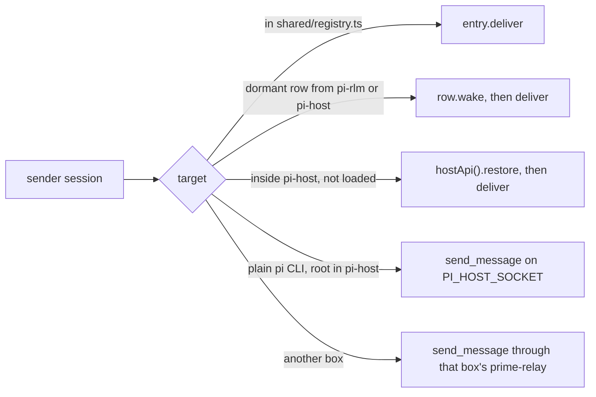

# pi-agent-bus

pi-agent-bus is the Pi extension that rebuilds Prime's `agent_message` and `agent_observe` on upstream Pi 1.4.0.
Load it with `pi -e components/pi-stack/agent-bus/index.ts`, or list `index.ts` in pi-host's extension paths.

## What it does

1. Each session it loads into registers in `shared/registry.ts` with a `deliver` and a `preview`.
2. `deliver` queues Prime's custom message, `customType: "agent_message"`, with the content `[agent-message from <relationship>:<name>]`, a blank line and the text, and `details` holding `id`, `message`, `from`, `fromRelationship` and `target`.
3. An idle target starts a turn, a busy one gets a steer for `auto` and `steer`, and `follow_up` waits until the run ends.
4. It answers the kernel's `agent_message.send`, `agent_observe.list`, `agent_observe.get` and `agent_observe.recent` through `shared/kernel-bridge.ts`, so pi-rlm's kernel reaches it.
5. The Python skills `agent_message` and `agent_observe` ship under `skills/`, copied from Prime 0.9.8 (MIT). The only change adds an optional `mode="auto" | "steer" | "follow_up"` to `agent_message.send`. The extension returns that folder from `resources_discover`.

## Routing



1. Reach follows Prime's rule in `src/family.ts`: the parent, siblings at the same depth under the same parent, and direct children, with every root a sibling of every other root.
2. pi-host's `send_message` handler calls `sendFromClient` in `src/route.ts`, so a send from the chat service or a plain `pi` CLI gets the same message shape and receipt.
   A client send with no sender session gets the header `[agent-message from <clientId>]`, as in Prime.
3. Receipts keep Prime's shape: `id`, `source`, `target`, `from`, `message`, `deliveryStatus` (`delivered` or `queued`), `deliveredAt` or `queuedAt`, and `deliveryMode`.

## Limits

The message size (16,384 chars), the pending queue (20 unfinished per target) and the rate (3 sends per sender and target, one more each second) are Prime's numbers.
They are soft caps under owner rule c98, because none guards data integrity, security, money, an outside send or a vendor limit.
A send over a cap goes through, and its receipt lists the overrun in `overLimit`.

## Durable inbox

Pi keeps queued steers and follow-ups in memory only, so `src/inbox.ts` writes each accepted message to `<agent dir>/agent-bus/inbox/<session id>.jsonl` before Pi queues it.
1. At `session_start`, other than a reload, the session replays every record whose id is not in its transcript, with the same id, so each message lands once.
2. At each `agent_end`, the file drops the records the transcript holds, and it is removed when none is left.
3. An abort leaves the messages in Pi's queue, and the next run delivers them. A kill after the abort loses the queue, and the reopen replays it from the file.
4. pi-host calls `recoverInboxes()` once at start, which reopens every session that still has records, and calls `clearInbox()` after `clear_queue` and `abort_and_clear_queue`.
5. The transcript decides what landed, because Pi writes a custom message to the session file only after the extensions' `message_end` handlers return.

## Idempotent sends

A `send_message` that carries an idempotency key delivers at most once, even when pi-host dies between taking the message and answering.
1. The key is the sender's client id and command id, which stay the same on a retry. pi-host takes it from `command.idempotencyKey`, or from a v7 envelope's `clientId` and `id`.
2. `sendFromClient` makes the message id from the target and the key, so a retry has the id of the first try.
3. Each live session keeps the ids it holds in its transcript and durable inbox, so a retry whose id is already there gets the first receipt back with `duplicate: true` and delivers nothing. After a host restart, the session rebuilds that set from its file and inbox, so no map in pi-host has to survive.
4. A plain `pi` session's send to pi-host or to another box's relay uses an envelope with client id `agent-bus:<session id>` and one command id, and retries for up to 60 s while the host does not answer.

## Other boxes

A root on one box reaches a root on another box through that box's prime-relay, which tunnels `GET /v1/daemon` to the pi-host socket byte for byte, so `relay.mjs` needs no change.
1. Each box runs a relay whose `daemonSocket` is its pi-host socket.
2. `PI_AGENT_BUS_BOXES` names a JSON file `{"self": "<this box>", "boxes": [{"name", "url", "tokenFile"}]}`, and every box can share one file, since the entry named `self` is skipped.
3. `src/members.ts` lists each other box's roots with a `list` line through its relay, and `src/route.ts` sends to one with a `send_message` line. The receipt gains `host` and `crossHost: true`, as Prime's cross-host receipts did, and the target box's pi-host delivers it with the header `[agent-message from sibling:<sender name>]`.
4. A box that does not answer adds no roots, so a send to a root on it fails with `No sibling matches`.
5. The live `~/.config/sieun-pi/hosts.json` points at Prime's relays on port 7790, so a cutover adds a pi-host relay per box and writes the boxes file from hosts.json's `address`, relay port and token.

## Tests

```sh
cd components/pi-stack
node --import tsx --test --test-force-exit "agent-bus/test/*.test.ts"
```

The step 3 check is 30 senders that send 20 messages each to one busy receiver, and `test/load.ts` counts the messages in the receiver's session file.
1. `test/load.test.ts` runs it in-process, once with a busy receiver and once with sends spread over time.
2. `test/host-load.test.ts` starts pi-host as its own process with this extension and `test/fixtures/busy.ts` loaded. It runs the load from 30 plain `pi` sessions on `PI_HOST_SOCKET` and from 30 socket clients with no sender session, then wakes a closed root.
3. `test/host-closed.test.ts` wakes a closed child inside pi-host from its parent and from a socket client.
4. `test/inbox.test.ts` kills and aborts busy receivers with queued messages and checks that each lands once.
5. `test/host-crash.test.ts` kills pi-host with SIGKILL during a 30 x 20 burst, restarts it and checks that every accepted message lands once.
6. `test/host-idempotency.test.ts` kills pi-host between taking a send and answering it, and checks that the retry delivers nothing more.
7. `test/cross-box.test.ts` runs two pi-hosts behind two scratch relays as boxes a and b, with this process as box c, and runs the 30 x 20 load across boxes.

Set `BUS_LOAD_SENDERS` and `BUS_LOAD_PER_SENDER` to change the load, `BUS_LOAD_OUT` to write each result as JSON, and `BUS_LOAD_ROOT` with `BUS_LOAD_KEEP=1` to keep the session files.
