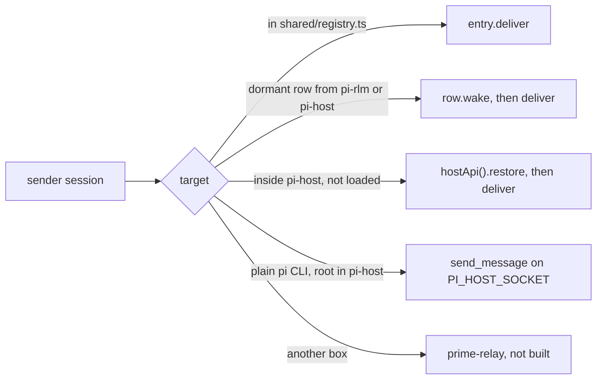

# pi-agent-bus

pi-agent-bus is the Pi extension that rebuilds Prime's `agent_message` and `agent_observe` on upstream Pi 1.4.0.
Load it with `pi -e components/pi-stack/agent-bus/index.ts`, or list `index.ts` in pi-host's extension paths.

## What it does

1. Each session it loads into registers in `shared/registry.ts` with a `deliver` and a `preview`.
2. `deliver` queues Prime's custom message, `customType: "agent_message"`, with the content `[agent-message from <relationship>:<name>]`, a blank line and the text, and `details` holding `id`, `message`, `from`, `fromRelationship` and `target`.
3. An idle target starts a turn, a busy one gets a steer for `auto` and `steer`, and `follow_up` waits until the run ends.
4. It answers the kernel's `agent_message.send`, `agent_observe.list`, `agent_observe.get` and `agent_observe.recent` through `shared/kernel-bridge.ts`, so pi-rlm's kernel reaches it.
5. The Python skills `agent_message` and `agent_observe` ship under `skills/`, copied from Prime 0.9.8 (MIT). The only change adds an optional `mode="auto" | "steer" | "follow_up"` to `agent_message.send`. The extension returns that folder from `resources_discover`.

## Routing



1. Reach follows Prime's rule in `src/family.ts`: the parent, siblings at the same depth under the same parent, and direct children, with every root a sibling of every other root.
2. pi-host's `send_message` handler calls `sendFromClient` in `src/route.ts`, so a send from the chat service or a plain `pi` CLI gets the same message shape and receipt.
   A client send with no sender session gets the header `[agent-message from <clientId>]`, as in Prime.
3. Receipts keep Prime's shape: `id`, `source`, `target`, `from`, `message`, `deliveryStatus` (`delivered` or `queued`), `deliveredAt` or `queuedAt`, and `deliveryMode`.

## Limits

The message size (16,384 chars), the pending queue (20 unfinished per target) and the rate (3 sends per sender and target, one more each second) are Prime's numbers.
They are soft caps under owner rule c98, because none guards data integrity, security, money, an outside send or a vendor limit.
A send over a cap goes through, and its receipt lists the overrun in `overLimit`.

## Other boxes

A send to a root on another box needs three things that do not exist yet.
1. pi-host has to publish its roots to prime-relay, as the chat service does for Prime's daemon today.
2. prime-relay has to forward a `send_message` line to the host that holds the target and return the receipt.
3. `src/members.ts` has to add the relay's roots as `remote` members, and `src/route.ts` has to send to them through the relay.

## Tests

```sh
cd components/pi-stack
node --import tsx --test --test-force-exit "agent-bus/test/*.test.ts"
```

The step 3 check is 30 senders that send 20 messages each to one busy receiver, and `test/load.ts` counts the messages in the receiver's session file.
1. `test/load.test.ts` runs it in-process, once with a busy receiver and once with sends spread over time.
2. `test/host-load.test.ts` starts pi-host as its own process with this extension and `test/fixtures/busy.ts` loaded. It runs the load from 30 plain `pi` sessions on `PI_HOST_SOCKET` and from 30 socket clients with no sender session, then wakes a closed root.
3. `test/host-closed.test.ts` wakes a closed child inside pi-host from its parent and from a socket client.

Set `BUS_LOAD_SENDERS` and `BUS_LOAD_PER_SENDER` to change the load, `BUS_LOAD_OUT` to write each result as JSON, and `BUS_LOAD_ROOT` with `BUS_LOAD_KEEP=1` to keep the session files.
