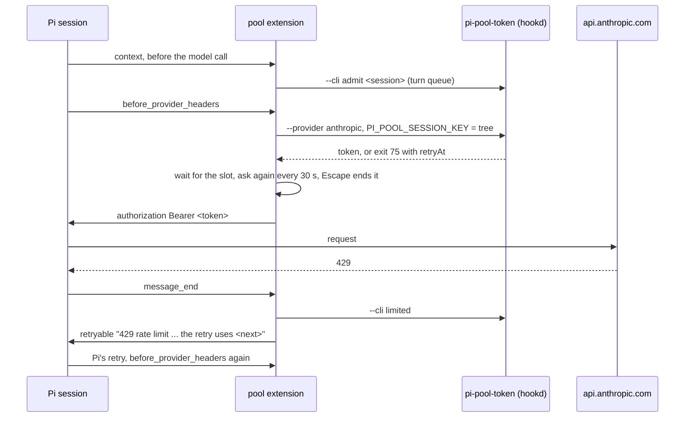

# pool

The `pi-pool` extension for upstream Pi, build step 5.
It gives every request on a pooled provider the account pi-pool picks for the session's tree, through pi-pool's own token hook called as a client.
Nothing under `components/pi-pool/` changes: the hook, hookd, the turn queue and the CLI verbs stay as they are.

## How a request gets its account



1. The extension keys each session's calls by its tree: `PI_POOL_SESSION_KEY` carries the root session id, which `rootOf` finds through the parent links pi-rlm assigns in `shared/registry.ts`, and the session's own id.
2. Every pool CLI verb already reads `PI_POOL_SESSION_KEY` (`pool/registry.py` `session_key`), so Prime's daemon variables are not needed and the extension drops any `PRIME_AGENT_INTERNAL_*` variable it inherits.
3. Anthropic vends in `before_provider_headers`, and the extension registers an `sk-ant-oat01` placeholder key so Pi takes its OAuth path.
4. openai-codex vends in a `streamSimple` wrapper, because Pi's codex provider writes `Authorization` and `chatgpt-account-id` from its own key after the caller's headers (`pi-ai` `openai-codex-responses.js:1302`).
5. A slot wait (the hook's exit 75 under `PRIME_CREDENTIAL_COMMAND_PROTOCOL=1`) waits inside that call with no time limit, which replaces Prime's credential wait and its park.
6. `message_end` turns a 429, an account-level 400 or 403, or a hook that gave no token into an error Pi's own retry accepts, and Pi's retry asks the hook again.
7. Pooled anthropic sessions get Prime's base preamble from `shared/preamble.ts` when nothing set `customPrompt`, because Anthropic answers Pi's default preamble on a subscription token with a 400.
8. The turn queue, `/account`, the account line in the footer, `adopt-logins` against Pi's own `auth.json`, and the release and `model --clear` on `session_shutdown` work as the Prime extension did.

## Limits on Pi 1.4.0

1. Pi keeps no status or response headers on a failed message, so the extension reads the status from the SDK's error text and marks a 429 for 5 minutes unless pi-ai's "Server requested <n>s retry delay" lead gives the reset.
2. Pi retries a turn 3 times by default (`retry.maxRetries`), so a tree that meets four limited accounts in a row ends its turn.
3. `ctx.hasPendingMessages()` ignores custom messages, so `release --queued-input` can miss a pending agent-message steer.

## Files

| Path | What it holds |
|---|---|
| `index.ts` | The extension: providers, hooks, turn queue and `/account`. |
| `src/pool-cli.ts` | Pool calls, the session key environment and the vend and slot-wait loop. |
| `src/errors.ts` | The `message_end` rewrite of 429, 400 and 403 failures. |
| `src/turns.ts` | The turn queue wait on `turns.json`. |
| `src/account.ts` | `/account` and the account line. |
| `check/` | The Q2 probe, the fake Anthropic server and the tmux rig that drives the real `pi` TUI. |
| `test/` | Unit and runtime tests, and `fake-pool.mjs`, a stand-in for `pi-pool-token`. |

## Use it

```sh
pi -e components/pi-stack/pool/index.ts --model anthropic/claude-opus-5-5
```

`PI_POOL_TOKEN_BIN` points the extension at another hook, and `PI_POOL_DIR` at another pool folder.

## Checks

```sh
cd components/pi-stack
node --import tsx --test --test-force-exit "pool/test/*.test.ts"
python3 -B pool/check/tui-hold.py --name hold --wait-sec 600 --scratch <dir> --out <dir>
python3 -B pool/check/tui-hold.py --name esc --wait-sec 3600 --escape-after 600 --scratch <dir> --out <dir>
```
