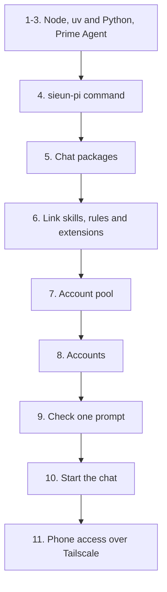

# Install sieun-pi

This guide has two starting points.

- [Path A](#path-a-prime-agent-is-already-installed): Prime Agent 0.9.8 is already installed. Start at step 4.
- [Path B](#path-b-from-scratch): a fresh Mac with nothing installed. Start at step 1.

Both paths were run word for word on macOS (Apple silicon) in an empty throwaway HOME.
Path B ran with `PATH=/usr/bin:/bin:/usr/sbin:/sbin`, so nothing came from Homebrew or an existing Node, Python or Prime Agent.
Linux notes come from the code and were not run on a Linux machine. See [Linux and remote boxes](#linux-and-remote-boxes).



## What you need

- macOS 13 or later. The Claude half of the pool, the login item and the Keychain steps need macOS.
- The Xcode command line tools for `git` and `/usr/bin/python3` (`xcode-select --install`).
- Node.js 22.8 or later with npm 10 or 11. npm 12 refuses Git URLs.
- Python 3.11 or later as `python3`.
- At least one Claude (Pro or Max) or ChatGPT (Plus or Pro) subscription for the pool.
- Optional: Aside or Chrome for the app window, and Tailscale for phone access.

## Path B: from scratch

### 1. Install Node.js 22

Use nvm so Node lives in your home folder. The installer from nodejs.org works too.

```sh
curl -o- https://raw.githubusercontent.com/nvm-sh/nvm/v0.40.3/install.sh | bash
export NVM_DIR="$HOME/.nvm"; . "$NVM_DIR/nvm.sh"
nvm install 22
node --version   # v22.x
```

### 2. Install uv and Python 3.12

```sh
curl -LsSf https://astral.sh/uv/install.sh | sh
. "$HOME/.local/bin/env"
uv python install 3.12 --default
python3 --version   # Python 3.12.x
```

The installers add `~/.local/bin` to your shell startup file. Open a new terminal before the next step, or run the `export` and `.` lines again.

### 3. Install Prime Agent 0.9.8

```sh
curl -fsSL https://app.primeintellect.ai/prime-agent/install.sh | sh -s -- 0.9.8
prime-agent --version   # 0.9.8
```

The installer downloads the release for your platform and checks its SHA-256.
It puts the app under `~/.local/share/prime-agent`, links `~/.local/bin/prime-agent` and prepares the Python kernel in `~/.prime/agent/kernel-venv`.

## Path A: Prime Agent is already installed

Check the host first. `prime-agent --version` must print `0.9.8`.
Then run the steps below. Path B continues here too.

### 4. Get the source and install the command

Clone the repository. The pool installs from a Git commit, so you need the clone in step 6 anyway.

```sh
git clone https://github.com/sieu-n/sieun-pi.git ~/src/sieun-pi
cd ~/src/sieun-pi
npm install --global --ignore-scripts "./$(npm pack --silent)"
sieun-pi source
```

`sieun-pi source` prints the installed package folder, for example `<npm prefix>/lib/node_modules/sieun-pi`.
The command installs a packed copy, so later edits in the clone do not change running sessions.

You can also install straight from the Git URL with npm 10 or 11:

```sh
npm install --global --ignore-scripts 'git+https://github.com/sieu-n/sieun-pi.git'
```

### 5. Link the skills, rules and extensions into Prime

```sh
sieun-pi plan --out "$HOME/sieun-pi-plan.json"
sieun-pi apply --plan "$HOME/sieun-pi-plan.json"
sieun-pi verify
```

`plan` prints the number of changes. Read the plan file before you apply it.
`apply` prints the receipt path. Keep it, because uninstall needs it.
`verify` prints `{"verified": N}`.

This links the sieun-pi skills, `AGENTS.md`, `pstack-models.json`, the global-rules extension and the chat extension under `~/.prime/agent`.
It writes `settings.json` only when you have none. An existing `settings.json` stays byte-for-byte unchanged.
A new `settings.json` comes from `config/settings.example.json` and names an `aside` MCP server. Remove that entry if you do not use Aside.

### 6. Install the account pool

```sh
/usr/bin/python3 -B ~/src/sieun-pi/components/pi-pool/install.py
```

It runs the pool's tests (about 200, 3 to 6 minutes) and copies the committed pool into `~/.local/share/pi-pool/releases/<id>`.
It links `~/.local/bin/pi-pool`, `~/.config/pi-pool/{vend.py,app,bin}` and the `/account` extension at `~/.prime/agent/extensions/pi-pool`.
The output ends with a `hooks` block. A provider with no account yet shows `"skipped": "no pooled account yet"`.
Run it from the clone. It reads the commit with `git`, so it fails from the npm folder.

### 7. Add accounts and point Prime at the pool

The pool keeps its own accounts in `~/.config/pi-pool/accounts`. Sign each one in.

```sh
export PATH="$HOME/.local/bin:$PATH"
pi-pool login                            # each Claude account
pi-pool login --provider openai-codex    # each ChatGPT account
pi-pool enable anthropic
pi-pool enable openai-codex
pi-pool                      # one card per account with usage bars
```

Each sign-in prints a link as JSON lines. Open it in a browser on the same machine and finish there, or paste the code the page shows. Codex prints a device code to enter on its page. Claude credentials go to the macOS Keychain, or to 0600 files on Linux.
You can also add accounts later in the chat under Settings > Accounts.

The two `enable` lines point the provider entries in `~/.prime/agent/models.json` at the pool's token hook.
Do not run `/login` inside Prime for these providers. A stored login outranks the pool until the next session start moves it into the pool's `fallback.json`. `pi-pool adopt-logins` does that at once.

### 8. Check that a prompt goes through the pool

```sh
mkdir -p ~/code/scratch && cd ~/code/scratch
prime-agent -p "Reply with one short sentence: what is 17 times 23?"
tail -n 3 ~/.config/pi-pool/pi-pool.log   # a "vend" line names the account that served it
```

The first call after an install starts the Prime daemon and its Python kernel. It can take a minute.
It can also stop with `Timed out after 30000ms waiting for the Prime Agent daemon response to "create"`. Run the same command again.

### 9. Start and open the chat

```sh
sieun-pi chat start    # login item com.sieun.agent-chat on macOS
sieun-pi chat status
sieun-pi open
```

`chat start` prints the private URL, `http://127.0.0.1:5182/<secret>/`. The secret grants access, so keep the URL private.
The main instance (`~/.prime/agent/browser-chat`) registers a login item, so it starts again after a crash or a reboot. It also starts the Prime daemon when the daemon is down.
`sieun-pi open` starts the chat if needed and opens it in the installed app window, else in the default browser.
`sieun-pi chat start --port 5190` uses another port. The port is saved, so later commands need no flag.
`sieun-pi chat serve` runs the chat in the foreground with no login item. `sieun-pi chat stop` stops it and leaves agents running.

### 10. Open the chat from your phone over Tailscale

1. Install Tailscale on the Mac and the phone, and sign both in to the same tailnet.
2. In the Tailscale admin console, turn on MagicDNS and HTTPS certificates.
3. Start the chat with `sieun-pi chat start`. The main instance adds itself to Tailscale Serve at `https://<mac>.<tailnet>.ts.net/<secret>/`.
4. Open Settings > Phone access on the Mac. It shows the link with a QR code and an on/off switch. `sieun-pi chat status` prints the link too.

Only devices signed in to your tailnet can reach it. Nothing is public. Do not use Tailscale Funnel or a public proxy for this URL.
The chat never changes a Serve handler that points somewhere else. Settings shows the command that frees it.
To use your own HTTPS proxy, start with `--public-origin https://host`. `--public-origin none` turns remote access off.

## Linux and remote boxes

These notes come from the code. They were not run on a Linux machine.

- Prime Agent publishes Linux builds for x64 and arm64, so step 3 is the same.
- The ChatGPT half of the pool reads files and works on Linux. The Claude half does not, because pi-pool reads Claude credentials only through the macOS Keychain (`/usr/bin/security`).
- `install.py` calls `/usr/bin/python3`. Install the distribution's `python3` package if it is missing.
- `sieun-pi chat start` loads a LaunchAgent, so it works only on macOS. On Linux, run `sieun-pi chat serve` under a systemd user unit or tmux.
- On a headless box, run `tailscale serve --bg --https=443 http://127.0.0.1:5182` yourself if the chat does not, then open `https://<host>.<tailnet>.ts.net/<secret>/`.
- The chat listens on `127.0.0.1` only. Reach it over Tailscale or an SSH tunnel, never by opening the port.

## Update

### Committed extension runtime on managed hosts

On a host whose checkout is under macOS `Documents`, install the extension runtime outside that protected folder. A background Prime worker can be denied access to checkout symlinks even when a terminal can read them.

```sh
node scripts/install-runtime.mjs --ref <committed-sha> --prepare-only
node scripts/install-runtime.mjs --ref <committed-sha> --home /path/to/isolated-home
node scripts/install-runtime.mjs --ref <committed-sha>
```

The first command prepares `~/.local/share/sieun-pi-runtime/releases/<sha>` without changing the active profile. It exports only the commit, runs `npm ci --omit=dev --ignore-scripts` against the root and user-history lockfiles, and checks that dependencies and links stay within the release. Build scratch trees live under `~/scratch` and are removed afterwards. The second command applies to an existing isolated HOME for verification; only the coordinator runs the final activation against the real HOME.

Activation uses the release's existing `manage.py` plan, apply and verify commands, retains their rollback receipt, then atomically switches `current`. Existing settings, credentials and session history remain untouched. The command never restarts Prime. A completed release is reused without rebuilding; passing an older explicit `--ref` rolls back by the same process.

Prime-sync uses `current` for manifest links and never relinks them into the source checkout. It installs `origin/main` as the runtime on its own when `main` changes `config/`, `skills/` or `install-manifest.json`, clones the active release's `node_modules` when the package files match, and deletes releases that no link, kernel pin, command line or older Prime session can still read (`components/prime-sync/README.md`). Each activation appends its commit and time to `~/.local/share/sieun-pi-runtime/history.jsonl`. Run the runtime installer yourself to release an extension-only change sooner. Its `.installing/owner.json` records the exclusive install lock; after an interrupted install, confirm that PID has exited before removing the stale `.installing` directory.

### Packed npm installation

Install each release into its own folder, so running sessions keep their source.

```sh
cd ~/src/sieun-pi && git pull && REF=$(git rev-parse --short HEAD)
PREFIX="$HOME/.local/share/sieun-pi/releases/$REF"
npm install --prefix "$PREFIX" --ignore-scripts "./$(npm pack --silent)"
NEW="$PREFIX/node_modules/.bin/sieun-pi"
"$NEW" plan --out "$HOME/sieun-pi-$REF-plan.json"
"$NEW" apply --plan "$HOME/sieun-pi-$REF-plan.json"
"$NEW" verify
/usr/bin/python3 -B ~/src/sieun-pi/components/pi-pool/install.py
```

Keep every release folder and receipt until you no longer need to roll back.
The pool keeps its 10 newest releases, and `install.py rollback` swaps back to the previous one.
Restart the chat on the new release with `sieun-pi chat stop` and `"$NEW" chat start`.
The pool's `/account` command and account line load from the current source in every new session, so nothing needs re-applying after a Prime Agent update.

## Uninstall

```sh
sieun-pi chat stop
"$NEW" rollback --receipt /path/to/update/receipt.json       # once per update, newest first
sieun-pi uninstall --receipt /path/to/first/receipt.json
npm uninstall --global sieun-pi
```

Use the CLI of the release that created each receipt.

If `uninstall` stops with `Destination or backup drift: ~/.prime/agent/settings.json`, Prime changed the settings file that the installer created.
Keep your copy, put the generated file back, uninstall, then restore your copy.

```sh
A="$HOME/.prime/agent"
mv "$A/settings.json" "$A/settings.json.keep"
python3 -c 'import json,sys; v=json.load(open(sys.argv[1])); open(sys.argv[2],"w").write(json.dumps(v,indent=2,sort_keys=True)+"\n")' \
  "$(sieun-pi source)/config/settings.example.json" "$A/settings.json"
chmod 600 "$A/settings.json"
sieun-pi uninstall --receipt /path/to/first/receipt.json
mv "$A/settings.json.keep" "$A/settings.json"
```

To remove the pool, delete its links and its entries in `models.json`. Its state and releases stay until you delete them.

```sh
rm ~/.prime/agent/extensions/pi-pool ~/.local/bin/pi-pool ~/.config/pi-pool/vend.py ~/.config/pi-pool/app ~/.config/pi-pool/bin
```

Then remove the `anthropic` and `openai-codex` entries whose `apiKey` names `pi-pool-token` from `~/.prime/agent/models.json`.
`install.py rollback` does not remove the pool once two releases exist. It swaps between them.

## What apply installs

- Each skill root and the auxiliary `skills/skills` directory go under `~/.prime/agent/skills`.
- `config/AGENTS.md` and `config/pstack-models.json` go under `~/.prime/agent`.
- One global entry links `~/.prime/agent/extensions/global-rules.ts` to `components/global-rules/index.ts`. It refuses history rewrites in the sieun-pi checkout and outside sends without the owner's ok.
- One global link points `~/.prime/agent/extensions/user-history` at the whole `components/user-history` package. Its `pi.extensions` declaration loads `./extension/index.ts`.
- The pool is not in the manifest. `components/pi-pool/install.py` owns its links. `~/.config/pi-pool` stays a real directory. See [the pool README](../components/pi-pool/README.md#install-update-and-roll-back).

Use a new plan filename each time. Omitting `--home` selects your HOME.
Plans cannot go under managed runtime directories. Inside a development checkout, use the ignored `.work/`.
The Node CLI calls `python3`. `SIEUN_PI_PYTHON` can select another Python 3.11+ executable.
The direct equivalent is `python3 -B scripts/manage.py <command>` from the source tree.
Credentials, `auth.json`, `models.json`, sessions, memories, account stores and unrelated files are outside installer ownership.
Do not also register this package through Prime's package settings. The `pi.extensions` and `pi.skills` metadata support resource discovery only.

The root runtime dependencies include `marked` and the official Prime Agent SDK tarball from its versioned R2 URL, because the npm registry has no `prime-agent` release.
The matching checksums are at [SHA256SUMS](https://pub-728493de92a943e2a9b2d17b4719f318.r2.dev/releases/v0.9.8/SHA256SUMS).
`node scripts/sync-prime-agent.mjs` moves the SDK to the installed Prime Agent version, and the chat service runs it when the daemon updates.
The pinned SDK has two high-severity npm audit entries through `extract-zip`, with no fix in that release. Do not use it to extract untrusted archives.

## Migrate old links

The installer removes two targets left by the retired `virev` extension, with receipt-backed backups.

```text
~/.prime/agent/extensions/virev.ts
~/.prime/agent/virev-projects.json
```

Rollback restores both. A repository that needs its own guard ships it as a project-local extension under `<repo>/.prime/agent/extensions/`, which Prime discovers from the session cwd.

The installer also removes the known legacy `~/.prime/agent/extensions/what-did-i-say` symlink only when its stored target
is the absolute path `<selected-home>/code/prime-agent-user-history`. It backs up the symlink without altering that source checkout.
A different target, including another directory named `prime-agent-user-history`, or a non-symlink fails for review.
Any other extension file or settings entry whose name contains `global-rules` or `virev` also fails for review.
The installer does not guess how to remove unknown package registrations or rewrite unrelated settings.
Do not install duplicate resources through Prime package settings and source links at the same time.

## Prove an isolated profile

Run step 4 first. Keep the profile outside the source tree and outside any folder with its own `.agents/skills`. Use an empty directory as the session cwd.

```sh
PROFILE="$(mktemp -d)"
mkdir -p "$PROFILE/home" "$PROFILE/work"
sieun-pi plan --home "$PROFILE/home" --out "$PROFILE/plan.json"
sieun-pi apply --plan "$PROFILE/plan.json"
sieun-pi verify --home "$PROFILE/home"
sieun-pi apply --plan "$PROFILE/plan.json"
/usr/bin/python3 -B ~/src/sieun-pi/components/pi-pool/install.py --home "$PROFILE/home"
node "$(sieun-pi source)/scripts/prove_runtime.mjs" --home "$PROFILE/home" --cwd "$PROFILE/work"
```

The proof uses the installed package's locked Prime SDK. It checks every custom skill, the pool, global-rules and chat extension entry points,
all three command registrations and the history flag. It reloads twice. It exercises the global-rules send guard from two working directories.
It runs no model, account or MCP calls and opens no browser.

From a development checkout, `npm run test:package` packs and installs with production dependencies into two isolated prefixes.
It checks repeat apply, native loading, a release-to-release source-link update, rollback and uninstall.
`npm run prove:runtime -- --home ... --cwd ...` runs the loader proof against an already installed test profile.
These checks do not prove live OAuth, a running daemon chat, Aside availability, or upstream Pi compatibility.

## Resume, roll back and uninstall

Plans fingerprint sources and destinations. Apply rejects changed source, target, manifest or unsafe symlink parents.
Do not edit source while apply or rollback runs. Receipts and source backups stay under
`<home>/.local/state/sieun-pi/receipts/<plan-id>/` with private permissions.

```text
plan -> verify fingerprints -> record receipt -> move old target to backup -> publish new target
                                                   |
                                                   +-> interruption -> apply the same plan again

new release -> rollback its receipt -> old source links -> uninstall initial receipt -> original targets
```

If apply stops, run the same `apply --plan` command again. It verifies the journal and resumes.
Do not create a new plan to conceal an interrupted replacement.

```sh
/path/to/new-release/sieun-pi rollback --receipt /absolute/path/to/update-receipt/receipt.json
/path/to/initial-release/sieun-pi uninstall --receipt /absolute/path/to/initial-receipt/receipt.json
```

Use the CLI path for the release that created each receipt. Roll back later updates first, in reverse order.
`uninstall` is rollback of the initial installation. It restores any pre-existing targets instead of deleting them.
Only after source links have been restored should you remove the package, for example `npm uninstall --global sieun-pi`.
Keep backups until you have verified the restored setup. Do not delete a source prefix while a live link still targets it.

Rollback refuses changed installed targets or backups before restoring anything. Restore an interrupted rollback with the same command.
Unchanged pre-existing settings are outside rollback ownership, so later Prime settings edits stay intact.
If Prime changed a settings file that this installer created, rollback stops rather than deleting those changes.
Review and preserve that new data before retrying. Receipts do not undo edits inside source files.

Backups use filesystem renames. Replaced project source and HOME receipts must share a filesystem.
A cross-device replacement fails rather than copying an unreviewed directory. Keep receipts in their original paths.
Use the creating release's manifest and installer for rollback; do not edit its target ownership.
Protected runtime names inside an old source directory block migration. Move that state separately after reviewing its owner.

## Develop and check

Use a Git checkout for development. Full checks also need uv, Bun and Node.js 22.13 or later.

```sh
git clone https://github.com/sieu-n/sieun-pi.git
cd sieun-pi
npm run develop
npm run check
npm run build:all
npm run test:package
```

`develop` runs root `npm ci --ignore-scripts`, `uv sync --locked`, the frozen Bun skill install and the chat's `npm ci`.
`check` runs skill checks, root and pool Python tests, global-rules Node tests, the chat tests, TypeScript checks and source syntax checks. It does not install missing dependencies.
`build:all` runs those checks, builds the Python skill wheels and writes the source npm tarball to `dist/`.
The script is not named `build`, because npm prepares a Git dependency that has a `build` script even with `--ignore-scripts`, and that breaks the Git URL install.
Prime's kernel installs linked Python skills into its own environment. The root `.venv` is only for development.
