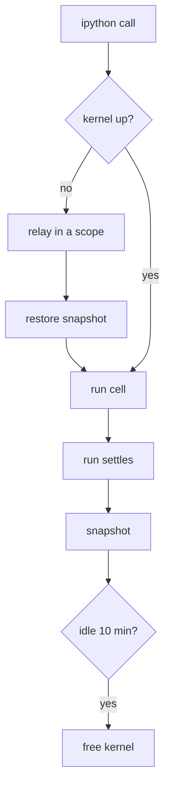

# Prime and pi prompt parity

A pi thread now gets the system prompt of a Prime browser chat, built by Prime's own code from the same files.
Before this change a pi thread's whole system prompt was Prime's three-line preamble (268 bytes) and its tool list.
A Prime chat's system prompt is about 51 KB, and Prime sends about 75 KB more as messages: the repo's `.claude/rules`, the harness digest and the corrections block.

On 2026-10-28 the builder reproduced the system prompt of 7 of the 11 Prime chat roots on us-metal02 byte for byte, including one on `openai-codex/gpt-6-astra` and five whose pinned brief is older than today's.
The other 4 captures are from chats that last loaded the global AGENTS.md before its rule 5 was rewritten (captured from 10-27 13:12 to 10-28 15:45 UTC), and each first differs at that rule, because Prime keeps the AGENTS.md a session loaded until it reloads.

## How each prompt is captured

```sh
node scripts/prompt-parity.mjs --out /tmp/parity                    # newest Prime chat capture, newest pi thread
node scripts/prompt-parity.mjs --out /tmp/parity --session <id> --thread <id> --tools pi
```

The script only reads. It writes `prime/`, `builder/`, `pi-live/`, `summary.json` and `summary.md` under `--out`.

| Side | What it reads | How exact |
|---|---|---|
| Prime | `<agent dir>/browser-chat/prompts/<session>.json`, which the legacy chat's user-history extension writes from `before_provider_request` on every request (`legacy/prime/user-history/src/prompt-capture.ts`). By default the newest capture of a chat listed in `browser-chat/chats.json`. | The payload as sent on the wire, after every extension. No Prime process is started. |
| Builder | `packages/pi-host/src/durable/prime-prompt.ts` for the capture's cwd, session file and pinned brief (the session's last `chat_brief` entry since its last compaction), and the capture's Prime release for bundled skills when it is still on disk | The text a pi thread gets for the same inputs |
| Harness | The chat's newest `harness_digest` message in its session file, against what `packages/pi-host/src/durable/prime-harness.ts` sends for the same global and local stores and the same messages, read the way an imported thread holds them | Byte for byte, when the stores still have the state fingerprint that message recorded; it writes `harness.json` and `harness/*.txt` |
| pi today | The newest thread under `<agent dir>/pi-host/durable/threads/`, opened with `?mode=ro`; its root conversation's `pi.system` entries replayed | The sections and tools that thread's file holds now |

A Prime session file does not store the system prompt, so the capture is the only exact record of it.
The capture holds the identity block `You are Claude Code, Anthropic's official CLI for Claude.` first; pi-ai's Anthropic provider sends the same block for a subscription token.

## Section by section

Bytes are from Prime chat `01a1180e` (VP of CI) at 18:05 UTC on 2026-10-28, cwd `auto-sns-agent`.

| # | Section | Source in Prime | Prime sends it as | Bytes | pi before | pi now |
|---|---|---|---|---|---|---|
| 1 | `preamble` | prime-agent `buildRlmPrompt` (`core/prompts/rlm.js`): base prompt, nonblocking work, progress updates, simplified English, working directory, conversation log, depth, Python skill modules, `rlm` and REPL rules | system prompt | 11,139 | different: its first 3 lines only (268 bytes) | identical |
| 2 | `delegation` | `buildSubagentGuidance` | system prompt | 1,317 | no | identical |
| 3 | `mcp` | `formatGenericMcpGuidance`, `settings.json` `mcpServers` | system prompt | 382 | no | identical |
| 4 | `guidance` | "# Additional Guidance": the `chat_board` tool's promptGuidelines (`CHAT_BRIEF` in `legacy/prime/user-history/src/chat-brief.ts`) and the `poteto_mode` line (`personaGuideline`); for a job, `jobReplyGuideline` and the poteto line | system prompt | 14,711 | no | identical |
| 5 | `context` | "# Project Context": `~/.prime/agent/AGENTS.md` (from `config/AGENTS.md`), then AGENTS.md or CLAUDE.md of the cwd and each folder above it (Prime's `loadProjectContextFiles`) | system prompt | 13,298 | no | identical |
| 6 | `skills` | `formatSkillsForPrompt` over Prime's loaded skills: `~/.prime/agent/skills/*` (from `skills/`) and the release's bundled skills, filtered by `settings.json` | system prompt | 10,388 | no | identical |
| 7 | `rules` | claude-rules (`packages/pi-claude-rules`): the cwd repo's unscoped `.claude/rules/*.md` | first user message of every request | 52,028 | no | identical text, in the system prompt |
| 8 | `harness` | Prime's harness digest (`formatHarnessStateForPrompt` of the running release) over `~/.prime/agent/harness` merged with the session's local store | `[harness-digest]` message before a turn's input, then `[harness-digest update]` messages | 10,616 (pi before: 9,898, global only) | no | identical bytes, as a message before the turn's input, see [Harness digest](#harness-digest) |
| 9 | `corrections` | `ledgerPrompt` over `browser-chat/corrections.json` (`chat-corrections.ts`), or `jobLedgerPrompt` for a job | `[corrections]` user message, once per context | 21,750 (Prime: 21,418) | no | same rules; pi lists the 1 correction added since that chat's snapshot |

Sections 1 to 6 joined with a blank line are the exact string Prime's `buildSystemPrompt` returns.
Sections 7 and 9 follow them in the system prompt, because pi-durable can add text only as sections or as hooks that are not stored.
Section 8 goes where Prime puts it, as the next section explains.

## Harness digest

A thread's root conversation gets Prime's harness digest with the same bytes and in the same place as a Prime chat, for the same entries.
On 2026-10-28 from 19:20 to 19:25 UTC, `scripts/prompt-parity.mjs` compared the newest digest message of each of the 11 Prime chat roots on us-metal02 with what pi-host sends for the same stores and messages.
In the 7 chats whose stores still had the state fingerprint of that message, the full digest and the message were both byte-identical; the other 4 chats were idle and their stores had changed since.

| Chat | Local entries | Prime's full digest | pi before | pi now | Prime's message (an update) | pi now |
|---|---|---|---|---|---|---|
| `01a1164b` | 110 | 10,616 | 9,898, 24 lines differ | 10,616, identical | 2,495 | 2,495, identical |
| `01a1180e` (VP of CI) | 467 | 11,112 | 9,898, 22 lines differ | 11,112, identical | 2,267 | 2,267, identical |
| `01a115e2` | 648 | 10,377 | 9,898, 24 lines differ | 10,377, identical | 733 | 733, identical |
| `01a11af8` | 468 | 10,448 | | 10,448, identical | 733 | 733, identical |
| `01a11bd7` | 92 | 10,408 | | 10,408, identical | 732 | 732, identical |
| `01a14d31` | 6 | 9,915 | | 9,915, identical | 732 | 732, identical |
| `01a162bc` | 2 | 9,332 | | 9,332, identical | 732 | 732, identical |

"pi before" is the old `harness` section for the same global store: the published prime-agent 0.9.8 formatter over the global store only.
The 21,986 bytes a capture of `01a1164b` shows for its digest are its first message, which is the compaction summary with the digest snapshot (10,208 bytes) in front of it.

What pi-host does, and where it comes from:

| Part | Prime | pi now |
|---|---|---|
| Formatter, ranking, update and fingerprint | `refinement.ts` of the running release: Okapi BM25 ranking with stemming and stopwords (`scoreHarnessEntries`), `formatHarnessStateForPrompt`, `formatHarnessDigestDelta`, `harnessDigestFingerprint` | the same code, copied verbatim into `packages/pi-host/src/durable/vendor/prime-harness.ts` by `scripts/vendor-prime-harness.mjs` from the commit `build: version <release>` in Prime's source; the published 0.9.8 package ranks with an older scorer and gives other bytes |
| Global store | `~/.prime/agent/harness/harness_state.json` | the same file |
| Local store | `session-artifacts/<session>/harness/harness_state.json` next to the sessions folder | `~/.prime/agent/pi-host/durable/session-artifacts/<thread>/harness/harness_state.json`, by Prime's rule next to the threads folder (`threadHarnessDir`); a child conversation's is `<thread>-<conversation>`. The kernel's `rlm.harness` and `refine.run()` write it once `RLM_HARNESS_STATE_DIR` points there |
| When | at each turn it starts, and at a cold boundary such as a resume | at each input submitted to the root conversation, unless it steers a running turn |
| What | the full digest when the context has none, nothing when the newest digest has the state's fingerprint, else `[harness-digest update]` with the lines that changed | the same function (`nextDelivery`, Prime's `_nextHarnessDigestMessage`) |
| Ranked by | the turn's input at weight 4, the goal at 3, the last four messages at 2, 1.5, 1 and 1 | the same; a thread has no goal |
| Where | a custom message before the turn's input; it stays there, so the cached prefix holds | a user message before the input, with no timestamp so the turn wrappers leave it alone as they leave Prime's custom message; stored in the conversation's `prime.harness-digests` document with the entry it follows, and put into each request by `prime-prompt`'s `beforeRequest` hook |
| After a compaction | the summary carries a snapshot of the digest, and digest messages from before it are dropped | deliveries from before the compaction are dropped, and the next input gets the full digest |

The digest is a document, not an entry, because an entry with a user message shows in apps/chat and its search as a message the owner sent.
On us-metal02 an input whose stores did not change costs about 46 ms (the fingerprint of 1,334 entries); one that needs a digest costs about 0.6 s more to rank them for a long input, in pi-host's one process, as it does in a Prime worker.
A thread from before this change drops its pinned `harness` section at its next request (one `pi.system` update after the history) and gets the full digest before its next input.

Three differences remain:

1. Prime also appends an update at a cold boundary, such as a session load after an idle unload; pi sends the same lines before the next input, so one pi update can hold what Prime sent as two.
2. A subagent's child conversation still gets the digest as the pinned `harness` section, built from the global store and its own local store with no ranking, because the subagent tool cannot record a delivery yet. A Prime job ranks its first digest by its task.
3. `packages/pi-harness/src/core/digest.ts`, which Pi sessions in pi-host's non-durable host use, is a rewrite of an older release and ranks with the old scorer.

## Tools

A thread's root conversation now runs Prime's own chat extension, `legacy/prime/user-history/extension/index.ts`, through an adapter (`packages/pi-host/src/durable/pi-extensions.ts` and `prime-chat.ts`).
pi-host loads the extension once at start as a Prime chat (flags `chat` and `owner-thread`) and fires its `session_start`, so it registers what a Prime chat's session gets.
Each registered tool becomes a pi-durable tool with the extension's own name, description and parameters, in the order a Prime chat's request lists them.

On 2026-10-28 at 18:35 UTC `scripts/prompt-parity.mjs` compared every tool of Prime chat `01a11af8`'s captured request with what pi-host offers, as pi-ai's Anthropic provider sends it (name, description, `input_schema`):

| Prime tool or module | Where Prime has it | pi equivalent | Status |
|---|---|---|---|
| `search_history` | user-history tool | the same tool, the extension's own execute (pi-history's socket) | identical definition (484 bytes); replay-safe |
| `chat_board` | user-history tool | the same tool on apps/chat's board, check-in and agents API for the thread | identical definition (182 bytes); output in Prime's words |
| `tell_owner` | user-history tool | the same tool with Prime's live guard | identical definition (3,445 bytes); replay-safe |
| `correction_add` | user-history tool | the same tool, the extension's own execute, on the shared ledger | identical definition (160 bytes) |
| `poteto_mode` | user-history tool that carries a guideline | the same tool | identical definition (38 bytes) |
| `job_reply` | user-history tool of a chat's job | none; a child conversation gets its guideline in `guidance` | missing tool, text identical |
| `ipython`, the persistent Python REPL | pi-rlm tool | the same tool on pi-rlm's kernel, one kernel per conversation (`rlm.ts`) | identical definition (444 bytes, checked 2026-10-29 against chat `01a1180e`); not replay-safe, so a restart gives `interrupted` |
| `bash()` handles and the nonblocking control loop | REPL | the same `bash()` in the kernel; a handle that ends after its cell sends `[bash-done pid:<pid> exit:<code>]` as an input, held while a run goes | equivalent, without goal continuations |
| `rlm.spawn`, `list_subagents`, `collect`, `progress_note`, `delete_subagent`, `find_models` | REPL | child conversations in the thread file, each started by a background `rlm.deliver` task (`children.ts`) | equivalent: `rlm.spawn` returns at admission with Prime's handle, and the child's notice or reply is a later input |
| `rlm.create_session` | REPL | a new durable thread with the prompt as its first input | equivalent |
| `rlm.harness.*`, `refine.run()` | REPL, `refine` skill | none; pi reads the global store and the thread's local store (`threadHarnessDir`) but writes neither, and the kernel answers that `refine.*` does not run in durable threads yet | missing |
| `agent_message.send` | Python skill | pi-rlm's skill; the kernel's request lands as an `agent.message` input of the parent, a sibling (another child of the same parent, or another thread's root) or a child | equivalent, with Prime's reach rule and headers |
| `agent_observe` | Python skill | pi-rlm's skill over the thread's conversations and the other threads' roots | equivalent; `tool_use_count` and `activity` are null |
| `board` (`board.wake`, `board.corrections`, `board.own`) | Python skill | the same module: a kernel with `PI_HOST_THREAD` reads the thread's board from apps/chat and sets run, time and check wakes through `POST /api/threads/<thread>/wakes` | none |
| `edit` | Python skill | pi-rlm's copy in the kernel, and the `edit` tool | equivalent |
| `attach_image` | Python skill | on the kernel's path but not installed, because it needs Prime's `prime-agent-runtime` package, so the kernel lists it under `[python-skills-unavailable]`; `read` returns an image file as an image | different |
| `goal`, `compact`, `rlm_heartbeat` | Python skills | `compact.run` asks pi-durable to compact; `goal.*` and `rlm_heartbeat.*` answer that they do not run in durable threads yet | missing except `compact` |
| `websearch`, `aside_browser`, the `mcp` object for `aside` | Python skills and REPL | the agent dir's `websearch` and `aside_browser` load in the kernel, and `mcp` is the vendored runtime's | equivalent as far as their own code goes |
| markdown skills (`unslop`, `how`, `why`, `spec-report`, `setup-pstack`, `typescript-best-practices`, `resume-paused-sessions`, `skill-creator`, `mcp`) | read with ipython | read with ipython or `read` at the same `<location>` | equivalent |
| none | | `read`, `write`, `edit`, `bash`, `subagent`, `send_message` | pi only |

The tool list a pi chat thread offers is `read, write, edit, bash, subagent, send_message, search_history, chat_board, tell_owner, correction_add, poteto_mode, ipython`; a Prime chat's is `ipython, search_history, chat_board, tell_owner, correction_add, poteto_mode`.
A child conversation, from `rlm.spawn` or the `subagent` tool, offers `read, write, edit, bash, ipython` and none of the chat's tools, as a Prime job has no `tell_owner`.

### How each chat tool runs in a thread

| Tool | Runs | Store | Replay after a restart |
|---|---|---|---|
| `search_history` | the extension's execute, with the thread id as the caller | pi-history's socket, as in Prime | safe: it only reads |
| `chat_board` | Prime's `parseBoardOps`, its c43, c72 lane-hold and hold-ask flags, `chatCheckIn`, `checkInLine`, `renderOpenPlan`, `boardRevLine` and `agentLines` | apps/chat (`PI_HOST_CHAT_URL`, default `http://127.0.0.1:5184`): `POST /api/threads/<thread>/board {ops, actor: "agent"}`, which now answers each op's summary, `GET .../board`, `GET`/`POST .../check-in`, `GET .../agents`; a read falls back to the thread's `chat.board` document when the chat server does not answer. Never the legacy `browser-chat/boards`. | unsafe: a rerun would apply the ops twice, so an interrupted call gets pi-durable's `interrupted` result |
| `tell_owner` | Prime's live guard (`liveGuard`: `tellTurn`, `tellOwner`, `askedTodos`, the same file a Prime chat loads), over the thread's messages up to the call | the board's asked todos from apps/chat, and on a decision or blocker the other chats' open asks from apps/chat's For you list | safe: nothing leaves the thread; the message is the call's `text` |
| `correction_add` | the extension's execute | the ledger Prime chats share: `AGENT_CHAT_SHARED_DIR` (pi-host's unit sets it to `~/.prime/agent/browser-chat`), or the chat host's corrections route when hosts.json names another box | unsafe: a rerun could record it twice |
| `poteto_mode` | the extension's execute | none | safe |

A throw from any of them is an error result whose text is the error's message, as pi's agent loop sends it, without pi-durable's `<harness>` wrapper.

Three differences remain in what these tools do:

1. apps/chat keeps no `pausedBy`, so every check-in pause reads as the owner's, which Prime's rule lets no agent lift. A chat that paused its own check-in cannot resume it until apps/chat records who paused.
2. The c43 limit-claim flag leaves out the job names of this board's steps; Prime leaves out the job names of every legacy board (`jobNames`).
3. `correction_add`'s answer says the service refines the global harness when the turn ends (`AUTO_REFINE`); the legacy chat service does that for its own chats only, so nothing refines after a thread's turn yet.

### `tell_owner` and `send_message`

`tell_owner` is the tool the brief names and the one a thread speaks to the owner through, with Prime's guard: a turn the owner did not start needs `why` and `about`, an `update` there is kept as a note, and the reply lints run.
apps/chat draws a `tell_owner` call exactly as a `send_message` call (one constant, `SPEAKING_TOOLS` in `apps/chat/server/timeline.ts`, used by the timeline, the live page, channels, duty reports and search), and draws a held call as a note in the fold, as Prime's feed does.

`send_message` stays beside it as an alias, with the same result and a description that points to `tell_owner` (`SendMessageAlias`).
Dropping it now would break two things apps/chat still asks for by name: a channel post's reply (`channels.ts` tells the agent "what you send with send_message is posted back into this thread") and a duty job's report (`duty-run.ts` "Send it with send_message"), and Prime's guard would hold both, since neither turn is the owner's.
Remove the alias once those two texts name `tell_owner` and the guard knows a channel turn.
A host without the chat extension (`PI_HOST_PRIME_CHAT=0`, or a failed load, which pi-host logs) offers the old `send_message` with its old description.

### Turn wrappers

The extension's context hook runs as a pi-durable `beforeRequest` hook of the root conversation, with Prime's own `withMessageIds` and `withWakeNotes`, in that order.
The hook reads the conversation's entries to tell who sent each input: a `pi.user` entry and an `agent.message` from `owner` are the owner's and get `[message id: <id>; reply_to it only after he sends a newer message]`; any other `agent.message` (a check-in, a wake, a duty report, another agent, a channel post by an agent) is Prime's `agent_message` and gets the `[not from the owner: ...]` note.
The notes go only into the request; the entries keep the raw text, and each note depends only on its message, so the cached prefix holds.

| Wrapper | Source | pi now |
|---|---|---|
| `[message id: ...]` | `withMessageIds` (chat-guard.ts) | identical, on each owner input |
| `[not from the owner: ...]` | `withWakeNotes` (chat-guard.ts) | identical, on each input from anyone else |
| `[corrections]` | `deliverCorrections` (correction-delivery.ts) | not added again: `prime-prompt.ts` sends the same `ledgerPrompt` text as the pinned `corrections` section |
| `[correction check]` | the legacy chat server (`chats.ts` `correctionStep`), not the extension | missing; apps/chat would have to send it |

### What a running thread sees at the first request after the release

1. A `pi.system` update that adds the five chat tools and replaces `send_message`'s description. pi-durable sends it after the history, so the cached prefix stays on a model that takes system messages mid-conversation.
2. Every earlier owner input in the history now carries its `[message id]` note and every earlier input from anyone else its `[not from the owner]` note in the request, so that first request writes the whole history to the cache once; later requests keep it.
3. A child conversation a subagent call made before this release stored only `remove: ["subagent", "send-message"]`, so if it runs again it is offered the chat's tools too (without the wrappers, which run only in the root). A child made from now on drops `prime-chat` as well.

### What the adapter skips, and why

| Part of the extension | Reason |
|---|---|
| The first context hook: notice rewording for cancelled and parked rlm children, the image fitter | A thread has no rlm child notices; pi-durable's `read` fits images. |
| `before_provider_request`: the prompt capture and a child's parent label | pi-host has no Prompt view for threads; a durable child's label is in its `preamble`. |
| `tool_call`, `tool_result`: ipython code rewrites, the job registry, load-wait notes, the moved-session block | They act on `ipython` and Prime's job registry, which a thread lacks. |
| `before_agent_start`, `session_compact` | They find a job's chat in Prime session files and re-pin the brief; the brief pin is the `guidance` section's. |
| `job_reply` | Registered only for a session whose parent is a Prime chat session file. |
| `registerCommand` (`what-did-i-say`, `agent-chat`), `registerFlag`, `appendEntry` | They open the legacy chat or write Prime session entries; the adapter records them (`skipped`, `appended`). |

### `ipython`, the RLM kernel and the family

Every conversation of a thread offers Prime's `ipython`, with the definition pi-rlm's extension registers (`packages/pi-rlm/src/pi/index.ts`), loaded through the adapter by `packages/pi-host/src/durable/rlm.ts`.
The cell runs on pi-rlm's own kernel code: `Kernel` and `kernel_relay.py` under a `systemd-run --user --scope` unit (`pi-rlm-kernel-*.scope`), the bootstrap cell, and the Python skills the prompt lists, with pi-rlm's copies of `goal`, `compact`, `edit`, `agent_message` and `agent_observe`.
The result text is pi-rlm's (`formatCell`, `<ipython_kernel_reset>`, `[python-state-restored]`, `[python-skills-unavailable]`).
The kernels use their own venv, `<agent dir>/pi-host/durable/rlm/kernel-venv`, so the skill set of durable kernels and of pi-host's other sessions never rebuild each other's venv.



1. A conversation gets its kernel at its first `ipython` call, and keeps it across turns while pi-host runs.
2. After each settled run, pi-host writes pi-rlm's snapshot (`kernel-state.dill`) in the conversation's folder, `<durable dir>/session-artifacts/<thread>-<conversation>`.
3. A kernel with no cell, no run and no live `bash()` handle for the threads' idle close time (10 minutes) is freed, and a thread file that closes frees its kernels (owner rule c92). pi-host's stop frees every kernel.
4. The next call after any of these starts a fresh kernel, revives what the snapshot holds, and puts pi-rlm's reset note and the revived names before the cell's output.
5. A kill of pi-host leaves the relay running with no client. The next pi-host kills it before it starts that conversation's kernel, and an orphaned relay ends itself after the idle close time (`PI_RLM_RELAY_TTL_S`). The cell the kill cut off gets pi-durable's `interrupted`, because a cell cannot be replay-safe.

The kernel's host requests are answered from the thread file:

| Request | What answers it |
|---|---|
| `rlm.run` (`rlm.spawn`) | One commit makes a background `rlm.deliver` task in the parent conversation and a child conversation that task owns, with the parent's model or `model=`, its `thinking=`, and no `subagent`, `send_message` or chat tools. It returns Prime's handle at admission: `rlm_child_id`, `name`, `session_dir` and `model`. |
| the child's end | The task gives the child `[task from parent]` and waits for that run. When the child did not reply with `agent_message.send(receiver_role="parent")`, the parent gets pi-rlm's `[child-exited: no-reply child:<name>]` with the child's last text, or `[child-failed child:<name>]`, as an `agent.message` input from `<thread>:<conversation>`. |
| `rlm.list_subagents`, `rlm.collect`, `rlm.delete_subagent`, `rlm.progress.note`, `rlm.find_models` | The parent's children, kept as an `rlm.child` document on each child conversation. |
| `rlm.create_session` | A new thread, with the prompt as its first input. |
| `agent_message.send` | An `agent.message` input with Prime's header, `[agent-message from <relationship>:<name>]`. A message to a child runs the same task, so its run's end notifies the parent as Prime's `owesNotice` does. |
| `agent_observe.list`, `get`, `recent` | The thread's agents and the other threads' roots, with Prime's reach rule (pi-rlm `bus/family.ts`). |
| `bash.completed` | `[bash-done pid:<pid> exit:<code>]` as an input, held until a running cell or run ends, and dropped when a live cell read the handle first. |
| `compact.run`, `model.info` | pi-durable's compaction, the conversation's model. |
| `goal.*`, `refine.*`, `heartbeat.*` and anything else | An error that says the request does not run in durable threads yet. |

The `subagent` tool now starts its child the same way and returns at once with `Started the subagent...`; the child's whole answer arrives later as `[subagent-answer child:<first line of the task>]`.
The parent's run ends meanwhile, so an owner message or a steer sent while a child works starts or joins the parent's next run instead of waiting behind the child, as AI harness VP measured on 2026-10-29 (a steer queued 45 minutes behind a foreground subagent call).
A subagent call made before this change owns its child and still waits for it when it reruns, so its answer lands once.

The board skill reads the thread's board from apps/chat when its kernel has `PI_HOST_THREAD`, and `board.wake(...)` posts a run, time or check wake to apps/chat's `POST /api/threads/<thread>/wakes`. apps/chat ticks them with the legacy chat's own ticker (`legacy/prime/user-history/src/wakes.ts`, imported by `apps/chat/server/wakes.ts`) and delivers each as the same `[wake] ...` text.
A run or check wake fails with a message that names the gap, because only the legacy chat on :5182 delivers those, and it delivers them to Prime sessions.

### Harness memories

The digest and its updates are Prime's, from the global store and the thread's local store (see [Harness digest](#harness-digest)).
Nothing writes a thread's local store yet: pi-harness (`packages/pi-harness/src/pi/index.ts`) refines a Pi session's store after its runs (`agent_settled`, kernel `refine.run`), which a thread cannot drive, and the kernel's `rlm.harness` needs `RLM_HARNESS_STATE_DIR` set to `threadHarnessDir(<thread file>, <thread id>)`.

## What pi-host does now

| File | Change |
|---|---|
| `packages/pi-host/src/durable/pi-extensions.ts` | The adapter: loads a pi coding-agent extension with a recording `ExtensionAPI`, keeps its tools, handlers and flags, fires its events with a pi context that answers with the thread's ids, name, file and cwd, and turns each tool into a pi-durable tool with its own definition and a replay policy. |
| `packages/pi-host/src/durable/prime-prompt.ts` | The builder and the `prime-prompt` extension. It calls prime-agent's `buildSystemPrompt`, `DefaultResourceLoader` and `formatSkillsForPrompt` from the installed `prime-agent` package, and imports `CHAT_BRIEF`, `personaGuideline`, `jobReplyGuideline`, `ledgerPrompt` and `jobLedgerPrompt` from the legacy chat and `SessionRules` from pi-claude-rules. No Prime text is retyped. Its `beforeRequest` hook puts the harness digests in, and `deliverHarnessDigest` records the one an input gets. |
| `packages/pi-host/src/durable/prime-harness.ts`, `vendor/prime-harness.ts` | The digest's stores, delivery and placement, and Prime's harness code copied verbatim from the running release's source by `scripts/vendor-prime-harness.mjs`, which `--check` compares again. |
| `packages/pi-host/src/durable/prime-chat.ts`, `chat-app.ts` | The user-history extension as a thread's `prime-chat` extension: its tools with their bindings, the turn wrappers hook, and the apps/chat client. |
| `packages/pi-host/src/durable/registry.ts` | `threadRegistry(prompt?, chat?, extras?)` installs `prime-prompt` in place of the 3-line `Preamble` when it gets prompt options, `prime-chat` with the `send_message` alias when it gets the chat, the `rlm.deliver` task, and `ipython` when it gets the RLM extension. |
| `packages/pi-host/src/durable/rlm.ts`, `children.ts`, `subagent.ts` | `ipython` on pi-rlm's kernel, one per conversation, and the family it answers for; the `rlm.child` document and the `rlm.deliver` task; the `subagent` tool that returns at once. pi-rlm exports the result texts and helpers they use (`formatCell`, `KERNEL_RESET`, `baseEnv`, `label` and others). |
| `packages/pi-host/src/durable/threads.ts` | `DurableThreadsOptions.prompt`; each thread file gets its own registry, so "Conversation log:" names its file and a child names its chat. `submit` records the harness digest of a root input before it admits it, one thread at a time. |
| `packages/pi-host/src/main.ts` | Passes `prompt: {agentDir}` from `--agent-dir`. `PI_HOST_PROMPT_TOOLS=pi` switches the tools profile. Loads the chat extension and the durable `ipython` at start; `PI_HOST_PRIME_CHAT=0` and `PI_HOST_RLM=0` leave them out. |
| `apps/chat/server/timeline.ts`, `threads.ts`, `search-snippet.ts`, `boards.ts`, `http.ts` | `SPEAKING_TOOLS`: a `tell_owner` call is drawn, previewed, posted and searched as a `send_message` call; a held one is a note. The agent's board write answers its summaries. An `ipython` cell's `details.conversations` gives a job pill per spawned child, and `POST /api/threads/<thread>/wakes` arms a run, time or check wake. |
| `skills/board/src/board/__init__.py` | In a durable kernel (`PI_HOST_THREAD`), reads the thread's board from apps/chat and sets time wakes there. |
| `scripts/prompt-parity.mjs` | The capture and comparison above. |
| `packages/pi-host/test/durable/prime-prompt.test.ts`, `test/fixtures/prime-agent/` | The tests below. |

The root conversation of a thread is a Prime chat root (depth 0, the chat brief).
A subagent's child conversation is a chat's job: depth 1, "You are a child agent spawned by <thread name>", `jobReplyGuideline` and the poteto line, no brief and no progress-update paragraph, and `jobLedgerPrompt` for corrections.

Three details keep the bytes equal:

1. Prime runs as a Bun binary, whose readdir keeps directory order, while Node sorts names. The builder walks each skills folder with `opendir` and puts the skills back in directory order.
2. Bundled skills come from the release `~/.local/share/prime-agent/bin/prime-agent` points to, so `<location>` names the same paths. A running Prime chat keeps the release it started on, so right after a Prime update the two differ in that path until the chat reloads.
3. The `prime` tools profile tells Prime's builder a chat's tools (`ipython`, `chat_board`, `tell_owner` and so on), because the builder gates text on them.

## Caching and what changes when a file changes

No section holds a time or a date: Prime's default prompt has none, and only its custom-prompt branch, which neither side uses, adds "Current date".
pi-durable renders every section before each request and writes a `pi.system` entry only for a section whose text changed.
`claude-opus-5-5` accepts system messages mid-conversation, so a changed section goes as `Updated system prompt section "<key>"` after the history, and the cached prefix stays.
A model without that support gets the whole system prompt rebuilt, which is one full cache write.

| Change | Sections sent again | Prime |
|---|---|---|
| A global or repo AGENTS.md or CLAUDE.md | `context` | read at session start and on reload |
| A skill added, removed or its description changed | `skills`, and `preamble` when a Python skill's import name list changes | read at session start and on reload |
| `settings.json` (`mcpServers`, `skills`, `bundledSkills`) | `mcp`, `skills`, `preamble` | at session start |
| A Prime release update | `skills` (bundled paths) | after the session reloads |
| The cwd | `preamble`, `context`, `rules` | |
| A thread rename | a child conversation's `preamble` (its `guidance` is pinned) | |
| The chat brief, the poteto line, the corrections ledger | none: these are pinned to the text the conversation first got | pinned until compaction |
| The global or local harness store | none: a `[harness-digest update]` message goes before the next input, after the history | the same update, at the next turn |
| `.claude/rules` | none until pi-host restarts (read once per repo, as claude-rules reads it once per session) | once per session |

The builder keeps what it loaded until a file it read changes. It checks about 100 file stamps per request, and a request with pinned sections builds in about 3 ms.
A thread from before this change keeps its first system message, the old preamble, and gets every new section in one update at its next request.

## Remaining gaps and decisions

| Gap | Recommendation |
|---|---|
| A pi thread offers `read`, `write`, `edit`, `bash`, `subagent` and `send_message` beside Prime's tools. | Drop them once durable `ipython` has run in production, so the tool list is Prime's. |
| `goal.*`, `refine.*` and `rlm_heartbeat.*` fail in a durable kernel, and `attach_image` is not installed there. | Map goals to pi-durable's `onYield`, refine to pi-harness, heartbeats to apps/chat's clock; install attach_image's Pillow without Prime's runtime package. |
| A depth-2 child's prompt says depth 1 and names the thread as its parent. | Compute the depth from the conversation's owners in `prime-prompt.ts`. |
| `send_message` beside `tell_owner`. | Move apps/chat's channel and duty texts to `tell_owner`, teach the guard a channel turn, then drop the alias. |
| No `[correction check]` after an owner message that reads as a correction. | Port the legacy server's `correctionStep` to apps/chat. |
| Prime sends `rules`, the digest and corrections as messages; pi puts them in the system prompt. | Keep it: the text is the same, and a system section keeps the cache when it changes. |
| A child conversation gets the digest as an unranked section. | Record the child's delivery when the subagent tool, or the kernel's `rlm.spawn`, creates it, ranked by its task. |
| Nothing writes a thread's local harness store. | Point the kernel's `RLM_HARNESS_STATE_DIR` at `threadHarnessDir` when it lands, and run pi-harness's refine after a thread's runs. |
| A Prime update can change its digest code. | Run `node scripts/vendor-prime-harness.mjs` after a Prime install; `prime-harness.test.ts` fails on this box until the copy matches the running release. |
| A job's corrections block misses the brief-dependent lines (`uiRuleLine`, `tokenCostRuleLine`), because a section cannot see the child's task. | Pass the task to the child through a document when the subagent tool creates it. |
| A job's `jobReplyGuideline` names a `~/scratch/<thread>-<conversation>` folder that nothing deletes. | Delete it with the child when `rlm.delete_subagent` or the thread's archive ends it. |
| Skill CLIs are not on pi's PATH. | Add `~/.prime/agent/kernel-venv/bin` to the PATH of `NodeExecutionEnv`, after checking each CLI runs outside the kernel. |
| `apps/chat/server/agent-config.ts` still reports the system text as `PRIME_BASE_PROMPT`. | Point it at the builder once this lands. |
| pi-host imports from `legacy/prime/user-history/src` and the root `prime-agent` package. | Both ship in every pi-host release (a whole-repo export). Move `chat-brief.ts` and `chat-corrections.ts` to a package when the legacy chat goes. |

## Tests

`packages/pi-host/test/durable/prime-chat.test.ts` runs the real user-history extension through the adapter against a fake apps/chat server:

1. The extension registers a Prime chat's five tools, and their promptGuidelines are the lines `prime-prompt.ts` renders as `guidance`.
2. A thread offers them after `read, write, edit, bash, subagent, send_message`, each equal to the definition the extension registered.
3. An owner input reaches the model with `messageIdNote(<its time>)` and a check-in with `WAKE_NOTE`, while the entries keep the raw text.
4. `tell_owner` answers `told the owner` on the owner's turn, refuses a call with no `why` on a check-in, and holds an `update` there.
5. `chat_board` posts the ops to apps/chat as the agent and returns Prime's summary and open-plan lines.
6. `correction_add` writes `corrections.json` in the shared dir with the thread as the chat.
7. A subagent's child conversation gets none of the chat's tools and no wrappers.

`packages/pi-host/test/durable/rlm.test.ts` runs a real kernel on a faux model:

1. Every conversation is offered `ipython` with pi-rlm's registered definition, and a variable set in one turn is read in the next.
2. `rlm.spawn` returns at admission while the child is still running, an input sent meanwhile is answered, the child's no-reply notice arrives later as an input from the child, a child that replied with `agent_message.send` sends no notice, and `rlm.list_subagents` lists both.
3. The `subagent` tool returns in about 60 ms, and a steer sent while its child runs for 120 s is answered in about 15 ms; the child's whole answer arrives as an input when it ends.
4. A worker process is killed with SIGKILL inside a sleeping cell; the reopened thread gives that call `interrupted`, the next call shows pi-rlm's reset note with `x` gone, and the old kernel process ends.

`apps/chat/test/server/rlm-jobs.test.ts` checks that a cell's spawned children each get a job pill and that a child's notice and reply are drawn as messages from that job.

`apps/chat/test/server/send-message.test.ts` checks that a `tell_owner` call renders, previews and searches like a `send_message` call, and that a held one is a note.

`packages/pi-host/test/durable/prime-harness.test.ts` holds the digest to Prime:

1. For the stores in `test/fixtures/prime-harness`, the digest, its fingerprint and the update after a change are byte for byte `expected.json`, which `scripts/vendor-prime-harness.mjs` writes by running Prime's whole, unchanged `refinement.ts` from the release commit.
2. On a box with the Prime source checkout and an installed release, `vendor/prime-harness.ts` and `expected.json` are what the running release's commit gives.
3. A delivery goes before the first input after its anchor, waits while that input is queued, and ends at a compaction.
4. Prime's turn wrappers leave the digest message alone and mark the owner's input.
5. A thread gets the digest before its first input, nothing new while the stores stay, and then only an update, with every earlier message in place.

`packages/pi-host/test/durable/prime-prompt.test.ts` builds from the fixture agent dir in `test/fixtures/prime-agent`:

1. The sections come in Prime's order, each with its source's text.
2. The Prime sections are byte for byte what prime-agent's `buildSystemPrompt` returns for the same skills, AGENTS.md files and guidelines, for a chat, a job and the `pi` profile.
3. A thread keeps its prompt across turns with no new `pi.system` entry; a changed AGENTS.md sends only `context`, the first system message stays the same, and the pinned corrections stay; the root's system prompt holds no digest; a child conversation gets a job's prompt.
4. `DurableThreads` with `prompt` names the thread file as the conversation log, and the digest message before the owner's words is ranked by them.

The real comparison against Prime's captured requests is `scripts/prompt-parity.mjs`, because the captures hold private session text and cannot be a fixture.
