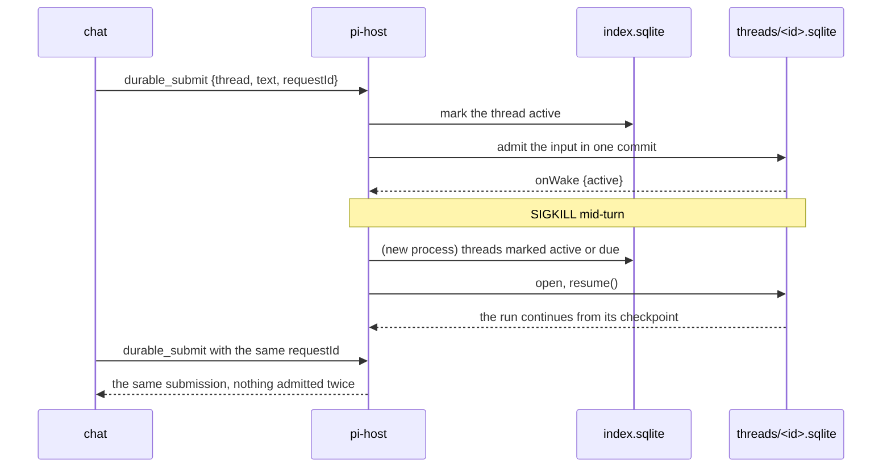
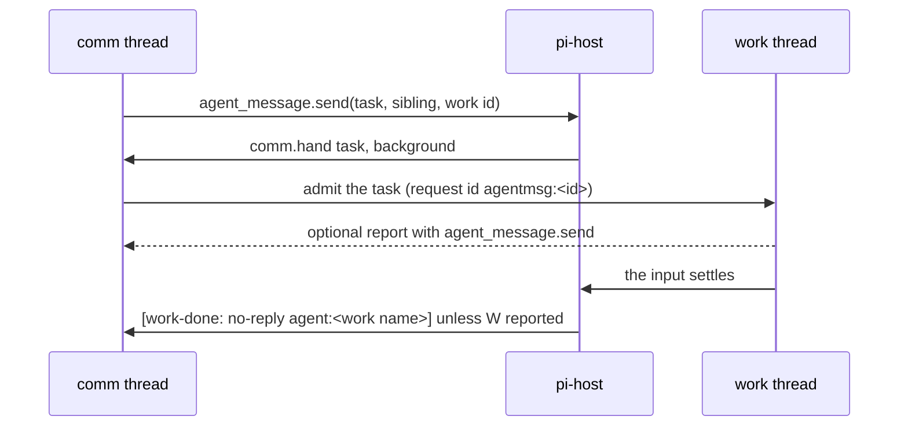

# Durable threads

pi-host's durable side runs each root thread on `@earendil-works/pi-durable` 1.4.0.
A thread is one SQLite file, `<durable dir>/threads/<id>.sqlite`, holding the root conversation, every child conversation its subagents create, and their entries, tasks and documents.
A crash, an OOM kill or a restart loses nothing that was admitted: the next pi-host reopens the file, and each run, tool call, child task and sleep continues from its last checkpoint.

## How a restart resumes work



1. pi-host marks a thread active in `index.sqlite` before it admits an input, and the Harness's `onWake` keeps the mark current after each commit, so a crash between the two still reopens the file.
2. At start pi-host opens every thread marked active or with a due sleep and calls `resume()`.
3. A thread whose tasks only sleep, such as a pi-pool slot wait, is closed after 10 idle minutes, and one timer for the earliest sleep reopens it when it is due.
   An open file also keeps a timer for its own earliest sleep, because pi-durable arms none once the host takes `onWake`, and a child's turn poll or retry backoff sleeps while the child's `rlm.deliver` task keeps the file active.
4. One pi-host is the only writer of each file, through a lockfile next to it as for Pi session files.
5. A repeated `requestId` returns the first submission, so a client that retries after a restart never doubles an input.

## Files

| Path | What it holds |
|---|---|
| `threads.ts` | `DurableThreads`: open, recover, submit, wait, abort, watch, tree, entries, documents and idle close. |
| `index-db.ts` | `ThreadIndex`: the thread rows, each thread's last wake, the FTS5 search rows and the usage rows, all derived from the thread files. |
| `commands.ts` | `DurableCommands`: the `durable_*` socket commands and the watches per connection. |
| `registry.ts` | What every thread runs with: Prime's prompt (or the preamble alone without an agent dir), pi-durable's coding tools in the thread's cwd, the subagent tool, the `send_message` tool, Prime's chat extension when the host loaded it, Prime's `ipython` when the host loaded it, the `rlm.deliver` task, `agent.message` entries and `chat.doc` documents. |
| `pi-extensions.ts` | The adapter that runs a pi coding-agent extension in pi-host: a recording `ExtensionAPI`, its events fired with a thread's pi context, and each registered tool as a pi-durable tool with the extension's own definition. |
| `prime-chat.ts`, `chat-app.ts` | Prime's chat extension (user-history) in a thread's root conversation: `search_history`, `chat_board`, `tell_owner`, `correction_add`, `poteto_mode` and the `[message id]` and `[not from the owner]` wrappers, with `chat_board` and `tell_owner` on apps/chat's board API; `docs/prime-pi-prompt-parity.md` lists each binding and what is skipped. |
| `prime-prompt.ts` | A Prime chat's system prompt, built by prime-agent's own `buildSystemPrompt` from the agent dir's AGENTS.md files, skills, chat brief and corrections ledger, as pi-durable sections; `docs/prime-pi-prompt-parity.md` maps each part. |
| `prime-harness.ts`, `vendor/prime-harness.ts` | Prime's harness digest and its updates from the global store and the thread's local one, sent as messages before the inputs they go with, with Prime's own code copied by `scripts/vendor-prime-harness.mjs`. |
| `agent-profile.ts` | The agent a thread belongs to, read from the `agent.ref` doc of its root conversation, what that agent's folder gives the thread (the brief as a Prime context file and the agent's harness store as the local store), and the tools filter and instructions its role sets on the root conversation. |
| `comm.ts` | A comm thread's link to its agent's work thread: the `comm.hand` task that hands the work thread a task and sends the work-done notice, and the `stop_work` tool. |
| `open.ts` | `openDurableHost()` for one file and the Prime preamble extension. |
| `@sieun-pi/pi-pool/durable` | `poolProvider()` in `packages/pi-pool/src/durable/pool-provider.ts`: a pi-ai Provider that vends each request's account through pi-pool and turns a slot wait into a stored sleep. |
| `subagent.ts` | The `subagent` tool: the call starts a child conversation through an `rlm.deliver` task and returns at once, and the child's whole answer reaches the parent later as an input. A call from before this change still owns its child and returns its answer. `ForegroundSubagent` keeps the old tool for `openDurableHost`. |
| `rlm.ts`, `children.ts` | Prime's `ipython` on pi-rlm's kernel, one kernel per conversation, with `rlm.spawn`, `agent_message` and `agent_observe` answered from the thread file; the `rlm.child` document and the `rlm.deliver` task. `docs/prime-pi-prompt-parity.md` describes both. |
| `send-message.ts` | The `send_message` tool, the one way an agent speaks to people: `{text, to?}`, result "Sent.", no effect outside the thread. |
| `import.ts` | `parseSession()`: a Prime or Pi session file's active branch as entry drafts, for `durable_import`. |

## Threads that belong to an agent

apps/chat writes an `agent.ref` chat.doc into the root conversation of each agent thread through `durable_doc_put`, in one of three shapes.

1. `{agent, dir, role: "work", comm?}` marks the agent's work thread, and `comm` names its DM comm thread once the agent is split.
2. `{agent, dir, role: "job"}` marks a root job thread filed under the agent.
3. `{agent, dir, role: "comm", room, work}` marks the thread that talks with the owner in room `room` (`dm_<slug>`) and hands work to the work thread `work`.

A value of any other shape reads as no agent.
Every conversation of such a thread, its root and each child conversation, differs from a plain thread in two ways.

1. The agent's `<dir>/brief.md` is one more Prime context file after the AGENTS.md and CLAUDE.md files Prime's resource loader found, so Prime's own `buildSystemPrompt` renders it in "# Project Context" under its path. That is the `context` section, which is not pinned, so an edit reaches the next request of every thread of the agent as a new `context` section alone, and an unchanged brief sends nothing new. A missing or blank brief adds nothing.
2. The local harness store is the agent's, `<dir>/harness`, in place of the thread's own `session-artifacts/<thread>[-<conversation>]/harness`. The root's digest and a child's `harness` section merge it over the global store, and every kernel of the thread gets it as `RLM_HARNESS_STATE_DIR`, so `rlm.harness.create_memory(...)` and `refine.run()` write the agent's memory, and `global_=True` still writes the global store.

A thread with no ref keeps its own store, whose root conversation is `session-artifacts/<thread>/harness` for both the digest and the root's kernel, and gets no brief. A kernel reads the ref when it starts, so a ref written while a kernel runs reaches that kernel at its next start.

## Comm and work threads

The commit that writes an `agent.ref` also sets the root conversation's agent for the role (`applyAgentRole`), so the next request of the thread uses it. pi-host applies the role again from its own code each time it opens a thread, so after a release that changes a role's text, every thread of that role sends the new text on its next request, and only the `instructions` section of its prompt changes. A role that did not change commits nothing.

| Role | `tools` | `modelTools` | `instructions` |
|---|---|---|---|
| comm | `{remove: ["write", "edit", "bash", "subagent"]}` | `{add: ["stop_work"]}` | the comm role text, naming the agent, the room and the work thread; a DM (`dm_`) gets the DM text, and a channel (`ch_`) or Solo room (`so_`) gets the group text, which says to speak only when the post concerns the agent or adds something |
| work with `comm` | `{remove: ["tell_owner"]}` | unset | the work role text, naming the agent and its DM comm thread, with the rule to report to the comm thread that handed the task by the name in its message header |
| work without `comm`, job | unset | unset | unset |

1. pi-host records each value it wrote in the root's `agent.role` document, and it changes or clears a field only while that field is unset or still holds pi-host's value, so a filter something else set stays.
2. A repeated ref commits no change.
3. A child conversation that `rlm.spawn` creates drops the role fields it copied from its owner (`dropAgentRole`), because a child is neither a comm nor a work thread.



1. A comm thread's `agent_message.send` to its agent's work thread commits a background `comm.hand` task in the comm thread's root, which admits the task to the work thread and waits for that input to settle.
2. A work thread's agent message to its comm thread is counted in the comm root's `comm.heard` document, and the hand-over compares that count with the one it read before it admitted the task.
3. When the input settles and the work thread sent no agent message since, the comm root gets `[work-done: no-reply agent:<work name>]` with the first 2,000 characters of the last text, or `[work-done: cancelled agent:<work name>]` for an aborted input, as an `agent.message` entry `{from: <work thread>, via: "work.done"}` with `whenBusy: "steer"` and request id `n:<work thread>:<submission>`.
4. A failed input sends `[work-failed agent:<work name>]` with the error even after a report, as Prime's `[child-failed ...]` does.
5. The task survives a restart: a phase cut by the shutdown reruns, and the request ids keep the task and the notice once. A call to the work thread that fails because pi-host is shutting down holds the phase until the comm file closes, so it never ends the task.
6. `stop_work` aborts the work thread's root conversation. It is a deferred tool that only the comm role loads, and it refuses in any other thread.

`agent_observe` reads another thread's root through `RlmThread.observeRoot` (`DurableThreads.observe`) without submitting anything to it: its status, `messageCount`, `firstMessage`, `latestMessage`, `recent_messages`, its live rlm children with their progress notes as `children`, and its place in pi-pool's turn queue as `turnQueue`.
`get_agent` and `recent_messages` open a closed file to read it, and `list_agents` reads only the files already open and gives the index row for the rest.

## Socket commands

Each command is one JSON line with `type` and `id`, and the response is a v7 `response` line.

| Command | Fields | Data |
|---|---|---|
| `durable_threads` | `archived?` | `threads`: id, name, provider, modelId, cwd, createdAt, updatedAt, status (idle, running, sleeping, failed), wakeAt, preview, children. |
| `durable_create` | `name?`, `model?` ("provider/id"), `thinkingLevel?`, `cwd?` | `thread` |
| `durable_submit` | `thread`, `conversation?`, `text?`, `images?` ({data, mimeType}), `requestId?`, `whenBusy?` (steer, followUp, reject), `entry?` ({kind: "agent.message", data: {from, via?}}), `ownerTurn?` | `submission`, `requestId`, `status`, `ticket` ({session, tree, place}), `owner?` ({state: marked, off or failed, ahead?}) |
| `durable_ticket` | `thread`, `conversation?` | `ticket`: the conversation's run in pi-pool's turn queue, read from `turns.json`. |
| `durable_wait` | `thread`, `submission` | `settled`: the submission record once done or unanswered. |
| `durable_watch` | `thread`, `conversation?`, `fromEntry?` | `watch`; then `durable_event` lines. |
| `durable_unwatch` | `watch` | `stopped` |
| `durable_abort` | `thread`, `conversation?` | |
| `durable_tree` | `thread` | `conversations`: id, parent, ownerTask, name, depth, status, model, createdAt. |
| `durable_entries` | `thread`, `conversation?`, `before?`, `after?`, `limit?` | `entries` newest first (oldest first with `after`), `more`. |
| `durable_search` | `q`, `threads?`, `conversation?`, `from?` (author), `by?` ({thread, conversation, id}: what one agent said), `skipAgentMessages?` (a LIKE pattern for agent messages to leave out), `notFrom?` (an author to leave out), `kinds?` and `skipKinds?` (entry kinds to keep or leave out), `skipEntries?` ([{thread, entry}]: entries to leave out, such as the chat's test sends), `demoteKinds?` (kinds that rank after every other match in relevance order), `after?`, `before?`, `limit?`, `offset?`, `sort?` (relevance, recent) | `hits`: one page of thread, conversation, entryId, kind, author, at, snippet with `<mark>`; `total`: the exact count of every match. Copies of one entry (same entry id, kind, author and time) count and show once, from the unarchived, newest thread. |
| `durable_usage` | `since?`, `until?`, `threads?` | `usage`: per thread and model, turns, input, output, cacheRead and cacheWrite tokens, and cost with costInput, costOutput, costCacheRead and costCacheWrite apart. |
| `durable_doc_get` | `thread`, `name`, `conversation?` | `value` |
| `durable_doc_put` | `thread`, `name`, `value`, `conversation?` | |
| `durable_set` | `thread`, `name?`, `model?`, `thinkingLevel?`, `archived?`, `cwd?` (an absolute folder on this box; the thread's next request runs its tools, prompt and kernels there) | `thread` |
| `durable_import` | `path` (a Prime or Pi session JSONL), `name?`, `model?`, `cwd?` | `thread` with `imported` and `skipped` counts. |

A `durable_event` line is `{type: "durable_event", thread, watch, event}`, and `event` is one of these.

1. `{type: "events", conversation, events}` carries pi-durable's agent events for one conversation, starting with a `snapshot` without its entries, then `entry_appended` for each entry after `fromEntry`, then every later batch.
2. `{type: "conversation", node}` says a subagent created a child conversation, and a watch on the whole file attaches to it.
3. `{type: "status", status, wakeAt?}` follows the thread's wake.
4. `{type: "doc", conversation, name, value}` follows `durable_doc_put`.
5. `{type: "closed", reason}` ends the watch when the file closes at shutdown.

Every entry reaches a watcher once, so a client that reconnects with `fromEntry` set to the newest id it has misses nothing.

## Speaking through send_message

A root thread on a host that loaded Prime's chat extension speaks to the owner through Prime's `tell_owner`, with Prime's guard, and keeps `send_message` as an alias for channel replies and duty reports (`SEND_MESSAGE_ALIAS_DESCRIPTION`); apps/chat draws both alike. The rest of this section holds for both tools.

Every root thread has `send_message {text, to?}`, and without the chat extension its description carries the rules for talking to people (`SEND_MESSAGE_DESCRIPTION`).

1. The call does nothing outside the thread and returns "Sent.", so it is replay-safe: the call's arguments in the assistant entry are the message.
2. The chat (`apps/chat/server/timeline.ts`) draws each call's text as its own bubble and folds the rest of the turn's text, as private notes, with its thinking and tool steps; a channel turn posts one reply per call. A conversation that has never called it keeps its turn text as the bubble.
3. `to` is only for a turn a channel post started, and names that channel; the chat posts a call aimed at another channel nowhere.
4. A subagent's child conversation is not offered the tool, because its parent reads its final text as the answer.
5. The thread list's preview is the newest sent message, never its "Sent." result.
6. Pi-durable stores extension names, not tools, and every conversation selects every installed extension unless it says otherwise, so a thread whose history predates the tool is offered it from its next model request on, through a new `pi.system` entry; `test/durable/send-message.test.ts` checks this on a file first run without the tool. A child created before this change stored only `remove: ["subagent"]` and is offered the tool too.

## Importing a Prime thread

`durable_import {path}` reads a Prime or Pi session file and writes its active branch into a new thread, and the old file is only read.

1. User, assistant and tool-result messages become `pi.user`, `pi.assistant` and `pi.tool-result` entries.
2. A compaction becomes a `pi.compaction` entry whose head is the entry its first kept line became, so the model sees the summary and the kept messages, as Prime sent them.
3. Prime's custom messages, such as agent messages, task briefs and heartbeats, become `prime.custom` entries the model reads as user text.
4. The thread takes the session's name, cwd, last model and thinking level.
5. Bookkeeping lines, such as `git_state` and `child_usage_attributed`, are counted in `skipped` and not written.

This job's own Prime transcript of 260 lines imported in 138 ms, and claude-opus-5-5 through pi-pool answered a question about it from the imported context.

## How a request gets its account

```mermaid
sequenceDiagram
participant G as pi.generation task
participant P as poolProvider
participant H as pi-pool-token
participant A as api.anthropic.com
G->>P: streamSimple, sessionId of the conversation
P->>H: --provider anthropic, PI_POOL_SESSION_KEY = the thread's tree
alt token
  H-->>P: sk-ant-oat01 token
  P->>A: the request, through pi-ai's anthropic provider
  A-->>G: the stream; a 429 goes to pi-pool limited
else exit 75 with retryAt
  H-->>P: slot wait
  P-->>G: stopReason deferred, pollAfterMs up to 30 s
  G->>G: commit a sleep until pollAt (survives a restart)
  G->>P: fetchDeferred at pollAt
  P-->>G: still waiting: deferred again; slot open: a retryable error
  G->>P: retry with a fresh vend
end
```

1. One thread is one pool tree: `PI_POOL_SESSION_KEY` carries `pi-durable:<thread id>` as the root and the conversation's `pi.provider` session id as the active session, so a child conversation draws from the root's account.
2. A poll that finds the slot open ends with a retryable error, because pi-durable's `fetchDeferred` gets only the handle and not the transcript, so each slot wait costs one attempt of `settings.retry.maxRetries`.
3. Each request first takes its run's place in pi-pool's turn queue, the one line every Prime and Pi run on the box waits in, through `TurnQueue` (`admit <session>` under the thread's tree).
4. A queued run is deferred like a slot wait: its stored sleep reads its place in `turns.json` each second and asks again every 30 s, as the pi-pool extension does, and a crash during the wait resumes the poll from the file.
5. When the slot starts, the poll ends with a retryable error and the retry sends the request. Each such retry, and each 429 or account refusal the pool takes on, raises that run's retry budget by one through pi-pool's `durableSettings`, so a run waits on the pool as long as the pool says, and only other errors spend pi-durable's own budget.
6. A working session renews its lease from its requests every 5 minutes, and pi-host releases the slot when the conversation's input settles, with `--queued-input` when a run goes on.
7. A crash drops the host's queue entries once pi-pool sees the process gone, so a resumed run asks again and keeps its place only through pi-pool's own `kept` rules.
8. `durable_submit {ownerTurn: true}` runs `pi-pool owner-turn <session>` before the admit, as the chat does for an owner prompt to Prime, so the run's first ask starts at once as kind `owner` and counts toward `working_max`, and a run of that conversation already queued starts now as kind `ahead`. A run that already holds its slot takes the owner's input as a steer or follow-up, and no mark is set. Every submit first waits for the slot release of the conversation's last settled input, so an input sent right after a settle never reads the ended run as working and never renews a slot that the release then drops.
9. A ticket's `place` is `{state: "working", kind}`, `{state: "queued", position, total}` in pi-pool's order (lead sessions first, then first asked), `{state: "marked"}` for an owner mark the run has not taken yet, or `{state: "none"}` before the run's first ask and after its release. The ticket in `durable_submit`'s answer is read right after the admit, so the run's first ask may come after it; `durable_ticket` reads it again.

## Crash tests

1. `test/durable/host-crash.test.ts` starts a real pi-host in a child process, submits through the socket, sends SIGKILL while the subagent streams, while a pool slot wait sleeps or while the run waits in the turn queue, starts a new pi-host on the same folder and checks through the socket that the host reopened the thread by itself and that the input was answered once and the child's answer reached the root once as its own input, plus search, usage and documents after the restart.
   In the turn-queue case it also checks that no token went out before the admit and that every session that asked gave its slot back.
2. `test/durable/owner-turn.test.ts` runs the real `pool/turns.py` queue in its own `PI_POOL_DIR` with one slot held and two runs queued, and checks that an agent input queues third while an owner input with `ownerTurn: true` is admitted as kind `owner` with no wait and answers, with each ticket over the socket and `durable_usage`'s four costs. `test/durable/owner-turn-settle.test.ts` slows each release by 1 s and checks that an owner input sent right after the last one settled is still admitted as kind `owner` and leaves no mark behind.
3. `test/durable/child-turn.test.ts` runs the real `pool/turns.py` queue with a subagent whose first ask queues behind two blockers after its root's run ended, gives the child a slot, and checks that the child sends its request and the root answers its answer within 15 s.
4. `test/durable/rlm.test.ts` runs Prime's `ipython` on a real kernel: state across turns, `rlm.spawn` at admission with the child's notice as a later input, a steer answered while a subagent child runs for 120 s, and a SIGKILL mid-cell that gives `interrupted` and then a fresh kernel.
5. `test/durable/comm.test.ts` reads a running work thread from a comm thread's status turn with no change to the work conversation's entries, stops it with `stop_work`, checks the role fields, checks that a handed task sends one work-done notice, none after a report, and one across a restart, and checks that a Solo room's comm thread gets the notice for the task it handed while the DM comm thread hears nothing.
6. `test/durable/crash.test.ts` runs the crash cases of item 1 on one file without pi-host, with kills mid root stream, mid child stream and in a slot wait.
7. The crash tests run on the faux provider behind the real pool wrapper and `pi-pool/test/fake-pool.mjs`, and `PI_DURABLE_REAL=1` adds a case on the real `claude-opus-5-5` through pi-pool.

```sh
cd packages
node --import tsx --test --test-force-exit "pi-host/test/durable/*.test.ts"
PI_DURABLE_REAL=1 node --import tsx --test --test-force-exit --test-isolation=none --test-name-pattern="real" pi-host/test/durable/host-crash.test.ts
```
