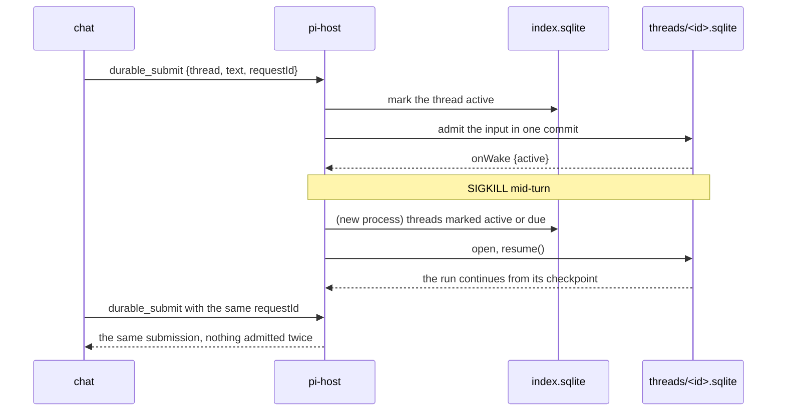

# Durable threads

pi-host's durable side runs each root thread on `@earendil-works/pi-durable` 1.4.0.
A thread is one SQLite file, `<durable dir>/threads/<id>.sqlite`, holding the root conversation, every child conversation its subagents create, and their entries, tasks and documents.
A crash, an OOM kill or a restart loses nothing that was admitted: the next pi-host reopens the file, and each run, tool call, child task and sleep continues from its last checkpoint.

## How a restart resumes work



1. pi-host marks a thread active in `index.sqlite` before it admits an input, and the Harness's `onWake` keeps the mark current after each commit, so a crash between the two still reopens the file.
2. At start pi-host opens every thread marked active or with a due sleep and calls `resume()`.
3. A thread whose tasks only sleep, such as a pi-pool slot wait, is closed after 10 idle minutes, and one timer for the earliest sleep reopens it when it is due.
4. One pi-host is the only writer of each file, through a lockfile next to it as for Pi session files.
5. A repeated `requestId` returns the first submission, so a client that retries after a restart never doubles an input.

## Files

| Path | What it holds |
|---|---|
| `threads.ts` | `DurableThreads`: open, recover, submit, wait, abort, watch, tree, entries, documents and idle close. |
| `index-db.ts` | `ThreadIndex`: the thread rows, each thread's last wake, the FTS5 search rows and the usage rows, all derived from the thread files. |
| `commands.ts` | `DurableCommands`: the `durable_*` socket commands and the watches per connection. |
| `registry.ts` | What every thread runs with: the preamble, pi-durable's coding tools in the thread's cwd, the subagent tool, `agent.message` entries and `chat.doc` documents. |
| `open.ts` | `openDurableHost()` for one file and the Prime preamble extension. |
| `pool-provider.ts` | `poolProvider()`: a pi-ai Provider that vends each request's account through pi-pool and turns a slot wait into a stored sleep. |
| `subagent.ts` | The `subagent` tool: a replay-safe call that owns one child conversation and returns its answer. |

## Socket commands

Each command is one JSON line with `type` and `id`, and the response is a v7 `response` line.

| Command | Fields | Data |
|---|---|---|
| `durable_threads` | `archived?` | `threads`: id, name, provider, modelId, cwd, createdAt, updatedAt, status (idle, running, sleeping, failed), wakeAt, preview, children. |
| `durable_create` | `name?`, `model?` ("provider/id"), `thinkingLevel?`, `cwd?` | `thread` |
| `durable_submit` | `thread`, `conversation?`, `text?`, `images?` ({data, mimeType}), `requestId?`, `whenBusy?` (steer, followUp, reject), `entry?` ({kind: "agent.message", data: {from, via?}}) | `submission`, `requestId`, `status` |
| `durable_wait` | `thread`, `submission` | `settled`: the submission record once done or unanswered. |
| `durable_watch` | `thread`, `conversation?`, `fromEntry?` | `watch`; then `durable_event` lines. |
| `durable_unwatch` | `watch` | `stopped` |
| `durable_abort` | `thread`, `conversation?` | |
| `durable_tree` | `thread` | `conversations`: id, parent, ownerTask, name, depth, status, model, createdAt. |
| `durable_entries` | `thread`, `conversation?`, `before?`, `after?`, `limit?` | `entries` newest first (oldest first with `after`), `more`. |
| `durable_search` | `q`, `threads?`, `from?`, `after?`, `before?`, `limit?`, `sort?` (relevance, recent) | `hits`: thread, conversation, entryId, kind, author, at, snippet with `<mark>`. |
| `durable_usage` | `since?`, `until?`, `threads?` | `usage`: per thread and model, turns and token and cost sums. |
| `durable_doc_get` | `thread`, `name`, `conversation?` | `value` |
| `durable_doc_put` | `thread`, `name`, `value`, `conversation?` | |
| `durable_set` | `thread`, `name?`, `model?`, `thinkingLevel?`, `archived?` | `thread` |

A `durable_event` line is `{type: "durable_event", thread, watch, event}`, and `event` is one of these.

1. `{type: "events", conversation, events}` carries pi-durable's agent events for one conversation, starting with a `snapshot` without its entries, then `entry_appended` for each entry after `fromEntry`, then every later batch.
2. `{type: "conversation", node}` says a subagent created a child conversation, and a watch on the whole file attaches to it.
3. `{type: "status", status, wakeAt?}` follows the thread's wake.
4. `{type: "doc", conversation, name, value}` follows `durable_doc_put`.
5. `{type: "closed", reason}` ends the watch when the file closes at shutdown.

Every entry reaches a watcher once, so a client that reconnects with `fromEntry` set to the newest id it has misses nothing.

## How a request gets its account

```mermaid
sequenceDiagram
participant G as pi.generation task
participant P as poolProvider
participant H as pi-pool-token
participant A as api.anthropic.com
G->>P: streamSimple, sessionId of the conversation
P->>H: --provider anthropic, PI_POOL_SESSION_KEY = the thread's tree
alt token
  H-->>P: sk-ant-oat01 token
  P->>A: the request, through pi-ai's anthropic provider
  A-->>G: the stream; a 429 goes to pi-pool limited
else exit 75 with retryAt
  H-->>P: slot wait
  P-->>G: stopReason deferred, pollAfterMs up to 30 s
  G->>G: commit a sleep until pollAt (survives a restart)
  G->>P: fetchDeferred at pollAt
  P-->>G: still waiting: deferred again; slot open: a retryable error
  G->>P: retry with a fresh vend
end
```

1. One thread is one pool tree: `PI_POOL_SESSION_KEY` carries `pi-durable:<thread id>` as the root and the conversation's `pi.provider` session id as the active session, so a child conversation draws from the root's account.
2. A poll that finds the slot open ends with a retryable error, because pi-durable's `fetchDeferred` gets only the handle and not the transcript, so each slot wait costs one attempt of `settings.retry.maxRetries`.
3. pi-pool's turn queue (`admit` and `release` around a run) is not wired here yet.

## Crash tests

1. `test/durable/host-crash.test.ts` starts a real pi-host in a child process, submits through the socket, sends SIGKILL while the subagent streams or while a pool slot wait sleeps, starts a new pi-host on the same folder and checks through the socket that the host reopened the thread by itself and that the input was answered once, with the child's answer as the tool result, plus search, usage and documents after the restart.
2. `test/durable/crash.test.ts` does the same on one file without pi-host, with kills mid root stream, mid child stream and in a slot wait.
3. Both run on the faux provider behind the real pool wrapper and `pi-pool/test/fake-pool.mjs`, and `PI_DURABLE_REAL=1` adds a case on the real `claude-opus-5-5` through pi-pool.

```sh
cd packages
node --import tsx --test --test-force-exit "pi-host/test/durable/*.test.ts"
PI_DURABLE_REAL=1 node --import tsx --test --test-force-exit --test-isolation=none --test-name-pattern="real" pi-host/test/durable/host-crash.test.ts
```
