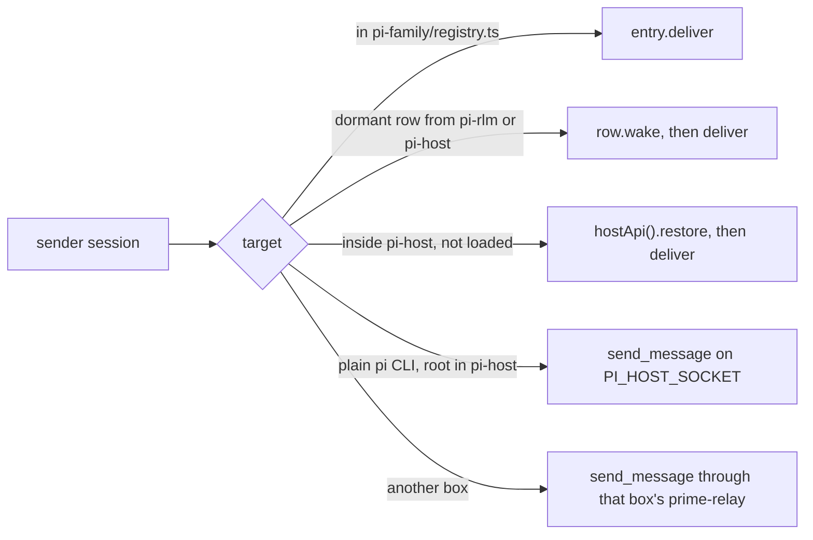

# pi-rlm

pi-rlm is Prime Agent's RLM kernel, its `rlm.spawn` children and its agent messaging, as one upstream Pi package.
It ships two Pi extensions over one `src/core`: `src/pi/index.ts` holds the `ipython` tool, children and goals, and `src/pi/agent-bus.ts` holds `agent_message` and `agent_observe`.
The two stay one package, because the bus routes through the family that `rlm.spawn` creates, and its API is a kernel skill.
They stay two entry files, because a session that loads only the kernel keeps working without the bus, as it did before the fold.

## Install alone into stock Pi

pi-rlm needs no other sieun-pi package at run time except `@sieun-pi/pi-family`, which the `packages/` npm workspace links.
Pi does not install the dependencies of a local package, so run `npm ci` in `packages/` once before you install it.

```sh
cd packages && npm ci && cd ..
pi install ./packages/pi-rlm                    # both extensions and the five skills, saved in settings
pi -e ./packages/pi-rlm                         # one run only, no settings change
pi -e ./packages/pi-rlm/src/pi/index.ts         # the kernel without messaging
```

The kernel needs a Python 3.11+ with `dill`, `tyro` and `mcp`.
Set `PI_RLM_PYTHON` to one, or let pi-rlm build a uv venv at `<agent dir>/rlm/kernel-venv` on first use, which is `~/.pi/agent/rlm/kernel-venv` unless `PI_CODING_AGENT_DIR` moves the agent dir.
That build needs `uv` on `PATH`.

The install was checked on 2026-10-28 with the stock `pi` 1.4.0 from `packages/node_modules/.bin/pi`, an empty `PI_CODING_AGENT_DIR` and a faux provider loaded with `-e`.
After `pi install ./packages/pi-rlm`, one `pi -p` run listed the five skills, ran an `ipython` cell in the new kernel venv, and ran an `rlm.spawn` child to `completed`.
The same run with `pi -e ./packages/pi-rlm` and no install gave the same result.

## Layout

| Path | What it holds |
|---|---|
| `src/pi/index.ts` | The kernel extension for the stock `pi` CLI and pi-host: the `ipython` tool, `host_request` answers, `bash()` notices, `/goal` and `/rlm-max-depth`. |
| `src/pi/children.ts` | `rlm.spawn` children as in-process `AgentSession`s, their index and `setChildLoaderOptions`. |
| `src/pi/goal.ts` | The `goal.*` state kept as `rlm_goal` custom entries. |
| `src/pi/agent-bus.ts` | The messaging extension: registry entry, `deliver`, and the kernel's `agent_message.*` and `agent_observe.*` answers. |
| `src/core/` | The kernel process and its relay client (`kernel.ts`), the venv build and skill lookup (`python.ts`), the kernel bootstrap, the prompt sections and the pi-host session client. |
| `src/core/bus/` | The bus's reach rule, routing, durable inbox, limits, roster and message shapes. |
| `skills/` | The Python skills `goal`, `compact` and `edit` from Prime, and `agent-message` and `agent-observe` for the bus. |
| `python/` | The vendored MIT Prime Python runtime (`rlm.repl` and friends) and its tests, listed in `PROVENANCE.md`. |
| `relay/` | `kernel_relay.py`, which keeps a kernel alive across a pi-host restart. |
| `rig/` | Real-provider checks. |
| `test/`, `test/bus/` | The kernel's tests and the bus's tests. |

`children.ts` and `goal.ts` sit under `src/pi`, because they are the parts that differ for pi-durable, where a child is a task-owned conversation.
pi-host's durable entry, `src/durable`, comes with the pi-durable work on pi-host.

The package exports `.` (the kernel extension), `./agent-bus`, `./children` (for pi-host's child loader), `./bus/route` and `./bus/inbox` (which pi-host loads when present), and `./test-helpers` (for other packages' tests).
pi-rlm reaches pi-host only through the host API table in `@sieun-pi/pi-family/host-api` and the `PI_HOST_SOCKET` socket, so it imports nothing from pi-host.

## What the kernel extension does

1. It registers the `ipython` tool, which runs each cell in one persistent `python -m rlm.repl` process per session and streams output through `onUpdate`.
2. It answers the kernel's `host_request` calls, and it looks each method up in `pi-family/kernel-bridge.ts` first, so pi-agent-bus and pi-harness answer their own methods.
3. A `bash()` handle that outlives its cell sends `[bash-done pid:<pid> exit:<code>]`, which starts a run when the agent is idle and goes in at the next turn end when it is busy, unless a live cell read the handle first.
4. `rlm.spawn` opens a child `AgentSession` in the same process with `createAgentSession`, after `assignIdentity` names it in `pi-family/registry.ts`, and returns the handle before the child runs.
5. A child that ends without replying sends the parent `[child-exited: no-reply child:<name>]` with its last text, and a failed child sends `[child-failed child:<name>]`.
6. `rlm.list_subagents`, `rlm.collect`, `rlm.delete_subagent`, `rlm.progress_note` and `rlm.find_models` work on the parent's child index in `<artifact dir>/rlm-children.json`, and a reopened parent registers its closed children as dormant rows.
7. Child usage goes on the parent transcript as `child_usage_attributed` custom entries until upstream Pi has `pi.appendUsage`.
8. The namespace survives compaction because the kernel process stays up, and it survives a restart through `kernel-state.dill`, which pi-rlm writes after every run and at shutdown.
9. `goal.*` keeps the goal as `rlm_goal` custom entries in Prime's shape, and while a goal is active each settling run gets a `[goal: continuation]` message, unless the run errored or was aborted, a compaction is pending, or a child or a `bash()` handle is still working.
10. A goal that spends its token budget turns `budget_limited` and gets a `[goal: budget-limit]` steer, and `/goal [--budget <tokens>] <objective>`, `status`, `pause`, `resume` and `clear` manage it.
11. `compact.run` compacts after the run settles and resumes it with a `[compaction-resume]` message.
12. `rlm.create_session` opens a root in pi-host, in-process through `hostApi()` or over `PI_HOST_SOCKET`.

## Python

The kernel runs the vendored Prime runtime in `python/`, listed with its hashes and changes in `PROVENANCE.md`.
Set `PI_RLM_PYTHON` to a Python 3.11+ that has `dill`, `tyro` and `mcp`, or let pi-rlm build a uv venv at `<agent dir>/rlm/kernel-venv`.
Every loaded Pi skill with a `pyproject.toml` and `src/<import name>/` is installed in that venv and imported by name when the kernel starts.

## Children

`RLM_MAX_DEPTH` (default 2) caps the depth, and `/rlm-max-depth <n>` changes it for one session.
A child loads the parent's `-e` extension paths from argv, or what `setChildLoaderOptions(fn)` returns, which pi-host and the tests set.
A child also loads the packages in the agent dir's settings, and pi-rlm adds its own entry when neither list has it. Pi loads each path once, so an installed pi-rlm is not loaded twice.

## Agent messaging

pi-agent-bus, `src/pi/agent-bus.ts`, rebuilds Prime's `agent_message` and `agent_observe` on upstream Pi 1.4.0.
pi-host lists it in `extensions.json` next to the kernel extension.

### What the bus does

1. Each session it loads into registers in `pi-family/registry.ts` with a `deliver` and a `preview`.
2. `deliver` queues Prime's custom message, `customType: "agent_message"`, with the content `[agent-message from <relationship>:<name>]`, a blank line and the text, and `details` holding `id`, `message`, `from`, `fromRelationship` and `target`.
3. An idle target starts a turn, a busy one gets a steer for `auto` and `steer`, and `follow_up` waits until the run ends.
4. It answers the kernel's `agent_message.send`, `agent_observe.list`, `agent_observe.get` and `agent_observe.recent` through `pi-family/kernel-bridge.ts`, so pi-rlm's kernel reaches it.
5. The Python skills `agent_message` and `agent_observe` ship under `skills/`, copied from Prime 0.9.8 (MIT). The only change adds an optional `mode="auto" | "steer" | "follow_up"` to `agent_message.send`. The bus extension returns those two skill folders from `resources_discover`.

### Routing



1. Reach follows Prime's rule in `src/core/bus/family.ts`: the parent, siblings at the same depth under the same parent, and direct children, with every root a sibling of every other root.
2. pi-host's `send_message` handler calls `sendFromClient` in `src/core/bus/route.ts`, so a send from the chat service or a plain `pi` CLI gets the same message shape and receipt.
   A client send with no sender session gets the header `[agent-message from <clientId>]`, as in Prime.
3. Receipts keep Prime's shape: `id`, `source`, `target`, `from`, `message`, `deliveryStatus` (`delivered` or `queued`), `deliveredAt` or `queuedAt`, and `deliveryMode`.

### Limits

The message size (16,384 chars), the pending queue (20 unfinished per target) and the rate (3 sends per sender and target, one more each second) are Prime's numbers.
They are soft caps under owner rule c98, because none guards data integrity, security, money, an outside send or a vendor limit.
A send over a cap goes through, and its receipt lists the overrun in `overLimit`.

### Durable inbox

Pi keeps queued steers and follow-ups in memory only, so `src/core/bus/inbox.ts` writes each accepted message to `<agent dir>/agent-bus/inbox/<session id>.jsonl` before Pi queues it.
1. At `session_start`, other than a reload, the session replays every record whose id is not in its transcript, with the same id, so each message lands once.
2. At each `agent_end`, the file drops the records the transcript holds, and it is removed when none is left.
3. An abort leaves the messages in Pi's queue, and the next run delivers them. A kill after the abort loses the queue, and the reopen replays it from the file.
4. pi-host calls `recoverInboxes()` once at start, which reopens every session that still has records, and calls `clearInbox()` after `clear_queue` and `abort_and_clear_queue`.
5. The transcript decides what landed, because Pi writes a custom message to the session file only after the extensions' `message_end` handlers return.

### Idempotent sends

A `send_message` that carries an idempotency key delivers at most once, even when pi-host dies between taking the message and answering.
1. The key is the sender's client id and command id, which stay the same on a retry. pi-host takes it from `command.idempotencyKey`, or from a v7 envelope's `clientId` and `id`.
2. `sendFromClient` makes the message id from the target and the key, so a retry has the id of the first try.
3. Each live session keeps the ids it holds in its transcript and durable inbox, so a retry whose id is already there gets the first receipt back with `duplicate: true` and delivers nothing. After a host restart, the session rebuilds that set from its file and inbox, so no map in pi-host has to survive.
4. A plain `pi` session's send to pi-host or to another box's relay uses an envelope with client id `agent-bus:<session id>` and one command id, and retries for up to 60 s while the host does not answer.

### Other boxes

A root on one box reaches a root on another box through that box's prime-relay, which tunnels `GET /v1/daemon` to the pi-host socket byte for byte, so `relay.mjs` needs no change.
1. Each box runs a relay whose `daemonSocket` is its pi-host socket.
2. `PI_AGENT_BUS_BOXES` names a JSON file `{"self": "<this box>", "boxes": [{"name", "url", "tokenFile"}]}`, and every box can share one file, since the entry named `self` is skipped.
3. `src/core/bus/members.ts` lists each other box's roots with a `list` line through its relay, and `src/core/bus/route.ts` sends to one with a `send_message` line. The receipt gains `host` and `crossHost: true`, as Prime's cross-host receipts did, and the target box's pi-host delivers it with the header `[agent-message from sibling:<sender name>]`.
4. A box that does not answer adds no roots, so a send to a root on it fails with `No sibling matches`.
5. The live `~/.config/sieun-pi/hosts.json` points at Prime's relays on port 7790, so a cutover adds a pi-host relay per box and writes the boxes file from hosts.json's `address`, relay port and token.

## Real-provider check

`rig/rpc-check.mjs` runs P1, P2 with 10 children, a compaction and a restart in `pi --mode rpc`, and `rig/inprocess-check.ts` runs the same in an in-process runtime.
Both take `RIG_DIR` (with `agent/models.json`), `EVIDENCE_DIR`, `MODEL`, `CHILDREN` and `EXTRA_EXTENSIONS`, and `rig/async-token.ts` vends pi-pool's token without Pi's `execSync`.
The 2026-10-27 results are in `/home/sieun/work/pi-migration-build/step-2/report.md`.

## Tests

```sh
cd packages/pi-rlm
npm test                                                   # test/*.test.ts and test/bus/*.test.ts
cd python && uv run --offline --with pytest pytest test    # the vendored runtime
```

The step 3 check is 30 senders that send 20 messages each to one busy receiver, and `test/bus/load.ts` counts the messages in the receiver's session file.
1. `test/bus/load.test.ts` runs it in-process, once with a busy receiver and once with sends spread over time.
2. `test/bus/host-load.test.ts` starts pi-host as its own process with this extension and `test/bus/fixtures/busy.ts` loaded. It runs the load from 30 plain `pi` sessions on `PI_HOST_SOCKET` and from 30 socket clients with no sender session, then wakes a closed root.
3. `test/bus/host-closed.test.ts` wakes a closed child inside pi-host from its parent and from a socket client.
4. `test/bus/inbox.test.ts` kills and aborts busy receivers with queued messages and checks that each lands once.
5. `test/bus/host-crash.test.ts` kills pi-host with SIGKILL during a 30 x 20 burst, restarts it and checks that every accepted message lands once.
6. `test/bus/host-idempotency.test.ts` kills pi-host between taking a send and answering it, and checks that the retry delivers nothing more.
7. `test/bus/cross-box.test.ts` runs two pi-hosts behind two scratch relays as boxes a and b, with this process as box c, and runs the 30 x 20 load across boxes.

Set `BUS_LOAD_SENDERS` and `BUS_LOAD_PER_SENDER` to change the load, `BUS_LOAD_OUT` to write each result as JSON, and `BUS_LOAD_ROOT` with `BUS_LOAD_KEEP=1` to keep the session files.
